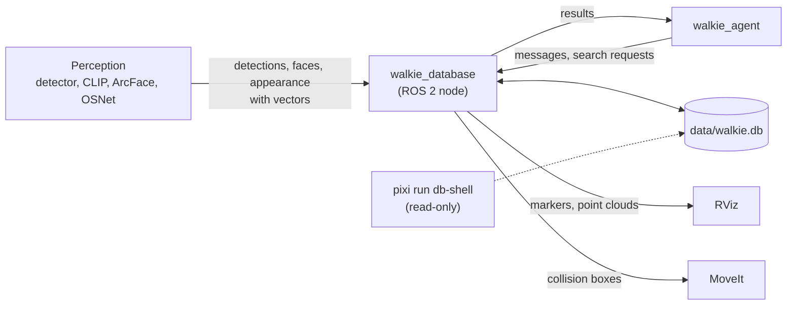
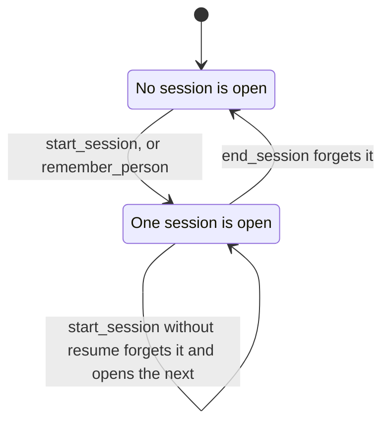
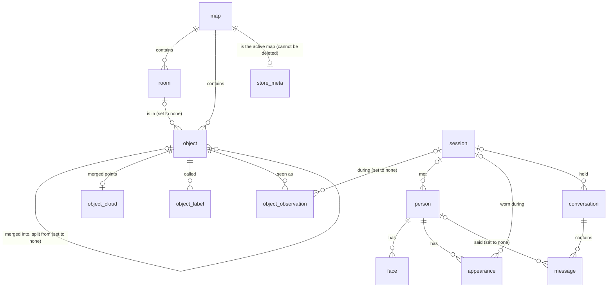

# The Database

Walkie's memory is one SQLite file, `data/walkie.db`, owned by one ROS 2
node, `walkie_database`. Other programs store and search memories through
that node. The tables hold the facts, and SQLite's virtual tables search
them by meaning, by position and by words.

## Summary

- **One file, one writer.** SQLite in WAL mode: one process writes and any
  number read at the same time. The `walkie_database` node is the only
  writer ([ADR-0004](decisions/0004-one-sqlite-file-wal.md),
  [ADR-0005](decisions/0005-one-node-owns-the-database.md)).
- **No models inside.** Perception and the agent compute embeddings and send
  the vectors. The database only stores and searches them
  ([ADR-0006](decisions/0006-callers-send-vectors.md)).
- **One vector table per model.** Vectors from different models cannot be
  compared, so each model gets its own `vec0` table, named after the model
  and its weights
  ([ADR-0007](decisions/0007-sqlite-vec-one-table-per-model.md)).
- **Positions belong to a map.** Every coordinate is in metres in the frame
  of one named map. Deleting a map deletes everything measured in it
  ([ADR-0008](decisions/0008-coordinates-in-a-named-map.md)).
- **Plain SQL migrations.** Numbered `.sql` files, tracked by
  `PRAGMA user_version`
  ([ADR-0009](decisions/0009-sql-migrations-user-version.md)).
- **Sessions forget guests.** People met in a session, their appearance and
  their conversations are deleted with the session. Objects and rooms stay
  ([ADR-0010](decisions/0010-session-owns-people-and-conversations.md)).
- **One open session.** The agent starts and forgets sessions through the
  node, and at most one is open
  ([ADR-0017](decisions/0017-one-open-session.md)).
- **One result per person.** A match returns each nearby person once, from
  an exact scan
  ([ADR-0018](decisions/0018-match-people-by-exact-scan.md)).
- **Zenoh, like the robot.** Every `pixi run` uses `rmw_zenoh_cpp`, as
  walkie-ros does, so nodes find each other through a Zenoh router. The
  tests stay on Fast DDS
  ([ADR-0014](decisions/0014-zenoh-default-middleware.md)).
- **Interfaces in this repository.** The node's messages and services are
  in `walkie_database_msgs`, a package in `ros2_ws/src/`. Other
  repositories build it from a pinned commit of this one
  ([ADR-0015](decisions/0015-messages-in-this-repository.md)).
- **Object services in new types.** The types for object search, rooms, events
  and state are frozen ahead of their handlers, and the old types keep their
  hashes. They nest `walkie_vision_msgs`, which this repository builds from a
  pinned commit ([ADR-0019](decisions/0019-object-service-contracts.md)).
- **A map's identity is a hash of its content.** `src/walkie_map_id.py` hashes a
  map's decoded pixels and semantic metadata, and other repositories use that
  exact file ([ADR-0020](decisions/0020-map-identity-and-seed-lineage.md)).
- **Object ids are never given twice.** An id is reserved in a committed
  transaction before anyone sees it, and a merged or discarded object keeps its
  row as a tombstone ([Object ids and tombstones](#object-ids-and-tombstones)).

## The parts

!!! note "Proposed"
    Today the node opens the file, migrates it, and answers `find_objects`
    and the people and session services
    ([The node's interface](#the-nodes-interface)). The other topics and
    services below are the plan, starting with
    [object memory](object-memory.md).



The node is the only program that writes the file. `pixi run db-shell` and
other tools may open it read-only, because WAL mode lets them read while
the node writes.

## The node's interface

The node is `/walkie_database`. Its message and service types are in the
`walkie_database_msgs` package, in `ros2_ws/src/` of this repository.
`pixi run import-interfaces` clones the walkie-vision commit that the package
nests, and `pixi run build-msgs` builds both
([ADR-0015](decisions/0015-messages-in-this-repository.md),
[ADR-0019](decisions/0019-object-service-contracts.md)).

| Parameter | Default          | What it is                                                                          |
| --------- | ---------------- | ----------------------------------------------------------------------------------- |
| `db_path` | `data/walkie.db` | The database file. The node creates it if needed and brings its schema up to date. |
| `map_id`  | empty            | The map the robot is using (`map.id`). Requests that name no map search this one. On the robot, set it to the map the robot is localized in: while it is empty, every request that names no map fails. The node reads it on every request, so `ros2 param set` changes it at once. |

| Service                              | Type                                      | What it does                                               |
| ------------------------------------ | ----------------------------------------- | ---------------------------------------------------------- |
| `/walkie_database/find_objects`      | `walkie_database_msgs/srv/FindObjects`    | Finds remembered objects by label in one map, newest first |
| `/walkie_database/start_session`     | `walkie_database_msgs/srv/StartSession`   | Resumes the open session, or forgets it and starts a new one |
| `/walkie_database/end_session`       | `walkie_database_msgs/srv/EndSession`     | Forgets a session: deletes it, its people, its appearances and its conversations |
| `/walkie_database/remember_person`   | `walkie_database_msgs/srv/RememberPerson` | Stores a new person in the open session, with facts, faces and appearances |
| `/walkie_database/match_faces`       | `walkie_database_msgs/srv/MatchPeople`    | For each query, the people nearest by face, each once, nearest first |
| `/walkie_database/match_appearances` | `walkie_database_msgs/srv/MatchPeople`    | The same, over the appearances recorded in the open session |

Every response has `success` and `message`. A call fails in one of two
ways:

- **A refusal.** The request is wrong, for example a vector of a model the
  database has no table for. `message` says what is wrong, and sending the
  same request again gives the same answer.
- **A database failure,** such as a locked or damaged file. `message`
  starts with `The database could not`, and the same request may work
  later.

Callers tell the two apart by that prefix, so it is part of the interface.

### `find_objects`

The request:

| Field         | Type     | Meaning                                                                                  |
| ------------- | -------- | ---------------------------------------------------------------------------------------- |
| `map_id`      | `string` | The map to search (`map.id`). Empty means the node's `map_id` parameter.                 |
| `label`       | `string` | The label to look for, for example `cup`. Compared with `object.label` ignoring the case of ASCII letters, so `Cup` finds `cup`. Empty matches every object. |
| `max_results` | `uint32` | At most this many objects. 0 means 10, and more than 100 means 100.                       |

The response:

| Field     | Type                 | Meaning                                                                                      |
| --------- | -------------------- | -------------------------------------------------------------------------------------------- |
| `success` | `bool`               | False when the search could not run: no map was named, the map is not in the database, or the database failed. A search that finds nothing succeeds, with no objects. |
| `message` | `string`             | For example `Found 2 objects.`, or why the search could not run. When `max_results` left objects out, it ends in `(more not shown).` instead. |
| `objects` | `RememberedObject[]` | The matches, the most recently seen first                                                    |

Each `RememberedObject` is one row of `object`:

| Field          | Type                       | Meaning                                                             |
| -------------- | -------------------------- | ------------------------------------------------------------------- |
| `id`           | `int64`                    | `object.id`. Stays the same while the object is remembered.         |
| `label`        | `string`                   | What the detector called it                                         |
| `caption`      | `string`                   | A short description. Empty when there is none.                      |
| `map_id`       | `string`                   | The map the object belongs to                                       |
| `frame_id`     | `string`                   | That map's TF frame, `map.frame_id`, usually `map`                  |
| `position`     | `geometry_msgs/Point`      | The centre of the object's box, in metres, in `frame_id`            |
| `orientation`  | `geometry_msgs/Quaternion` | The box's rotation from the axes of `frame_id`                      |
| `size`         | `geometry_msgs/Vector3`    | The box's full side lengths along its own axes, in metres           |
| `room`         | `string`                   | The name of the room the object is in. Empty when it is in no room. |
| `n_detections` | `uint32`                   | How many detections were merged into it. 0 for furniture drawn on the map. |
| `last_seen`    | `builtin_interfaces/Time`  | When the object was last detected, or added if it never was         |

A request searches exactly one map: the one it names, or else the node's
`map_id` parameter. Objects in other maps have coordinates in another
frame, so they are never returned
([ADR-0008](decisions/0008-coordinates-in-a-named-map.md)). The call fails,
with `success` false, in two cases:

- The request and the parameter are both empty. `message` says that the
  `map_id` parameter is empty.
- The map is not in the `map` table, for example because of a typo.
  `message` names the map and says whether it came from the request or from
  the parameter. The node also logs a warning at start-up when its `map_id`
  parameter names such a map.

So a wrong map is never mistaken for a map with nothing in it
([ADR-0015](decisions/0015-messages-in-this-repository.md)). Spaces at
either end of `map_id` and `label` are ignored.

The node answers one call at a time
([ADR-0005](decisions/0005-one-node-owns-the-database.md)), so
`max_results` has a cap that keeps each search short. A row that the
message types cannot hold, such as a `last_seen` after 2038, fails the
search with a message, instead of stopping the node when it sends the
answer.
[Getting Started](../getting-started.md#ask-it-for-objects) shows a call on
the sample house.

### Sessions

A session is one run of a task, such as one Receptionist attempt. The
people met in it are forgotten with it
([ADR-0010](decisions/0010-session-owns-people-and-conversations.md)). The
open session is the `session` row whose `ended_at` is NULL, and at most one
is open. The node keeps nothing about it in memory: it is all in the file
([ADR-0017](decisions/0017-one-open-session.md)).



- `start_session` with `resume` true keeps the open session, so the guests
  met before an agent restart are still recognised. With `resume` false, it
  forgets the open session and starts the next one, in one transaction, so
  there is never a moment with no open session.
- `end_session` forgets a session. There is no "end and keep": the people
  of a session that is not open are never searched again, so keeping them
  would only keep personal data.
- `remember_person` adds the person to the open session. When none is open,
  it starts one.
- A restart of the node changes nothing, because the open session is in the
  file.
- When to resume is the agent's choice, not the node's. walkie-agent-ros
  plans to forget the open session at each new task, once its people
  memory client exists. Today nothing in it calls these services.
- Session and person ids are never given twice, also after a forget. A new
  session never gets the id of a forgotten one, so a retried `end_session`
  never forgets a newer session by mistake.
- Guests stay on disk while the agent is stopped, until the next
  `start_session` without `resume`, or an `end_session`.

### `start_session`

The request:

| Field    | Type     | Meaning                                                                                       |
| -------- | -------- | --------------------------------------------------------------------------------------------- |
| `label`  | `string` | Stored as `session.label`, for example `walkie-agent`. Empty stores none. Spaces at either end are ignored. Ignored when the open session is resumed. |
| `resume` | `bool`   | True: keep the open session and return it. A new session starts only when none is open. False: forget the open session and its people first, then start a new one. |

The response:

| Field               | Type                      | Meaning                                                                       |
| ------------------- | ------------------------- | ----------------------------------------------------------------------------- |
| `success`           | `bool`                    | False when the database failed                                                |
| `message`           | `string`                  | For example `Started session 5.`, `Resumed session 4, with 2 people.` or `Forgot session 4 and its 2 people, and started session 5.` |
| `session_id`        | `int64`                   | `session.id` of the open session                                              |
| `resumed`           | `bool`                    | True when the open session was kept instead of a new one started              |
| `people`            | `uint32`                  | How many people the open session holds. 0 for a new session.                  |
| `started_at`        | `builtin_interfaces/Time` | When the open session started                                                 |
| `face_models`       | `ModelInfo[]`             | The face models the node stores and searches, in the order of their names     |
| `appearance_models` | `ModelInfo[]`             | The same for appearances                                                      |

The node refuses a vector of any model that is not in these lists
([Vectors](#vectors)). A caller that has vectors of several models, for
example during a switch to new weights, leaves the others out before it
sends, and logs that it did. Only a migration changes the lists.

### `end_session`

The request:

| Field        | Type    | Meaning                                                                                        |
| ------------ | ------- | ---------------------------------------------------------------------------------------------- |
| `session_id` | `int64` | The session to forget, `session.id`. 0 means the open session. It may name a session that has ended, such as the sample data's "Receptionist demo". |

The response:

| Field        | Type     | Meaning                                                                       |
| ------------ | -------- | ----------------------------------------------------------------------------- |
| `success`    | `bool`   | False when the database failed. Forgetting a session that is not there succeeds, and forgets nothing. |
| `message`    | `string` | For example `Forgot session 4 and its 2 people.`, `No session is open, so nothing was forgotten.` or `Session 9 is not in the database, so nothing was forgotten.` |
| `session_id` | `int64`  | The session that was forgotten. 0 when there was none.                       |
| `people`     | `uint32` | How many people were forgotten with it                                        |

It deletes the session, the people met in it with their faces and
appearances, every appearance recorded in it, also of people who stay, and
its conversations with their messages. Object observations made in it lose
their `session_id`, and the objects stay. People kept across sessions stay,
with their faces. This cannot be undone.

A retry with the same `session_id` after a lost answer is safe, because ids
are never given twice. A retry with 0 forgets whichever session is open by
then.

### `remember_person`

The request:

| Field         | Type            | Meaning                                                                    |
| ------------- | --------------- | -------------------------------------------------------------------------- |
| `name`        | `string`        | Empty stores a person whose name is not known                              |
| `facts`       | `Fact[]`        | What the person told the robot, stored in `person.attributes`              |
| `faces`       | `ModelVector[]` | Face samples, for example from different angles                            |
| `appearances` | `ModelVector[]` | Clothing and body samples. They are searched only in this session, because clothes change. |

The response:

| Field        | Type     | Meaning                                                                       |
| ------------ | -------- | ----------------------------------------------------------------------------- |
| `success`    | `bool`   | False when nothing was stored: a refusal, or a database failure               |
| `message`    | `string` | For example `Remembered Sam as person 12 in session 5, from 21 faces and 20 appearances.`, or why nothing was stored, naming the field at fault, such as `faces[3]` |
| `person_id`  | `int64`  | `person.id` of the new person. 0 when `success` is false.                    |
| `session_id` | `int64`  | The session the person joined. 0 when `success` is false.                    |

The person joins the open session. When no session is open, the call starts
one, and `message` says so. The limits:

| What                 | Limit                                        |
| -------------------- | -------------------------------------------- |
| `name`               | At most 100 characters                       |
| `facts`              | At most 32, each with a different key        |
| A fact's key         | 1 to 64 characters                           |
| A fact's value       | 1 to 256 characters                          |
| `faces`              | At most 100                                  |
| `appearances`        | At most 100                                  |
| Vectors              | At least one face or appearance, or the person could never be matched |

Spaces at either end of the name, keys and values are ignored. The facts
are stored as a JSON object of strings, in the order they were sent. The
node checks the whole request before it writes anything, and the writes are
one transaction, so a refused or failed call stores nothing.

Every call stores a new person. So a retry after a lost answer may store
the same person twice.

### `match_faces` and `match_appearances`

Both services take the same request and give the same response
(`MatchPeople`). They differ in who they search:

| Service             | Searches                                                                      |
| ------------------- | ----------------------------------------------------------------------------- |
| `match_faces`       | The faces of people kept across sessions, and of the open session's people. With no open session, only the kept people. |
| `match_appearances` | Only the appearances recorded in the open session, of anyone. With no open session, no one. |

The request:

| Field         | Type            | Meaning                                                                    |
| ------------- | --------------- | -------------------------------------------------------------------------- |
| `queries`     | `ModelVector[]` | At most 32. Each query is compared only with samples of its own model. An empty list succeeds, with no results. |
| `max_results` | `uint32`        | At most this many people per query. 0 means 10, and more than 100 means 100. |

The response:

| Field     | Type              | Meaning                                                                       |
| --------- | ----------------- | ----------------------------------------------------------------------------- |
| `success` | `bool`            | False when the search could not run: a refusal, or a database failure. A search that finds no one succeeds, with empty lists. |
| `message` | `string`          | For example `Matched 2 queries.`. When `max_results` left people out of any list, it ends in `(more not shown).` instead. It also says when no session is open. |
| `results` | `PersonMatches[]` | One list per query, in the order of `queries`                                 |

Each list holds each person once, with the cosine distance of their nearest
sample, nearest first. People at the same distance are in the order of
their id. The node never decides whether a query is a stranger. The caller
applies its own limit for each model, measured on real faces and cameras
([ADR-0018](decisions/0018-match-people-by-exact-scan.md)).

People kept across sessions are face candidates in every session. A caller
that wants guests only leaves out the matches whose `session_id` is 0.
Every list repeats the name and facts of each person in it, so ask for no
more people than you need.

### Vectors

Every vector names its model, and the node compares it only with samples of
that model, in the vector table `face_<model>` or `appearance_<model>`
([ADR-0006](decisions/0006-callers-send-vectors.md),
[ADR-0007](decisions/0007-sqlite-vec-one-table-per-model.md)). The node
refuses, with a message that names the field, such as `faces[3]` or
`queries[0]`:

- a model with no table of that kind. The message lists the models there
  are;
- a vector with the wrong number of values, 512 for both people tables;
- a vector that holds NaN or infinity;
- a vector of all zeros, which has no direction.

It then scales each vector to length 1, which keeps every cosine distance.
So raw ArcFace and OSNet outputs are fine as they are.

### The people messages

`ModelVector`, one embedding and the model that made it:

| Field       | Type        | Meaning                                                                       |
| ----------- | ----------- | ----------------------------------------------------------------------------- |
| `model`     | `string`    | The `<model>` part of the vector table's name, for example `arcface_w600k_r50` for `face_arcface_w600k_r50` |
| `embedding` | `float32[]` | The vector. Named like every other embedding field, so that a filter on fields named `*embedding` catches it. |

In Python, build it as `ModelVector(model=..., embedding=...)`. On Jazzy,
rclpy drops a keyword argument that is not a field, with no error, unless
`ROS_PYTHON_CHECK_FIELDS=1` is set or the call passes `check_fields=True`.
So a vector sent as `values=...` arrives empty, and the node refuses it
with `faces[0] has 0 values, but arcface_w600k_r50 vectors have 512.`.
Client tests should build these messages with `check_fields=True`, so that
a wrong field name fails at once.

`ModelInfo`, one model the node takes:

| Field    | Type     | Meaning                                         |
| -------- | -------- | ----------------------------------------------- |
| `model`  | `string` | As in `ModelVector.model`                       |
| `length` | `uint32` | How many values each vector has, for example 512 |

`Fact`, one thing a person told the robot:

| Field   | Type     | Meaning                                                                       |
| ------- | -------- | ----------------------------------------------------------------------------- |
| `key`   | `string` | For example `drink`                                                           |
| `value` | `string` | For example `coke`. A value stored in JSON as something other than a string, such as `true`, comes back as its JSON text, `"true"`. |

`PersonMatch`, one stored person near a query:

| Field        | Type      | Meaning                                                                      |
| ------------ | --------- | ---------------------------------------------------------------------------- |
| `person_id`  | `int64`   | `person.id`. Never given to two people, also after a forget.                 |
| `session_id` | `int64`   | The session that met them. 0 for a person kept across sessions.              |
| `name`       | `string`  | Empty while the robot does not know it                                       |
| `facts`      | `Fact[]`  | `person.attributes`, in the order they were stored                           |
| `distance`   | `float32` | The cosine distance from the query to this person's nearest sample: 0 is the same direction, 1 is unrelated, 2 is opposite |

`PersonMatches` holds one query's list, `PersonMatch[] people`, nearest
first.

### The object contract

!!! warning "Types only, so far"
    These types are built and frozen, but the node serves none of these
    endpoints yet. A type existing does not mean a feature exists. Until a
    handler lands, a client finds no service.

| Endpoint under `/walkie_database/` | Type                                                      | When it is served, what it does                                   |
| ---------------------------------- | --------------------------------------------------------- | ------------------------------------------------------------------ |
| `search_objects`                   | `SearchObjects`                                           | Filters by map, room, state, layer and attributes before ranking   |
| `get_object`                       | `GetObject`                                               | One object by id, following a merged object to its winner          |
| `find_near`                        | `FindNear`                                                | Objects on, inside or near a reference                             |
| `list_rooms`                       | `ListRooms`                                               | The rooms of a map                                                 |
| `get_room_contents`                | `GetRoomContents`                                         | What memory holds in one room                                      |
| `remember_event`, `find_events`    | `RememberEvent`, `FindEvents`                             | The task's event log                                               |
| `localize_objects`                 | `LocalizeObjects`                                         | Stateless centroids of supplied clouds, at their stamp. Stores nothing |
| `get_store_status`                 | `GetStoreStatus`                                          | A read-only probe of the map, schema and store                     |
| `set_object_state`                 | `SetObjectState`                                          | `NOT_READY` until the fusion core lands                            |
| `report_sighting`                  | `ReportSighting`                                          | `NOT_READY` until the fusion core lands                            |
| `arena_reset`                      | `ArenaReset`                                              | `NOT_READY` until the fusion core lands. It never restores a file  |
| `submit_detections`                | `SubmitDetections`                                        | `NOT_READY` until the fusion core lands                            |
| `describe_object`                  | `DescribeObject`                                          | `NOT_READY` while captions are disabled                            |

`objects/updates` (`ObjectUpdates`, reliable, volatile, depth 100) will announce
committed changes, and a client that sees a gap in `sequence` or a new `store_id`
reads again. Every new response has an `OperationStatus`: its `code` is always
set by the server, and `message` says why in at most 512 characters. An empty
successful search is `OK` with no results, so it differs from an unavailable
backend.

Every field is commented in its `.msg` or `.srv` file, in
`ros2_ws/src/walkie_database_msgs/`. `tests/test_interfaces.py` pins their
fields, defaults and hashes, and pins the old types to their hashes from before
this work.

## The tables

Arrows point from the table that owns a row to the rows it owns. Deleting
the owner deletes them too, except where noted.



| Table                | One row is                                                                | Notes                                                                           |
| -------------------- | ------------------------------------------------------------------------- | ------------------------------------------------------------------------------- |
| `map`                | A map the robot built, for example `arena-2026-10-19`                     | `frame_id` is the TF frame its coordinates are in, usually `map`. `map_hash`, `baseline_rev` and `clock_kind` identify it ([Map identity](#map-identity)). A map from before migration 0004 has a blank hash. |
| `store_meta`         | The identity of the active run, in one row                                | `store_id`, `clock_kind` and `map_id`. `refresh_anchors_pending` is 1 when the anchors need seeding again. A map named here cannot be deleted. Nothing writes this table yet. |
| `session`            | One run of a task, for example one Receptionist attempt                   | At most one is open (`ended_at` NULL): the session the agent is in. Migration 0003's `session_one_open` index refuses a second. |
| `last_id`            | The largest id ever given in `session`, in `person` and in `object`       | The node gives a new session or person the next id, so no id is given twice. Object ids are reserved from it in blocks ([Object ids and tombstones](#object-ids-and-tombstones)). Triggers keep it up to date. |
| `room`               | A named room in a map                                                     | `x`, `y`, `yaw`: where the robot stands to be in the room                       |
| `object`             | One real object, merged from all its detections                           | An oriented box: centre, size, and a quaternion. `source` says where it came from: `perception` (merged from detections), `map` (drawn on the map, such as furniture) or `manual` (added by hand). See [Object fields](#object-fields). |
| `object_cloud`       | The merged point cloud of one object                                      | Its own table, so reading `object` never loads the points                      |
| `object_label`       | One name a detector gave an object, and how many times                    | Starts empty. `object.label` stays the name in use.                            |
| `object_observation` | One detection of an object                                                | No points, masks or full images ([ADR-0011](decisions/0011-merge-clouds-in-memory.md)). `view_score`, the camera pose and `color_shares` are the evidence for its crop. |
| `person`             | One person. `session_id` is NULL for people kept across sessions          | `attributes` is JSON, for example `{"drink": "coke"}`                           |
| `face`               | One face sample of a person                                               | A person has several, from different angles                                     |
| `appearance`         | Clothing and body, for when the face is not visible                       | Belongs to one session, because clothes change                                  |
| `conversation`       | Everything said between two resets of the agent                           |                                                                                 |
| `message`            | One thing said, by a human, the robot, a tool or the system               | `person_id` says who, when it is known                                          |

### Object fields

Migration 0004 adds these columns to `object`. They hold what object memory will
write. No code decides a state, measures a belief or merges an object yet, so
most of them keep their defaults.

| Column                                | Default     | What it is                                                                  |
| ------------------------------------- | ----------- | --------------------------------------------------------------------------- |
| `key`                                 | None        | A stable name for a seeded anchor, unique in its map when set                |
| `layer`                               | `movable`   | `anchor` for furniture that stays, or `movable`                              |
| `state`                               | `candidate` | `candidate`, `present`, `grasping`, `held`, `missing`, `handed_over`, `discarded` or `merged`, as `ObjectSummary.state` |
| `p_exist`                             | 0.5         | The belief that it is there, from 0.05 to 0.95                               |
| `last_verified`                       | None        | When it was last confirmed. Not the same as `last_seen`.                     |
| `geometry_valid`                      | 1           | 0 when the box is not measured. Such an object has no row in `object_box`, and clearing this column removes the row. |
| `geometry_stamp`                      | None        | When the box was last observed                                               |
| `in_baseline`, `depth_seen`           | 0           | Seeded from a confirmed baseline, and seen with depth                        |
| `revision`                            | 0           | Goes up with each change a client should notice                              |
| `official_name`, `category`           | None        | Task-level names, set later                                                  |
| `attributes`                          | `{}`        | A JSON object. The application checks its keys and values.                   |
| `printed_text`, `caption_model`, `prompt_version` | None | Reserved for captions, which are off                                  |
| `caption_view_id`                     | None        | The `object_observation` the caption came from. Not a foreign key, because that row already points back here. |
| `best_view_quality`, `viewpoints`     | 0           | The best view so far, and how many different views                           |
| `fingerprint_weight`                  | 0           | How much evidence the stored embedding holds                                 |
| `anchor_node_id`, `anchor_offset`     | None        | Unused for now: a pose relative to a saved map node                          |
| `merged_into`, `split_from`           | None        | Links to the object that took over, or the one this came from. Set to none when that object is deleted. |
| `gripper_frame`                       | None        | Reserved for a held object                                                   |
| `expected_pose`, `expected_surface_key` | None      | Reserved for a planned place                                                 |

An upgrade treats old rows carefully. An object with `source = 'map'` becomes an
`anchor` that is `present`, with `p_exist` at 0.95. Every other old object stays a
`candidate` until someone reviews it or seeds it again. `last_verified` stays
empty, because an old sighting was never verified, and `in_baseline` stays 0,
because only a confirmed baseline seed sets it.

### Object ids and tombstones

`src/walkie_database/objects.py` hands out object ids. Clients hold on to an id
across a restart, so giving one twice would point a client at the wrong object.

- `reserve_object_ids(conn, count)` adds to the `object` counter in `last_id`,
  commits, and only then returns the block. It refuses to run inside a
  transaction, because the caller's rollback would undo the reservation after
  the ids had been seen.
- That commit runs with `synchronous = FULL`, and the setting goes back to
  `NORMAL` after it. In WAL mode, `NORMAL` may lose the last commits on a power
  cut, and a lost reservation would give an id twice. The disk's own promise to
  keep a synced write is still a limit no test here can check.
- A crash can leave reserved ids unused. Those gaps are harmless.
- `insert_object` refuses an id outside the reservation, and an id that the
  reservation has already used, even after a delete. It accepts `retained_ids`,
  for the anchors a seed keeps across runs. A test fixture that needs fixed ids
  writes SQL into a fresh store instead. It writes a row into `object_box` only
  for a measured box.
- `tombstone_object` marks an object `merged` or `discarded` and keeps its row,
  so a client holding the id still gets an answer. `merged_into` and `split_from`
  refuse a link to itself, across maps, to a missing object, or one that makes a
  cycle, and stop after 32 links.

Nothing calls these from the node yet.

### The search indexes

Each index is a virtual table whose rows have the same id as the row they
index: `object_box` row 10 is the box of `object` row 10. Virtual tables
cannot have foreign keys, so triggers delete index rows with their owner.

| Index                          | Kind      | Indexes      | Answers                                         |
| ------------------------------ | --------- | ------------ | ----------------------------------------------- |
| `room_shape`                   | `geopoly` | `room`       | Which room is this point in?                    |
| `room_clip_vit_b16`            | `vec0`    | `room`       | Which room looks most like "a kitchen"?         |
| `object_box`                   | `rtree`   | `object`     | What is near this point?                        |
| `object_clip_vit_b16`          | `vec0`    | `object`     | What looks most like "a red mug", in this room? |
| `face_arcface_w600k_r50`       | `vec0`    | `face`       | Whose face is this?                             |
| `appearance_osnet_x1_0_msmt17` | `vec0`    | `appearance` | Who is wearing these clothes?                   |
| `message_fts`                  | `fts5`    | `message`    | Which messages mention a drink?                 |

A caller picks a vector table by its name, and the database checks only the
name and the length of the vector
([ADR-0006](decisions/0006-callers-send-vectors.md)). So the name says
which weights made the vectors, and a caller must use exactly those:

| Vector table                   | Model and weights                                                                 |
| ------------------------------ | --------------------------------------------------------------------------------- |
| `face_arcface_w600k_r50`       | ArcFace R50 trained on WebFace600K, the recognition model of InsightFace's `buffalo_l` pack |
| `appearance_osnet_x1_0_msmt17` | OSNet x1.0 trained for person re-identification on MSMT17: `osnet_x1_0_msmt17_combineall_256x128_amsgrad_ep150_stp60_lr0.0015_b64_fb10_softmax_labelsmooth_flip_jitter.pth` |

Migration 0002 gave these two tables their names
([Write the schema and migrations](../setup/04-schema-and-migrations.md#migration-0002-the-weights-in-the-name)).
The CLIP tables, `room_clip_vit_b16` and `object_clip_vit_b16`, still name
only the network.

All vector tables use cosine distance: 0 means the same direction, 1 means
unrelated, 2 means opposite. sqlite-vec compares the query with every
vector, with no approximate index. On a laptop, that takes about 7 ms for
10,000 vectors of 512 numbers, and about 75 ms for 100,000.

That is a KNN search (`MATCH ... AND k`). The people services compute every
distance in SQL instead, so that each person counts once
([ADR-0018](decisions/0018-match-people-by-exact-scan.md)). That reads each
embedding out of the table, about 10 µs per sample: 5 ms for 600 samples
and 55 ms for 5,000, per query.

A vector table takes no space until its first row. Then it reserves room
for 1,024 vectors at once: about 2 MB for 512 numbers each. A file with a
few rows in each vector table is therefore already about 8 MB.

## Example queries

The `:name` words are parameters. From Python, pass them as a dictionary:
`conn.execute(sql, {"map": "arena", ...})`. A vector is passed as the bytes
of a float32 NumPy array: `vector.astype(np.float32).tobytes()`. In
`pixi run db-shell`, set a parameter first with `.param set :map 'arena'`.
Vector queries are easier from Python.

=== "Objects by meaning"

    The objects in the kitchen that look most like a text or image query.
    `:query` is a CLIP ViT-B/16 vector made by the caller.

    ```sql
    WITH matches AS (
        SELECT object_id, distance
        FROM object_clip_vit_b16
        WHERE embedding MATCH :query AND k = 5
          AND map_id = :map AND room_id = :room
    )
    SELECT o.id, o.label, o.center_x, o.center_y, o.center_z, matches.distance
    FROM matches JOIN object o ON o.id = matches.object_id
    ORDER BY matches.distance;
    ```

    `k = 5` must be on the `vec0` table itself, so the search stays in its
    own `WITH` part and the join comes after. The `map_id` and `room_id`
    filters are applied during the search, so you still get 5 results when
    the kitchen has 5 objects.

=== "Recognize a face"

    The people nearest a new face, each once, nearest first, with the
    distance of their nearest sample. This is `match_faces`'s query.
    `:session` is the open session's id, or NULL when none is open.

    ```sql
    WITH sample AS MATERIALIZED (
        SELECT face_id, vec_distance_cosine(embedding, :face) AS distance
        FROM face_arcface_w600k_r50
    )
    SELECT p.id AS person_id, p.session_id, p.name, p.attributes,
           min(s.distance) AS distance
    FROM sample AS s
    CROSS JOIN face AS f ON f.id = s.face_id
    CROSS JOIN person AS p ON p.id = f.person_id
    WHERE s.distance IS NOT NULL
      AND (p.session_id IS NULL OR p.session_id = :session)
    GROUP BY p.id
    ORDER BY distance, p.id
    LIMIT 10;
    ```

    - `MATERIALIZED` computes every sample's distance once, before the
      joins.
    - `CROSS JOIN` fixes the join order in SQLite, so the samples are read
      once. With a plain `JOIN`, SQLite may read them again for each row of
      the other table.
    - `s.distance IS NOT NULL` skips a stored vector of all zeros, whose
      distance is NULL.

    A KNN search with `k` would not do here. It returns the nearest
    samples, not people, and a person has about 20 samples. So the 5
    nearest samples are often all one person's
    ([ADR-0018](decisions/0018-match-people-by-exact-scan.md)).

    The database always returns someone: the caller decides above which
    distance the face is a stranger. That limit depends on the model and
    the cameras, so measure it on real faces.

=== "Who is wearing these clothes"

    The same for appearances. Only the appearances recorded in the open
    session count, because clothes change.

    ```sql
    WITH sample AS MATERIALIZED (
        SELECT appearance_id, vec_distance_cosine(embedding, :clothes) AS distance
        FROM appearance_osnet_x1_0_msmt17
        WHERE session_id = :session
    )
    SELECT p.id AS person_id, p.session_id, p.name, p.attributes,
           min(s.distance) AS distance
    FROM sample AS s
    CROSS JOIN appearance AS a ON a.id = s.appearance_id
    CROSS JOIN person AS p ON p.id = a.person_id
    WHERE s.distance IS NOT NULL AND a.session_id = :session
    GROUP BY p.id
    ORDER BY distance, p.id
    LIMIT 10;
    ```

    The vector table's `session_id` is a copy of `appearance.session_id`.
    Filtering on it in the scan skips reading other sessions' vectors. The
    join checks the real column.

=== "Forget a session"

    ```sql
    DELETE FROM session WHERE id = :session;
    ```

    This deletes the people met in the session with their faces and
    appearances, every appearance recorded in it, and its conversations
    with their messages. The triggers delete their vectors. Object
    observations lose their `session_id`. This is what `end_session` runs.
    Run it through the node, which owns the file
    ([ADR-0005](decisions/0005-one-node-owns-the-database.md)).

=== "Messages by words"

    ```sql
    SELECT m.ts, m.role, m.text
    FROM message_fts JOIN message m ON m.id = message_fts.rowid
    WHERE message_fts MATCH :words
    ORDER BY message_fts.rank
    LIMIT 5;
    ```

    `:words` uses the [FTS5 query syntax](https://www.sqlite.org/fts5.html#full_text_query_syntax),
    for example `drink`, `coke OR pepsi`, or `"living room"`. The porter
    tokenizer matches word forms, so `drinks` finds "a drink".

=== "Which room is this point in"

    ```sql
    SELECT r.id, r.name
    FROM room_shape s JOIN room r ON r.id = s.rowid
    WHERE geopoly_contains_point(s._shape, :x, :y)
      AND r.map_id = :map
    ORDER BY geopoly_contains_point(s._shape, :x, :y) DESC
    LIMIT 1;
    ```

    `geopoly_contains_point` returns 2 for a point inside the outline, 1 for
    a point on its edge and 0 outside. A point on a wall between two rooms
    is on both edges. Sorting puts a room the point is truly inside first.

=== "What is near this point"

    The objects whose box comes within `:r` metres of a point, on every
    axis.

    ```sql
    SELECT o.id, o.label
    FROM object_box b JOIN object o ON o.id = b.id
    WHERE b.max_x >= :x - :r AND b.min_x <= :x + :r
      AND b.max_y >= :y - :r AND b.min_y <= :y + :r
      AND b.max_z >= :z - :r AND b.min_z <= :z + :r
      AND o.map_id = :map;
    ```

    The R*Tree finds the boxes without reading every object. `object_box`
    stores the box aligned with the map's axes around the object's oriented
    box, so it is slightly bigger than the object.

=== "Facts about a person"

    ```sql
    SELECT name, json_extract(attributes, '$.drink') AS drink
    FROM person
    WHERE json_extract(attributes, '$.drink') IS NOT NULL;
    ```

    Facts that every person has, such as `name`, are columns. Facts that only
    some tasks need go into `attributes`, so a new kind of fact needs no
    migration.

## Map identity

`src/walkie_map_id.py` names a map by what it holds, not by its file names
([ADR-0020](decisions/0020-map-identity-and-seed-lineage.md)).

| Function                           | What it does                                                         |
| ---------------------------------- | -------------------------------------------------------------------- |
| `decode_pgm(data)`                 | Returns width, height, maxval and the samples of a P2 or P5 image    |
| `map_digest(pgm, metadata)`        | Returns the 64-character SHA-256 of the image's bytes and the YAML's values |
| `make_map_id(arena, date, digest)` | Returns `<arena>-<YYYY-MM-DD>-<digest[:8]>`                          |

All three raise `ValueError` on anything else.

| Keeps the digest                                   | Changes the digest                           |
| -------------------------------------------------- | -------------------------------------------- |
| P2 or P5, header comments and whitespace           | Any pixel, or the width and height           |
| The image's name, YAML key order, comments         | `resolution`, `origin`, `negate`             |
| A description, or any other YAML key               | `occupied_thresh`, `free_thresh`, `mode`     |
| `0` or `0.0` or `-0.0`                             | A new algorithm version                      |
| Another `maxval` that normalizes to the same samples |                                            |

!!! warning "The helper exists, the gate does not"
    The node still accepts any `map_id` string, and only warns when the map is
    not in the `map` table. The startup gate and the seed tools come later.

`walkie_database.map_config` holds this repository's YAML side.
`digest_map_files(path)` reads a map YAML and the image it names, and
`parse_map_yaml(text)` rejects malformed YAML, repeated keys and merge keys.
`walkie_map_id` itself never parses YAML, which is why it has no dependencies.

### Use it from another repository

1. Pin a commit of this repository, as for the messages.
2. Get the file verbatim, with `git show <commit>:src/walkie_map_id.py`, in your
   dependency setup. Record the file's SHA-256 next to the pin, and check it.
3. Never copy it by hand or write your own. Two implementations drift, and one map
   would then have two identities.
4. Parse the YAML yourself, with a safe parser that rejects repeated keys. Pass the
   image's bytes and the parsed dict.
5. Compare **full digests**. The 8 characters in a map ID only name a directory.

`tests/fixtures/map_id/golden.json` holds the vectors to check a copy against:
each has a `pgm_hex`, a `metadata`, the decoded samples, and the `digest` and
`map_id`. It also lists images and metadata that must be rejected. A separate
script computed them by hand, without importing this module. This repository only
runs the module on Python 3.12.

## What lives where

| What                              | Where                                       | In Git |
| --------------------------------- | ------------------------------------------- | ------ |
| The memory                        | `data/walkie.db`, plus `-wal` and `-shm` files next to it while the node runs | No |
| Sample data, for learning and demos | `data/demo.db`, written by `pixi run db-seed` ([setup step 6](../setup/06-sample-data-and-browser.md)) | No |
| Images of detections and faces    | Files on disk. The database keeps their path in `crop_path` | No |
| Raw detections, for re-tuning     | A `ros2 bag` of the detection topic ([ADR-0011](decisions/0011-merge-clouds-in-memory.md)) | No |
| The schema                        | `src/walkie_database/migrations/`           | Yes    |
| Connection settings               | `src/walkie_database/db.py`                 | Yes    |
| Object ids, rows and tombstones   | `src/walkie_database/objects.py`            | Yes    |
| The map identity helper           | `src/walkie_map_id.py`                      | Yes    |
| The node's messages and services  | `ros2_ws/src/walkie_database_msgs/`         | Yes    |
| The walkie-vision commit they nest | `ros2_ws.repos`                            | Yes    |
| The clone of that commit          | `ros2_ws/src/walkie-vision/`, written by `pixi run import-interfaces` | No |
| Their build                       | `ros2_ws/build/`, `install/` and `log/`, written by `pixi run build-msgs` | No |

!!! tip "Back up with `VACUUM INTO`, not `cp`"
    While the node runs, recent changes may still be in `walkie.db-wal`, so
    copying only `walkie.db` can miss them or catch a half-written page.
    This writes a complete, consistent copy, even while the node runs:

    ```bash
    pixi run sqlite3 -readonly data/walkie.db "VACUUM INTO 'data/backup.db'"
    ```

## Decisions

??? success "ADR-0001: Record architecture decisions · Accepted"

    --8<-- "architecture/decisions/0001-record-architecture-decisions.md:body"

??? success "ADR-0002: Install ROS 2 and Python packages with Pixi and RoboStack · Accepted"

    --8<-- "architecture/decisions/0002-pixi-and-robostack.md:body"

??? success "ADR-0003: Document the project with MkDocs Material · Accepted"

    --8<-- "architecture/decisions/0003-mkdocs-material.md:body"

??? success "ADR-0004: Keep all memory in one SQLite file in WAL mode · Accepted"

    --8<-- "architecture/decisions/0004-one-sqlite-file-wal.md:body"

??? success "ADR-0005: One ROS 2 node owns and writes the database · Accepted"

    --8<-- "architecture/decisions/0005-one-node-owns-the-database.md:body"

??? success "ADR-0006: Callers send vectors, the database runs no models · Accepted"

    --8<-- "architecture/decisions/0006-callers-send-vectors.md:body"

??? note "ADR-0007: Search vectors with sqlite-vec, one table per model · Proposed"

    --8<-- "architecture/decisions/0007-sqlite-vec-one-table-per-model.md:body"

??? note "ADR-0008: Store coordinates in the frame of a named map · Proposed"

    --8<-- "architecture/decisions/0008-coordinates-in-a-named-map.md:body"

??? note "ADR-0009: Migrate the schema with numbered SQL files and user_version · Proposed"

    --8<-- "architecture/decisions/0009-sql-migrations-user-version.md:body"

??? success "ADR-0010: A session owns the people and conversations in it · Accepted"

    --8<-- "architecture/decisions/0010-session-owns-people-and-conversations.md:body"

The object memory decisions, ADR-0011 to ADR-0013, are on the
[Object Memory](object-memory.md#decisions) page.

??? success "ADR-0014: Use Zenoh as the default ROS 2 middleware · Accepted"

    --8<-- "architecture/decisions/0014-zenoh-default-middleware.md:body"

??? success "ADR-0015: Keep the node's interfaces in a package in this repository · Accepted"

    --8<-- "architecture/decisions/0015-messages-in-this-repository.md:body"

The sim harvest decision, ADR-0016, is on the
[Sim Harvest Support](harvest.md#decisions) page.

??? success "ADR-0017: The node keeps one open session, which the agent starts and forgets · Accepted"

    --8<-- "architecture/decisions/0017-one-open-session.md:body"

??? success "ADR-0018: Match people with an exact scan, one result per person · Accepted"

    --8<-- "architecture/decisions/0018-match-people-by-exact-scan.md:body"

??? success "ADR-0019: Freeze the object services in new types, pinned to walkie-vision · Accepted"

    --8<-- "architecture/decisions/0019-object-service-contracts.md:body"

??? success "ADR-0020: Identify a map by its pixels and metadata, and keep seed lineage · Accepted"

    --8<-- "architecture/decisions/0020-map-identity-and-seed-lineage.md:body"
