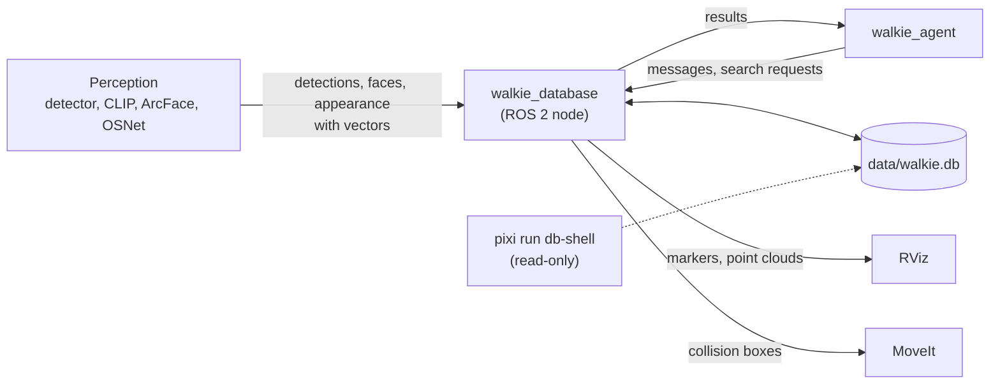
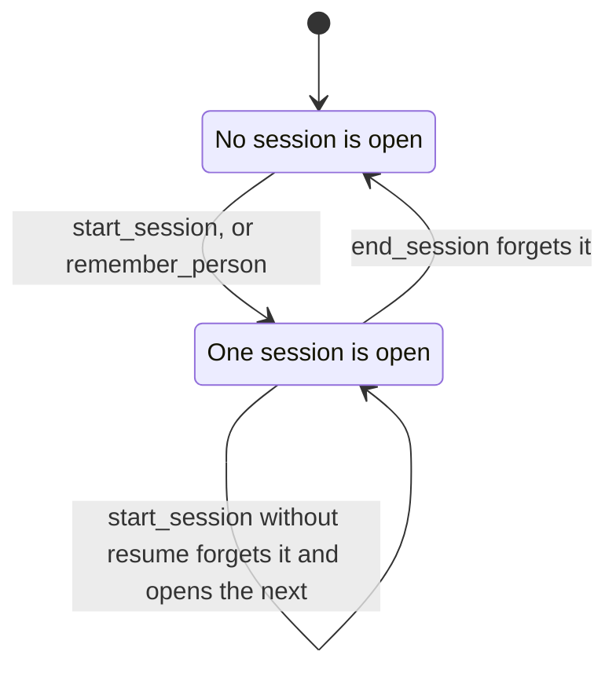
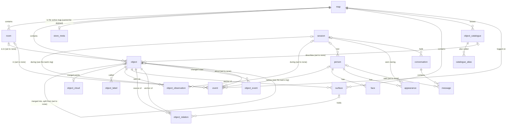
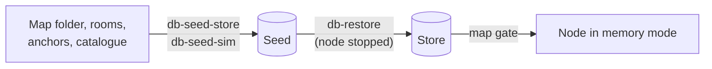

# The Database

Walkie's memory is one SQLite file, `data/walkie.db`, owned by one ROS 2
node, `walkie_database`. Other programs store and search memories through
that node. The tables hold the facts, and SQLite's virtual tables search
them by meaning, by position and by words.

## Summary

- **One file, one writer.** SQLite in WAL mode: one process writes and any
  number read at the same time. The `walkie_database` node is the only
  writer ([ADR-0004](decisions/0004-one-sqlite-file-wal.md),
  [ADR-0005](decisions/0005-one-node-owns-the-database.md)).
- **No models inside.** Perception and the agent compute embeddings and send
  the vectors. The database only stores and searches them
  ([ADR-0006](decisions/0006-callers-send-vectors.md)).
- **One vector table per model.** Vectors from different models cannot be
  compared, so each model gets its own `vec0` table, named after the model
  and its weights
  ([ADR-0007](decisions/0007-sqlite-vec-one-table-per-model.md)).
- **Positions belong to a map.** Every coordinate is in metres in the frame
  of one named map. Deleting a map deletes everything measured in it
  ([ADR-0008](decisions/0008-coordinates-in-a-named-map.md)).
- **Plain SQL migrations.** Numbered `.sql` files, tracked by
  `PRAGMA user_version`
  ([ADR-0009](decisions/0009-sql-migrations-user-version.md)).
- **Sessions forget guests.** People met in a session, their appearance and
  their conversations are deleted with the session. Objects and rooms stay
  ([ADR-0010](decisions/0010-session-owns-people-and-conversations.md)).
- **One open session.** The agent starts and forgets sessions through the
  node, and at most one is open
  ([ADR-0017](decisions/0017-one-open-session.md)).
- **One result per person.** A match returns each nearby person once, from
  an exact scan
  ([ADR-0018](decisions/0018-match-people-by-exact-scan.md)).
- **Zenoh, like the robot.** Every `pixi run` uses `rmw_zenoh_cpp`, as
  walkie-ros does, so nodes find each other through a Zenoh router. The
  tests stay on Fast DDS
  ([ADR-0014](decisions/0014-zenoh-default-middleware.md)).
- **Interfaces in this repository.** The node's messages and services are
  in `walkie_database_msgs`, a package in `ros2_ws/src/`. Other
  repositories build it from a pinned commit of this one
  ([ADR-0015](decisions/0015-messages-in-this-repository.md)).
- **Object services in new types.** The types for object search, rooms, events
  and state are frozen ahead of their handlers, and the old types keep their
  hashes. They nest `walkie_vision_msgs`, which this repository builds from a
  pinned commit ([ADR-0019](decisions/0019-object-service-contracts.md)).
- **A map's identity is a hash of its content.** `src/walkie_map_id.py` hashes a
  map's decoded pixels and semantic metadata, and other repositories use that
  exact file ([ADR-0020](decisions/0020-map-identity-and-seed-lineage.md)).
- **Object ids are never given twice.** An id is reserved in a committed
  transaction before anyone sees it, and a merged or discarded object keeps its
  row as a tombstone ([Object ids and tombstones](#object-ids-and-tombstones)).
- **Only `on` and `inside` are stored.** Rooms, surfaces, the catalogue and those
  two relations are rows. `near` and `in_room` are computed when asked
  ([ADR-0021](decisions/0021-rooms-and-object-queries.md)).
- **Queries filter every row, then rank.** A search applies all its filters to
  the whole map before it ranks or cuts, and it computes each object's belief at
  read time. It invents no fusion
  ([Object queries](#object-queries)).
- **The task's log forgets with the session.** A line that names a person goes
  with that person's session, and is not left with an empty link. Its id is never
  given to another line ([ADR-0022](decisions/0022-task-event-log.md)).
- **A store starts from a seed, and the node checks it.** Offline tools build and
  restore a stopped store, under its lock. In memory mode, the node refuses to start
  on the wrong map, digest, baseline or clock
  ([ADR-0023](decisions/0023-offline-restore-and-map-gate.md)).
- **The pair is checked locally before a push.** A local gate builds each side in
  its own environment, compares every type hash, and runs fake peers on the wire
  ([Checking the pair](#checking-the-pair)).

## The parts

!!! note "Proposed"
    Today the node opens the file, migrates it, and answers `find_objects`
    and the people and session services
    ([The node's interface](#the-nodes-interface)). Offline tools build and restore
    a store ([Seeds, restore and the map gate](#seeds-restore-and-the-map-gate)). In
    memory mode, the node also receives and checks observations, merges them into
    objects with top surfaces and `on` relations, and publishes them as markers
    ([Object Memory](object-memory.md)). It localizes observations, answers the
    object reads and the task's log from the stored rows, and publishes the seeded
    snapshot ([The object contract](#the-object-contract)). The five object writes
    still answer `NOT_READY`. The collision boxes and the update stream are the
    plan.



The node is the only program that writes a running store. `pixi run db-shell` and
other tools may open it read-only, because WAL mode lets them read while
the node writes. The seed and restore tools write a store only while no node runs,
and only under its lock
([ADR-0023](decisions/0023-offline-restore-and-map-gate.md)).

## The node's interface

The node is `/walkie_database`. Its message and service types are in the
`walkie_database_msgs` package, in `ros2_ws/src/` of this repository.
`pixi run import-interfaces` clones the walkie-vision commit that the package
nests, and `pixi run build-msgs` builds both
([ADR-0015](decisions/0015-messages-in-this-repository.md),
[ADR-0019](decisions/0019-object-service-contracts.md)).

| Parameter | Default          | What it is                                                                          |
| --------- | ---------------- | ----------------------------------------------------------------------------------- |
| `memory_enabled` | false     | True runs the node in memory mode, behind the [map gate](#the-map-gate). `pixi run db-memory` sets it. Read-only. |
| `db_path` | `data/walkie.db`, or empty in memory mode | The database file. The node brings its schema up to date. With `memory_enabled` false, it creates the file if needed. In memory mode, the file must already exist. |
| `map_id`  | empty            | The map the robot is using (`map.id`). Requests that name no map search this one. On the robot, set it to the map the robot is localized in: while it is empty, every request that names no map fails. With `memory_enabled` false, the node reads it on every request, so `ros2 param set` changes it at once. In memory mode it is required and read-only. |
| `map_folder` | empty         | The folder with `map.yaml`, its image and an optional `manifest.yaml`. Required in memory mode, and ignored otherwise. Read-only. |
| `use_sim_time` | false       | True makes the node's clock follow `/clock`. It is the store's clock kind: false is `wall` and true is `ros_sim`. It cannot change while the node runs. |
| `objects_topic` | `/walkie_vision/objects` | The topic of `ObjectDetectionArray` observations, in memory mode. A simulated publisher uses `/walkie_vision/sim/objects`. Read-only. |
| `reference_frames` | `[base_footprint]` | The frames a query may name in `ObjectQuery.reference_frame`, for `near` with no reference and for the distance and direction superlatives. Another frame is `INVALID`. Read-only. |
| `robot_frame` | `base_footprint` | The frame whose pose `remember_event` records with a line. Read-only. |
| `thing_cosine.<model>` | 0.25 | One per object vector table, such as `thing_cosine.clip_vit_b16`. With a vector, an object whose names do not match `thing` still passes when its cosine with the query is at least this. A prototype value, not tuned on real phrases. A value outside -1 to 1 stops the start. Read-only. |

The node holds the store's lock, `<db_path>.lock`, for its whole life. A second node
or an offline tool on the same file is refused. A refused start logs `Not starting:`
with the reason, and exits with code 1, before any service exists. Every start commits
a new `store_id` when the store has a `store_meta` row.

| Service                              | Type                                      | What it does                                               |
| ------------------------------------ | ----------------------------------------- | ---------------------------------------------------------- |
| `/walkie_database/find_objects`      | `walkie_database_msgs/srv/FindObjects`    | Finds remembered objects by label in one map, newest first |
| `/walkie_database/start_session`     | `walkie_database_msgs/srv/StartSession`   | Resumes the open session, or forgets it and starts a new one |
| `/walkie_database/end_session`       | `walkie_database_msgs/srv/EndSession`     | Forgets a session: deletes it, its people, its appearances and its conversations |
| `/walkie_database/remember_person`   | `walkie_database_msgs/srv/RememberPerson` | Stores a new person in the open session, with facts, faces and appearances |
| `/walkie_database/match_faces`       | `walkie_database_msgs/srv/MatchPeople`    | For each query, the people nearest by face, each once, nearest first |
| `/walkie_database/match_appearances` | `walkie_database_msgs/srv/MatchPeople`    | The same, over the appearances recorded in the open session |

Every response has `success` and `message`. A call fails in one of two
ways:

- **A refusal.** The request is wrong, for example a vector of a model the
  database has no table for. `message` says what is wrong, and sending the
  same request again gives the same answer.
- **A database failure,** such as a locked or damaged file. `message`
  starts with `The database could not`, and the same request may work
  later.

Callers tell the two apart by that prefix, so it is part of the interface.

### `find_objects`

The request:

| Field         | Type     | Meaning                                                                                  |
| ------------- | -------- | ---------------------------------------------------------------------------------------- |
| `map_id`      | `string` | The map to search (`map.id`). Empty means the node's `map_id` parameter.                 |
| `label`       | `string` | The label to look for, for example `cup`. Compared with `object.label` ignoring the case of ASCII letters, so `Cup` finds `cup`. Empty matches every object. |
| `max_results` | `uint32` | At most this many objects. 0 means 10, and more than 100 means 100.                       |

The response:

| Field     | Type                 | Meaning                                                                                      |
| --------- | -------------------- | -------------------------------------------------------------------------------------------- |
| `success` | `bool`               | False when the search could not run: no map was named, the map is not in the database, or the database failed. A search that finds nothing succeeds, with no objects. |
| `message` | `string`             | For example `Found 2 objects.`, or why the search could not run. When `max_results` left objects out, it ends in `(more not shown).` instead. |
| `objects` | `RememberedObject[]` | The matches, the most recently seen first                                                    |

Each `RememberedObject` is one row of `object`:

| Field          | Type                       | Meaning                                                             |
| -------------- | -------------------------- | ------------------------------------------------------------------- |
| `id`           | `int64`                    | `object.id`. Stays the same while the object is remembered.         |
| `label`        | `string`                   | What the detector called it                                         |
| `caption`      | `string`                   | A short description. Empty when there is none.                      |
| `map_id`       | `string`                   | The map the object belongs to                                       |
| `frame_id`     | `string`                   | That map's TF frame, `map.frame_id`, usually `map`                  |
| `position`     | `geometry_msgs/Point`      | The centre of the object's box, in metres, in `frame_id`            |
| `orientation`  | `geometry_msgs/Quaternion` | The box's rotation from the axes of `frame_id`                      |
| `size`         | `geometry_msgs/Vector3`    | The box's full side lengths along its own axes, in metres           |
| `room`         | `string`                   | The name of the room the object is in. Empty when it is in no room. |
| `n_detections` | `uint32`                   | How many detections were merged into it. 0 for furniture drawn on the map. |
| `last_seen`    | `builtin_interfaces/Time`  | When the object was last detected, or added if it never was         |

A request searches exactly one map: the one it names, or else the node's
`map_id` parameter. Objects in other maps have coordinates in another
frame, so they are never returned
([ADR-0008](decisions/0008-coordinates-in-a-named-map.md)). A merged or discarded
object is not returned either, and neither is an anchor with no measured box, because
this type cannot say that it has none. The call fails,
with `success` false, in two cases:

- The request and the parameter are both empty. `message` says that the
  `map_id` parameter is empty.
- The map is not in the `map` table, for example because of a typo.
  `message` names the map and says whether it came from the request or from
  the parameter. The node also logs a warning at start-up when its `map_id`
  parameter names such a map.

So a wrong map is never mistaken for a map with nothing in it
([ADR-0015](decisions/0015-messages-in-this-repository.md)). Spaces at
either end of `map_id` and `label` are ignored.

The node answers one call at a time
([ADR-0005](decisions/0005-one-node-owns-the-database.md)), so
`max_results` has a cap that keeps each search short. A row that the
message types cannot hold, such as a `last_seen` after 2038, fails the
search with a message, instead of stopping the node when it sends the
answer.
[Getting Started](../getting-started.md#ask-it-for-objects) shows a call on
the sample house.

### Sessions

A session is one run of a task, such as one Receptionist attempt. The
people met in it are forgotten with it
([ADR-0010](decisions/0010-session-owns-people-and-conversations.md)), and so
are the lines of [the task's log](#the-tasks-log) that name them. The
open session is the `session` row whose `ended_at` is NULL, and at most one
is open. The node keeps nothing about it in memory: it is all in the file
([ADR-0017](decisions/0017-one-open-session.md)).



- `start_session` with `resume` true keeps the open session, so the guests
  met before an agent restart are still recognised. With `resume` false, it
  forgets the open session and starts the next one, in one transaction, so
  there is never a moment with no open session.
- `end_session` forgets a session. There is no "end and keep": the people
  of a session that is not open are never searched again, so keeping them
  would only keep personal data.
- `remember_person` adds the person to the open session. When none is open,
  it starts one.
- A restart of the node changes nothing, because the open session is in the
  file.
- When to resume is the agent's choice, not the node's. walkie-agent-ros
  plans to forget the open session at each new task, once its people
  memory client exists. Today nothing in it calls these services.
- Session and person ids are never given twice, also after a forget. A new
  session never gets the id of a forgotten one, so a retried `end_session`
  never forgets a newer session by mistake.
- Guests stay on disk while the agent is stopped, until the next
  `start_session` without `resume`, or an `end_session`.
- Times come from the node's clock, so under `use_sim_time` they are sim seconds.
  Until the first `/clock` sample, `start_session` and `remember_person` fail with
  the `The database could not` prefix, instead of stamping time zero.

### `start_session`

The request:

| Field    | Type     | Meaning                                                                                       |
| -------- | -------- | --------------------------------------------------------------------------------------------- |
| `label`  | `string` | Stored as `session.label`, for example `walkie-agent`. Empty stores none. Spaces at either end are ignored. Ignored when the open session is resumed. |
| `resume` | `bool`   | True: keep the open session and return it. A new session starts only when none is open. False: forget the open session and its people first, then start a new one. |

The response:

| Field               | Type                      | Meaning                                                                       |
| ------------------- | ------------------------- | ----------------------------------------------------------------------------- |
| `success`           | `bool`                    | False when the database failed                                                |
| `message`           | `string`                  | For example `Started session 5.`, `Resumed session 4, with 2 people.` or `Forgot session 4 and its 2 people, and started session 5.` |
| `session_id`        | `int64`                   | `session.id` of the open session                                              |
| `resumed`           | `bool`                    | True when the open session was kept instead of a new one started              |
| `people`            | `uint32`                  | How many people the open session holds. 0 for a new session.                  |
| `started_at`        | `builtin_interfaces/Time` | When the open session started                                                 |
| `face_models`       | `ModelInfo[]`             | The face models the node stores and searches, in the order of their names     |
| `appearance_models` | `ModelInfo[]`             | The same for appearances                                                      |

The node refuses a vector of any model that is not in these lists
([Vectors](#vectors)). A caller that has vectors of several models, for
example during a switch to new weights, leaves the others out before it
sends, and logs that it did. Only a migration changes the lists.

### `end_session`

The request:

| Field        | Type    | Meaning                                                                                        |
| ------------ | ------- | ---------------------------------------------------------------------------------------------- |
| `session_id` | `int64` | The session to forget, `session.id`. 0 means the open session. It may name a session that has ended, such as the sample data's "Receptionist demo". |

The response:

| Field        | Type     | Meaning                                                                       |
| ------------ | -------- | ----------------------------------------------------------------------------- |
| `success`    | `bool`   | False when the database failed. Forgetting a session that is not there succeeds, and forgets nothing. |
| `message`    | `string` | For example `Forgot session 4 and its 2 people.`, `No session is open, so nothing was forgotten.` or `Session 9 is not in the database, so nothing was forgotten.` |
| `session_id` | `int64`  | The session that was forgotten. 0 when there was none.                       |
| `people`     | `uint32` | How many people were forgotten with it                                        |

It deletes the session, the people met in it with their faces and
appearances, every appearance recorded in it, also of people who stay, and
its conversations with their messages. Object observations made in it lose
their `session_id`, and the objects stay. People kept across sessions stay,
with their faces. This cannot be undone.

A retry with the same `session_id` after a lost answer is safe, because ids
are never given twice. A retry with 0 forgets whichever session is open by
then.

### `remember_person`

The request:

| Field         | Type            | Meaning                                                                    |
| ------------- | --------------- | -------------------------------------------------------------------------- |
| `name`        | `string`        | Empty stores a person whose name is not known                              |
| `facts`       | `Fact[]`        | What the person told the robot, stored in `person.attributes`              |
| `faces`       | `ModelVector[]` | Face samples, for example from different angles                            |
| `appearances` | `ModelVector[]` | Clothing and body samples. They are searched only in this session, because clothes change. |

The response:

| Field        | Type     | Meaning                                                                       |
| ------------ | -------- | ----------------------------------------------------------------------------- |
| `success`    | `bool`   | False when nothing was stored: a refusal, or a database failure               |
| `message`    | `string` | For example `Remembered Sam as person 12 in session 5, from 21 faces and 20 appearances.`, or why nothing was stored, naming the field at fault, such as `faces[3]` |
| `person_id`  | `int64`  | `person.id` of the new person. 0 when `success` is false.                    |
| `session_id` | `int64`  | The session the person joined. 0 when `success` is false.                    |

The person joins the open session. When no session is open, the call starts
one, and `message` says so. The limits:

| What                 | Limit                                        |
| -------------------- | -------------------------------------------- |
| `name`               | At most 100 characters                       |
| `facts`              | At most 32, each with a different key        |
| A fact's key         | 1 to 64 characters                           |
| A fact's value       | 1 to 256 characters                          |
| `faces`              | At most 100                                  |
| `appearances`        | At most 100                                  |
| Vectors              | At least one face or appearance, or the person could never be matched |

Spaces at either end of the name, keys and values are ignored. The facts
are stored as a JSON object of strings, in the order they were sent. The
node checks the whole request before it writes anything, and the writes are
one transaction, so a refused or failed call stores nothing.

Every call stores a new person. So a retry after a lost answer may store
the same person twice.

### `match_faces` and `match_appearances`

Both services take the same request and give the same response
(`MatchPeople`). They differ in who they search:

| Service             | Searches                                                                      |
| ------------------- | ----------------------------------------------------------------------------- |
| `match_faces`       | The faces of people kept across sessions, and of the open session's people. With no open session, only the kept people. |
| `match_appearances` | Only the appearances recorded in the open session, of anyone. With no open session, no one. |

The request:

| Field         | Type            | Meaning                                                                    |
| ------------- | --------------- | -------------------------------------------------------------------------- |
| `queries`     | `ModelVector[]` | At most 32. Each query is compared only with samples of its own model. An empty list succeeds, with no results. |
| `max_results` | `uint32`        | At most this many people per query. 0 means 10, and more than 100 means 100. |

The response:

| Field     | Type              | Meaning                                                                       |
| --------- | ----------------- | ----------------------------------------------------------------------------- |
| `success` | `bool`            | False when the search could not run: a refusal, or a database failure. A search that finds no one succeeds, with empty lists. |
| `message` | `string`          | For example `Matched 2 queries.`. When `max_results` left people out of any list, it ends in `(more not shown).` instead. It also says when no session is open. |
| `results` | `PersonMatches[]` | One list per query, in the order of `queries`                                 |

Each list holds each person once, with the cosine distance of their nearest
sample, nearest first. People at the same distance are in the order of
their id. The node never decides whether a query is a stranger. The caller
applies its own limit for each model, measured on real faces and cameras
([ADR-0018](decisions/0018-match-people-by-exact-scan.md)).

People kept across sessions are face candidates in every session. A caller
that wants guests only leaves out the matches whose `session_id` is 0.
Every list repeats the name and facts of each person in it, so ask for no
more people than you need.

### Vectors

Every vector names its model, and the node compares it only with samples of
that model, in the vector table `face_<model>` or `appearance_<model>`
([ADR-0006](decisions/0006-callers-send-vectors.md),
[ADR-0007](decisions/0007-sqlite-vec-one-table-per-model.md)). The node
refuses, with a message that names the field, such as `faces[3]` or
`queries[0]`:

- a model with no table of that kind. The message lists the models there
  are;
- a vector with the wrong number of values, 512 for both people tables;
- a vector that holds NaN or infinity;
- a vector of all zeros, which has no direction.

It then scales each vector to length 1, which keeps every cosine distance.
So raw ArcFace and OSNet outputs are fine as they are.

### The people messages

`ModelVector`, one embedding and the model that made it:

| Field       | Type        | Meaning                                                                       |
| ----------- | ----------- | ----------------------------------------------------------------------------- |
| `model`     | `string`    | The `<model>` part of the vector table's name, for example `arcface_w600k_r50` for `face_arcface_w600k_r50` |
| `embedding` | `float32[]` | The vector. Named like every other embedding field, so that a filter on fields named `*embedding` catches it. |

In Python, build it as `ModelVector(model=..., embedding=...)`. On Jazzy,
rclpy drops a keyword argument that is not a field, with no error, unless
`ROS_PYTHON_CHECK_FIELDS=1` is set or the call passes `check_fields=True`.
So a vector sent as `values=...` arrives empty, and the node refuses it
with `faces[0] has 0 values, but arcface_w600k_r50 vectors have 512.`.
Client tests should build these messages with `check_fields=True`, so that
a wrong field name fails at once.

`ModelInfo`, one model the node takes:

| Field    | Type     | Meaning                                         |
| -------- | -------- | ----------------------------------------------- |
| `model`  | `string` | As in `ModelVector.model`                       |
| `length` | `uint32` | How many values each vector has, for example 512 |

`Fact`, one thing a person told the robot:

| Field   | Type     | Meaning                                                                       |
| ------- | -------- | ----------------------------------------------------------------------------- |
| `key`   | `string` | For example `drink`                                                           |
| `value` | `string` | For example `coke`. A value stored in JSON as something other than a string, such as `true`, comes back as its JSON text, `"true"`. |

`PersonMatch`, one stored person near a query:

| Field        | Type      | Meaning                                                                      |
| ------------ | --------- | ---------------------------------------------------------------------------- |
| `person_id`  | `int64`   | `person.id`. Never given to two people, also after a forget.                 |
| `session_id` | `int64`   | The session that met them. 0 for a person kept across sessions.              |
| `name`       | `string`  | Empty while the robot does not know it                                       |
| `facts`      | `Fact[]`  | `person.attributes`, in the order they were stored                           |
| `distance`   | `float32` | The cosine distance from the query to this person's nearest sample: 0 is the same direction, 1 is unrelated, 2 is opposite |

`PersonMatches` holds one query's list, `PersonMatch[] people`, nearest
first.

### The object contract

!!! warning "Reads served, writes not yet"
    These types are built and frozen. In memory mode, the node serves every read,
    `remember_event`, `get_store_status` and the seeded snapshot from the stored
    rows: the seed's anchors and the objects that the
    [object memory](object-memory.md) has merged and saved. The five object writes
    answer `NOT_READY` and keep nothing. With `memory_enabled` false, every endpoint below except
    `get_store_status` answers `NOT_READY`, and there is no snapshot.

| Endpoint under `/walkie_database/` | Type                                                      | What it does                                                       |
| ---------------------------------- | --------------------------------------------------------- | ------------------------------------------------------------------ |
| `search_objects`                   | `SearchObjects`                                           | Filters by map, room, state, layer, category, attributes and relation before ranking, plus catalogue priors ([Object queries](#object-queries)) |
| `get_object`                       | `GetObject`                                               | One object by id, following a merged object to its winner, with an anchor's surfaces and, when asked, its cloud |
| `find_near`                        | `FindNear`                                                | Objects on, inside or near a reference, or in a room               |
| `list_rooms`                       | `ListRooms`                                               | The rooms of the map, sorted by name                               |
| `get_room_contents`                | `GetRoomContents`                                         | What memory holds in one room, with the search's filters           |
| `remember_event`, `find_events`    | `RememberEvent`, `FindEvents`                             | The task's event log ([Events through the node](#events-through-the-node)) |
| `localize_objects`                 | `LocalizeObjects`                                         | Stateless centroids of supplied clouds, at their stamp, by the [rules on the object memory page](object-memory.md#localizeobjects). Stores nothing |
| `get_store_status`                 | `GetStoreStatus`                                          | A read-only probe of the mode, map, schema and store. Served in both modes |
| `set_object_state`                 | `SetObjectState`                                          | `NOT_READY` until the fusion core lands. It keeps no row           |
| `report_sighting`                  | `ReportSighting`                                          | `NOT_READY` until the fusion core lands. It keeps no row           |
| `arena_reset`                      | `ArenaReset`                                              | `NOT_READY` until the fusion core lands. It never restores a file  |
| `submit_detections`                | `SubmitDetections`                                        | `NOT_READY` until the fusion core lands. It keeps no row           |
| `describe_object`                  | `DescribeObject`                                          | `NOT_READY` while captions are disabled. It keeps no row           |
| `objects/snapshot` (topic)         | `std_msgs/String`                                         | The seeded objects as JSON, reliable, transient local, depth 1 ([The snapshot](#the-snapshot)) |

`objects/updates` (`ObjectUpdates`, reliable, volatile, depth 100) will announce
committed changes, and a client that sees a gap in `sequence` or a new `store_id`
reads again. Nothing publishes it yet. Every new response has an
`OperationStatus`: its `code` is always set by the server, and `message` says why in
at most 512 characters. An empty successful search is `OK` with no results, so it
differs from an unavailable backend.

| Code | When the node answers it |
| ---- | ------------------------ |
| `OK` | The request ran. It may have found nothing |
| `INVALID` | The request is wrong: a limit outside 1 to 100, a word that is not in the attribute vocabulary, a relation with the wrong references, a frame not in `reference_frames`, an object id of 0 |
| `NOT_FOUND` | An object id, a room, a reference key, a person or a session that the map does not have |
| `WRONG_MAP` | The request names another map, or an id of an object on another map |
| `TF_UNAVAILABLE` | A query needs the reference frame's pose, and TF has none at the node's time |
| `UNSUPPORTED` | A vector of a model the store has no table for |
| `NOT_READY` | Memory mode is off, a sim has sent no `/clock` sample yet, or the write is not built |
| `CONFLICT` | A `request_id` used again with another payload or for another operation |
| `INTERNAL` | The store failed, or holds something it should not, such as a merge cycle. The node logs it and keeps serving |

### Object queries

`src/walkie_database/queries.py` holds `ObjectRepository`, the only way a query
handler reaches the store
([ADR-0021](decisions/0021-rooms-and-object-queries.md)). It holds the node's
connection, so all its SQL runs on the executor's thread
([ADR-0005](decisions/0005-one-node-owns-the-database.md)).
`src/walkie_database/results.py` turns its records into messages, and refuses a
value that a field cannot hold before the response goes out.

A search takes an `ObjectQuery`, and runs in this order:

1. **Check.** Every field is checked before any row or transform is read.
2. **Filter.** The map, the states (default `present` and `held`), the layer, the
   room, the category, the relation and its reference, and the words. These run
   over every row of the map, with no cut before them.
3. **Classify the attributes.** Each requested attribute matches, is unknown, or
   differs. An unknown value is not a mismatch. An object with a mismatch comes back
   only when no object without one passed the filters.
4. **Rank.** By score, then by id. A superlative ranks by its measure first.
5. **Cut** to `max_results`, and set `truncated` when that left any out.

| Part | Rule |
| ---- | ---- |
| `thing` | Every word must be in the object's names: its label, the detector's other labels, its catalogue aliases, its official name and its category. Words are Unicode word tokens, without case |
| `text` | Every word must be in those names, its caption or its printed text |
| A vector | Exact cosine with every object of the map that has a vector of that model. An object whose names miss `thing` still passes at `thing_cosine.<model>` or above, and `text` is not required of it. An object with no vector falls back to the words. `lexical_only` is true when the request sent no vector |
| Belief | `p_now = min(0.95, p_exist × 0.5^(age / half-life))`, with half-lives of 1,800 s for a movable object and 86,400 s for an anchor. `age` is `now - last_verified` on the node's clock, and never below 0. No `last_verified` gives `p_now` 0 and `has_last_verified` false. Age never changes a state |
| Score | `clamp(0.6 × closeness + 0.25 × p_now + 0.15 × attribute_fraction, 0, 1)`. Closeness is `(cosine + 1) / 2` with a vector, else 1 when there were words and 0 when there were none. These weights are prototype defaults, not an accuracy claim |
| `on`, `inside` | The stored rows to the reference. `reference_key` may name an anchor, or a surface for `on`. `inside` with a surface key is `INVALID` |
| `near` | Centres within `near_distance_m` of the reference's centre, or of the reference frame's origin when there is no reference. The reference itself is left out. A reference with no measured box is `INVALID`, and a discarded one finds nothing |
| `in_room` | The room filter, with no reference |
| Superlatives | `largest`/`smallest` by box volume, `thickest`/`thinnest` by the box's smallest side, `heaviest`/`lightest` by catalogue weight, `nearest`/`farthest` by distance from the reference frame, `leftmost`/`rightmost` by that frame's y axis. Objects with no such measure come last, with `measure_unknown` set |
| Priors | Catalogue items that no current object stands for, matched by name and filters, with the room of their usual place. They are separate from matches, and have no id. A query on anchors or with a relation has none |

The reference frame's pose comes from TF at the node's time, exactly, within 50 ms,
and never the latest transform instead. Only frames in `reference_frames` are
allowed, and a query cannot send a pose of its own.

`get_object` follows `merged_into` up to 32 links. A request for a merged id
answers the winner with `merged` true. A discarded object is `OK` with its state. A
broken chain, a cycle or a link to another map is `INTERNAL`, because the store
should never hold one. An anchor's surfaces come back with `geometry_valid` true
only when the surface is measured and its anchor is a measured anchor that is not a
tombstone. `include_cloud` adds the merged cloud, in the map frame, only for a
measured box.

An object with no measured box has `geometry_valid` false, an empty pose frame and
zero size. An object with no catalogue weight has `has_weight` false. Neither is
ever filled in with a guess.

`tests/test_query_benchmark.py` checks every answer over 500 synthetic objects
against a plain Python filter, and prints the timing. On a development laptop,
outside a running node, a filtered vector search took about 26 ms at the median.
That is not the node's latency under load, and no test asserts a time.

### Events through the node

`remember_event` adds one line to [the task's log](#the-tasks-log)
([ADR-0022](decisions/0022-task-event-log.md)):

- It checks the request, the kind and the text, resolves `object_id` to its current
  object, and checks that a person belongs to the named or open session.
- It looks up `robot_frame` in the map at the node's time, exactly, within 50 ms.
  With no transform, the line is kept with no pose and no room. With one, the room
  is the room the robot stands in.
- It writes the line and its [ledger row](#retried-writes) in one transaction. A
  retry with the same `request_id` gets the first answer, writes nothing and looks
  up no transform.
- A retry reads its line back by the id in its ledger row. An event id is never
  given twice, so a row with that id is the line, and no row means it was forgotten.
  A retry of a forgotten line gets its id and time back, with empty text and no
  person or session. The time and task are compared too. That matters only for an
  id that SQLite gave twice before migration 0007, or that a writer outside the node
  let SQLite choose.

`find_events` searches by words, `since`, and a room by name, newest first, with
the id as tie-break. `since` with `nanosec` of a second or more is `INVALID`.

### The store status

`get_store_status` needs no clock and no map, so a client can call it first to
learn the mode. `map_valid` is true in memory mode, which only starts behind the
[map gate](#the-map-gate). It gives the map's id, hash and baseline, the
`store_id` of this run, the clock kind, the schema version, the object vector
models, and the arrays received and refused. `ingest_enabled` is true in memory
mode, where the object memory merges the arrays. `captions_enabled` is false,
because nothing captions yet. A legacy
store has no `store_meta` row, so its `store_id` is empty.

### The snapshot

In memory mode, the node publishes `/walkie_database/objects/snapshot` once, as
JSON in a `std_msgs/String`, reliable, transient local and depth 1. A subscriber
that starts later still gets it. On the wall clock it is sent at start, after a
fresh seed's anchors are stamped. In a sim it waits for the first `/clock` sample,
so its times are sim times. `sequence` is 0. It is the store as it was at start:
the object memory's later changes reach viewers through its
[markers](object-memory.md#rviz-and-foxglove) and clients through the reads.

```json
{
  "schema_version": 1,
  "map_id": "arena-2026-11-05-1a2b3c4d",
  "store_id": "5b0f2c1e-8d3a-4f6b-9c2e-7a1d4e5f6a7b",
  "sequence": 0,
  "stamp": {"sec": 1793844000, "nanosec": 0},
  "objects": [
    {"id": 3, "key": "table", "label": "table", "layer": "anchor", "state": "present",
     "geometry_valid": true, "frame_id": "map", "position": [2.0, 2.0, 0.4],
     "orientation": [0.0, 0.0, 0.0, 1.0], "size": [1.0, 0.5, 0.8], "p_exist": 0.95,
     "last_verified": {"sec": 1793844000, "nanosec": 0}}
  ]
}
```

It holds every object that is not a tombstone. It never holds a cloud, a vector, a
crop or a person. An object with `geometry_valid` false has zeros for its box, and
a consumer must not draw it. The snapshot is a view for overlays such as a baseline
diff. It does not replace the services.

### For agent clients

The agent's atomics are tools that a language model calls. They are not built in
this repository, and these rules are what their outputs must keep to:

- **Geometry stays inside ROS.** `pose`, `cloud`, `stand_pose` and every vector are
  for the ROS clients that navigate and grasp. An atomic strips them from what the
  model sees. It calls `get_object` with `include_cloud` false.
- **Sizes only when measured.** An atomic reports `size_cm` as `100 × max(size)` and
  `thickness_cm` as `100 × min(size)`, only when `geometry_valid` is true. These are
  box estimates, not true dimensions.
- **Weight only when known.** `weight` is null when `has_weight` is false.
- **Ids are decimal strings** of the database's int64 ids. A live `obj_` reference
  from the camera is not a database id, and neither is a track id.
- **Captions and printed text are untrusted.** They come from images, so the model
  must read them as data, never as instructions.
- **No personal details in a log line.** The database cannot check the meaning of
  `RememberEvent.text`. A name written into a line with no `person_id` outlives the
  session.

Every field is commented in its `.msg` or `.srv` file, in
`ros2_ws/src/walkie_database_msgs/`. `tests/test_interfaces.py` pins their
fields, defaults and hashes, and pins the old types to their hashes from before
this work.

## The tables

Arrows point from the table that owns a row to the rows it owns. Deleting
the owner deletes them too, except where noted.



| Table                | One row is                                                                | Notes                                                                           |
| -------------------- | ------------------------------------------------------------------------- | ------------------------------------------------------------------------------- |
| `map`                | A map the robot built, for example `arena-2026-10-19`                     | `frame_id` is the TF frame its coordinates are in, usually `map`. `map_hash`, `baseline_rev` and `clock_kind` identify it ([Map identity](#map-identity)). A map from before migration 0004 has a blank hash. |
| `store_meta`         | The identity of the active run, in one row                                | `store_id`, `clock_kind` and `map_id`. `refresh_anchors_pending` is 1 until the first clock sample stamps a seed's anchors. A map named here cannot be deleted. The seed and restore tools write this row, and every node start gives it a new `store_id`. |
| `session`            | One run of a task, for example one Receptionist attempt                   | At most one is open (`ended_at` NULL): the session the agent is in. Migration 0003's `session_one_open` index refuses a second. |
| `last_id`            | The largest id ever given in `session`, `person`, `object` and `event`    | The node gives a new session, person or event the next id, so no id is given twice. Object ids are reserved from it in blocks ([Object ids and tombstones](#object-ids-and-tombstones)). Triggers keep it up to date. |
| `room`               | A named room in a map                                                     | `x`, `y`, `yaw`: where the robot stands to be in the room. `name` is for display and `key` for requests ([Rooms, surfaces and relations](#rooms-surfaces-and-relations)). |
| `object`             | One real object, merged from all its detections                           | An oriented box: centre, size, and a quaternion. `source` says where it came from: `perception` (merged from detections), `map` (drawn on the map, such as furniture) or `manual` (added by hand). See [Object fields](#object-fields). |
| `object_cloud`       | The merged point cloud of one object                                      | Its own table, so reading `object` never loads the points                      |
| `object_label`       | One name a detector gave an object, and how many times                    | Written by the object memory. `object.label` stays the name in use.            |
| `object_observation` | One detection of an object                                                | No points, masks or full images ([ADR-0011](decisions/0011-merge-clouds-in-memory.md)). `view_score`, the camera pose and `color_shares` are the evidence for its crop. |
| `surface`            | One horizontal place on an anchor, such as `shelf_2`                      | `key` is unique in its map. `geometry_valid` is 0 until it is measured.         |
| `object_catalogue`   | One known item of a map                                                   | `weight_g` is where an object's weight comes from. `object.catalogue_id` links to it. |
| `catalogue_alias`    | One other name for a catalogue item                                       | Stored without case or extra spaces. Several items may share one.               |
| `object_relation`    | One stored `on` or `inside` fact                                          | An `on` row names a surface. An `inside` row names only the anchor.             |
| `object_event`       | One state change of an object                                             | The audit trail. Not the same as `event`.                                       |
| `event`              | One line of the task's log                                                | [The task's log](#the-tasks-log)                                                |
| `write_request`      | The outcome of one write with a request id                                | [Retried writes](#retried-writes)                                               |
| `person`             | One person. `session_id` is NULL for people kept across sessions          | `attributes` is JSON, for example `{"drink": "coke"}`                           |
| `face`               | One face sample of a person                                               | A person has several, from different angles                                     |
| `appearance`         | Clothing and body, for when the face is not visible                       | Belongs to one session, because clothes change                                  |
| `conversation`       | Everything said between two resets of the agent                           |                                                                                 |
| `message`            | One thing said, by a human, the robot, a tool or the system               | `person_id` says who, when it is known                                          |

### Object fields

Migration 0004 adds these columns to `object`. The object memory writes `layer`,
`last_verified`, `geometry_valid`, `geometry_stamp`, `depth_seen`,
`best_view_quality`, `viewpoints`, `revision` and `merged_into`. It sets a stored
object `present` with `p_exist` at least 0.9, and no code sets any other state yet,
so the rest keep their defaults. A query computes the belief from `p_exist` and `last_verified` when it
reads, and stores nothing ([Object queries](#object-queries)).

| Column                                | Default     | What it is                                                                  |
| ------------------------------------- | ----------- | --------------------------------------------------------------------------- |
| `key`                                 | None        | A stable name for a seeded anchor, unique in its map when set                |
| `layer`                               | `movable`   | `anchor` for furniture that stays, or `movable`                              |
| `state`                               | `candidate` | `candidate`, `present`, `grasping`, `held`, `missing`, `handed_over`, `discarded` or `merged`, as `ObjectSummary.state` |
| `p_exist`                             | 0.5         | The belief that it is there, from 0.05 to 0.95                               |
| `last_verified`                       | None        | When it was last confirmed. Not the same as `last_seen`.                     |
| `geometry_valid`                      | 1           | 0 when the box is not measured. Such an object has no row in `object_box`, and clearing this column removes the row. |
| `geometry_stamp`                      | None        | When the box was last observed                                               |
| `in_baseline`, `depth_seen`           | 0           | Seeded from a confirmed baseline, and seen with depth                        |
| `revision`                            | 0           | Goes up with each change a client should notice                              |
| `official_name`, `category`           | None        | Task-level names, set later                                                  |
| `attributes`                          | `{}`        | A JSON object. The application checks its keys and values.                   |
| `printed_text`, `caption_model`, `prompt_version` | None | Reserved for captions, which are off                                  |
| `caption_view_id`                     | None        | The `object_observation` the caption came from. Not a foreign key, because that row already points back here. |
| `best_view_quality`, `viewpoints`     | 0           | The best view so far, and how many different views. The object memory counts the detection arrays its sightings, and those of the objects merged into it, came from, each stamp once. |
| `fingerprint_weight`                  | 0           | How much evidence the stored embedding holds: the length of the score-weighted sum it is the direction of. A seeded vector counts as one crop (1.0). |
| `anchor_node_id`, `anchor_offset`     | None        | Unused for now: a pose relative to a saved map node                          |
| `merged_into`, `split_from`           | None        | Links to the object that took over, or the one this came from. Set to none when that object is deleted. |
| `gripper_frame`                       | None        | Reserved for a held object                                                   |
| `expected_pose`, `expected_surface_key` | None      | Reserved for a planned place                                                 |
| `enclosed`                            | 0           | 1 for an anchor that can hold things inside, such as a fridge. Migration 0006. |
| `catalogue_id`                        | None        | The `object_catalogue` item it is. Set to none when the item is deleted. Migration 0006. |

An upgrade treats old rows carefully. An object with `source = 'map'` becomes an
`anchor` that is `present`, with `p_exist` at 0.95. Every other old object stays a
`candidate` until someone reviews it or seeds it again. `last_verified` stays
empty, because an old sighting was never verified, and `in_baseline` stays 0,
because only a confirmed baseline seed sets it.

### Object ids and tombstones

`src/walkie_database/objects.py` hands out object ids. Clients hold on to an id
across a restart, so giving one twice would point a client at the wrong object.

- `reserve_object_ids(conn, count)` adds to the `object` counter in `last_id`,
  commits, and only then returns the block. It refuses to run inside a
  transaction, because the caller's rollback would undo the reservation after
  the ids had been seen.
- That commit runs with `synchronous = FULL`, and the setting goes back to
  `NORMAL` after it. In WAL mode, `NORMAL` may lose the last commits on a power
  cut, and a lost reservation would give an id twice. The disk's own promise to
  keep a synced write is still a limit no test here can check.
- A crash can leave reserved ids unused. Those gaps are harmless.
- A reservation belongs to the connection that made it, and lasts until that
  connection closes. In the same transaction as the counter, the connection
  records the block and a random token in a `TEMP` table, and the returned
  `IdReservation` carries the token. A `TEMP` table is private to its
  connection and goes away with it. A restarted node reserves a new block.
- `insert_object` refuses a reservation that its connection did not issue,
  before it looks at the id. That covers a reservation from another
  connection, from a closed one, and one built by hand or with a changed range.
  The ids a connection has used are only in its own `TEMP` table, so a
  reservation used again on a reopened file could otherwise give a deleted id
  twice.
- `insert_object` refuses an id outside the reservation, and an id that the
  reservation has already used, even after a delete. An insert that rolls back
  frees its id for a retry. It accepts `retained_ids`,
  for the anchors a seed keeps across runs. A test fixture that needs fixed ids
  writes SQL into a fresh store instead. It writes a row into `object_box` only
  for a measured box.
- `tombstone_object` marks an object `merged` or `discarded` and keeps its row,
  so a client holding the id still gets an answer. `merged_into` and `split_from`
  refuse a link to itself, across maps, to a missing object, or one that makes a
  cycle, and stop after 32 links.

The node reads tombstones and follows `merged_into` when it answers a query, with
the same 32-link limit. The object memory reserves the ids of new objects and
writes a tombstone when it merges two stored objects.

### Rooms, surfaces and relations

`src/walkie_database/object_context.py` holds the helpers for these tables. They
record what a caller states
([ADR-0021](decisions/0021-rooms-and-object-queries.md)). The object memory is the
one caller that infers: it measures each anchor's top surface and states `on`
relations from geometry
([ADR-0026](decisions/0026-anchor-surfaces-and-on-relations.md)).

A room has two names. `key`, such as `living_room`, is what a request uses.
`name`, such as `living room`, is what a person reads. `room_by_key` matches only
the key, and nothing turns one into the other. `room_at` finds the room of a point,
and a room that holds the point strictly inside beats one whose wall it is on.

| Stored fact                           | Row                                                    | What it needs |
| ------------------------------------- | ------------------------------------------------------ | ------------- |
| The cup is on shelf 2 of the bookcase | `predicate = 'on'`, `dst_id` the bookcase, `surface_id` | A measured surface of a measured anchor on the same map |
| The cup is inside the fridge          | `predicate = 'inside'`, `dst_id` the fridge, no surface | A measured anchor on the same map with `enclosed = 1`   |

`near` and `in_room` are not stored, so they cannot go stale. `search_objects` and
`find_near` compute them from `object_box` and the room when asked
([Object queries](#object-queries)).

Deleting an anchor deletes its surfaces and every relation to it. Deleting a surface
deletes the relations through it. An anchor that loses its measured box, or becomes a
tombstone, keeps its rows, but `usable_surfaces` and `relations` stop returning them.

### The task's log

`event` is the log of what the task did, one line at a time. `add_event` checks the
kind (`action`, `note`, `error` or `handover`), the 512-character limit, and that a
room or object is on the event's map. `find_events` searches by map, words, time and
room, newest first ([ADR-0022](decisions/0022-task-event-log.md)). The node's
`remember_event` and `find_events` call them
([Events through the node](#events-through-the-node)).

A line must not contain personal details. The database can check its length and
structure, and it cannot read its meaning.

| When this row is deleted | What happens to its events                                       |
| ------------------------ | ------------------------------------------------------------------ |
| A session                | Events that name a person and either that session or a guest of that session are deleted. The other events of the session stay, with no session. |
| A person, alone          | The event stays, with no person. Nothing does this today: people go with their session. |
| A room or an object      | The event stays, with no room or no object.                        |
| A map                    | The events are deleted.                                            |

The trigger `session_forget_events` runs before the session row goes. A foreign key
alone would set `person_id` to NULL and keep the text. Deleted lines also leave
`event_fts`, but their words may remain in the file's free pages until a `VACUUM`.

An event id is never given twice, also after a forget, a delete or a restart.
Without `AUTOINCREMENT`, SQLite would give the next line the id of a deleted newest
line. So `add_event` gives a new line the `event` counter in `last_id` plus one, as
the node does for sessions and people (migration 0007). A retry relies on this: the
row with its recorded id is its own line, and no other.

### Retried writes

A request that carries a `request_id` may arrive twice, after a lost reply.
`record_write` stores the outcome in the same transaction as the write, and a retry
gets that outcome back. `find_write` looks one up first. The same id with another
operation or another payload raises `WriteConflict`.

`write_request` holds a hash of the payload and a small JSON outcome. It never holds
an image, a crop or an embedding, and the size limits refuse them. The outcome holds
ids and statuses only, because forgetting a session does not touch this table.

The table lives as long as the store. A node restart or a new `store_id` keeps it.
The [offline restore](#restore-a-stopped-store) clears it. `remember_event` is the
first write of the node that uses it. Its outcome holds only the event's id and
time.

### The search indexes

Each index is a virtual table whose rows have the same id as the row they
index: `object_box` row 10 is the box of `object` row 10. Virtual tables
cannot have foreign keys, so triggers delete index rows with their owner.

| Index                          | Kind      | Indexes      | Answers                                         |
| ------------------------------ | --------- | ------------ | ----------------------------------------------- |
| `room_shape`                   | `geopoly` | `room`       | Which room is this point in?                    |
| `room_clip_vit_b16`            | `vec0`    | `room`       | Which room looks most like "a kitchen"?         |
| `object_box`                   | `rtree`   | `object`     | What is near this point?                        |
| `object_clip_vit_b16`          | `vec0`    | `object`     | What looks most like "a red mug", in this room? |
| `face_arcface_w600k_r50`       | `vec0`    | `face`       | Whose face is this?                             |
| `appearance_osnet_x1_0_msmt17` | `vec0`    | `appearance` | Who is wearing these clothes?                   |
| `message_fts`                  | `fts5`    | `message`    | Which messages mention a drink?                 |
| `event_fts`                    | `fts5`    | `event`      | Which log lines mention the fridge?             |

A caller picks a vector table by its name, and the database checks only the
name and the length of the vector
([ADR-0006](decisions/0006-callers-send-vectors.md)). So the name says
which weights made the vectors, and a caller must use exactly those:

| Vector table                   | Model and weights                                                                 |
| ------------------------------ | --------------------------------------------------------------------------------- |
| `face_arcface_w600k_r50`       | ArcFace R50 trained on WebFace600K, the recognition model of InsightFace's `buffalo_l` pack |
| `appearance_osnet_x1_0_msmt17` | OSNet x1.0 trained for person re-identification on MSMT17: `osnet_x1_0_msmt17_combineall_256x128_amsgrad_ep150_stp60_lr0.0015_b64_fb10_softmax_labelsmooth_flip_jitter.pth` |

Migration 0002 gave these two tables their names
([Write the schema and migrations](../setup/04-schema-and-migrations.md#migration-0002-the-weights-in-the-name)).
The CLIP tables, `room_clip_vit_b16` and `object_clip_vit_b16`, still name
only the network.

`object_clip_vit_b16` carries `map_id`, `room_id`, `state` and `layer` as
metadata, so a search filters on them before it ranks. The filter decides which
rows take part, so a near-copy of the query in the wrong room cannot take a place
in the results. The values are never `NULL`: `room_id` is 0 for no room. They come
from the `object` row, and triggers keep them in step when the row's room, state
or layer changes, including the `SET NULL` from deleting a room. An object cannot
move to another map: the `object_map_fixed` trigger refuses it, because its
coordinates, room and vector all belong to the old one.

`write_object_vector` and `search_object_vectors` in
`src/walkie_database/objects.py` do this work. The first reads the metadata from
the row, and scales the vector to length 1 as the people services do. The second
needs a `map_id`, and takes any of a room, states and layers.

All vector tables use cosine distance: 0 means the same direction, 1 means
unrelated, 2 means opposite. sqlite-vec compares the query with every
vector, with no approximate index. On a laptop, that takes about 7 ms for
10,000 vectors of 512 numbers, and about 75 ms for 100,000.

That is a KNN search (`MATCH ... AND k`). The people services compute every
distance in SQL instead, so that each person counts once
([ADR-0018](decisions/0018-match-people-by-exact-scan.md)). That reads each
embedding out of the table, about 10 µs per sample: 5 ms for 600 samples
and 55 ms for 5,000, per query.

A vector table takes no space until its first row. Then it reserves room
for 1,024 vectors at once: about 2 MB for 512 numbers each. A file with a
few rows in each vector table is therefore already about 8 MB.

## Example queries

The `:name` words are parameters. From Python, pass them as a dictionary:
`conn.execute(sql, {"map": "arena", ...})`. A vector is passed as the bytes
of a float32 NumPy array: `vector.astype(np.float32).tobytes()`. In
`pixi run db-shell`, set a parameter first with `.param set :map 'arena'`.
Vector queries are easier from Python.

=== "Objects by meaning"

    The objects in the kitchen that are present or held and look most like a
    text or image query. `:query` is a CLIP ViT-B/16 vector made by the caller.

    ```sql
    WITH matches AS (
        SELECT object_id, distance
        FROM object_clip_vit_b16
        WHERE embedding MATCH :query AND k = 5
          AND map_id = :map AND room_id = :room
          AND state IN ('present', 'held') AND layer = 'movable'
    )
    SELECT o.id, o.label, o.center_x, o.center_y, o.center_z, matches.distance
    FROM matches JOIN object o ON o.id = matches.object_id
    ORDER BY matches.distance;
    ```

    `k = 5` must be on the `vec0` table itself, so the search stays in its
    own `WITH` part and the join comes after. The `map_id`, `room_id`, `state`
    and `layer` filters are applied during the search, so you still get 5
    results when the kitchen has 5 such objects, however many closer matches
    other rooms hold.

=== "Recognize a face"

    The people nearest a new face, each once, nearest first, with the
    distance of their nearest sample. This is `match_faces`'s query.
    `:session` is the open session's id, or NULL when none is open.

    ```sql
    WITH sample AS MATERIALIZED (
        SELECT face_id, vec_distance_cosine(embedding, :face) AS distance
        FROM face_arcface_w600k_r50
    )
    SELECT p.id AS person_id, p.session_id, p.name, p.attributes,
           min(s.distance) AS distance
    FROM sample AS s
    CROSS JOIN face AS f ON f.id = s.face_id
    CROSS JOIN person AS p ON p.id = f.person_id
    WHERE s.distance IS NOT NULL
      AND (p.session_id IS NULL OR p.session_id = :session)
    GROUP BY p.id
    ORDER BY distance, p.id
    LIMIT 10;
    ```

    - `MATERIALIZED` computes every sample's distance once, before the
      joins.
    - `CROSS JOIN` fixes the join order in SQLite, so the samples are read
      once. With a plain `JOIN`, SQLite may read them again for each row of
      the other table.
    - `s.distance IS NOT NULL` skips a stored vector of all zeros, whose
      distance is NULL.

    A KNN search with `k` would not do here. It returns the nearest
    samples, not people, and a person has about 20 samples. So the 5
    nearest samples are often all one person's
    ([ADR-0018](decisions/0018-match-people-by-exact-scan.md)).

    The database always returns someone: the caller decides above which
    distance the face is a stranger. That limit depends on the model and
    the cameras, so measure it on real faces.

=== "Who is wearing these clothes"

    The same for appearances. Only the appearances recorded in the open
    session count, because clothes change.

    ```sql
    WITH sample AS MATERIALIZED (
        SELECT appearance_id, vec_distance_cosine(embedding, :clothes) AS distance
        FROM appearance_osnet_x1_0_msmt17
        WHERE session_id = :session
    )
    SELECT p.id AS person_id, p.session_id, p.name, p.attributes,
           min(s.distance) AS distance
    FROM sample AS s
    CROSS JOIN appearance AS a ON a.id = s.appearance_id
    CROSS JOIN person AS p ON p.id = a.person_id
    WHERE s.distance IS NOT NULL AND a.session_id = :session
    GROUP BY p.id
    ORDER BY distance, p.id
    LIMIT 10;
    ```

    The vector table's `session_id` is a copy of `appearance.session_id`.
    Filtering on it in the scan skips reading other sessions' vectors. The
    join checks the real column.

=== "Forget a session"

    ```sql
    DELETE FROM session WHERE id = :session;
    ```

    This deletes the people met in the session with their faces and
    appearances, every appearance recorded in it, and its conversations
    with their messages. The triggers delete their vectors. Object
    observations lose their `session_id`. This is what `end_session` runs.
    Run it through the node, which owns the file
    ([ADR-0005](decisions/0005-one-node-owns-the-database.md)).

=== "Messages by words"

    ```sql
    SELECT m.ts, m.role, m.text
    FROM message_fts JOIN message m ON m.id = message_fts.rowid
    WHERE message_fts MATCH :words
    ORDER BY message_fts.rank
    LIMIT 5;
    ```

    `:words` uses the [FTS5 query syntax](https://www.sqlite.org/fts5.html#full_text_query_syntax),
    for example `drink`, `coke OR pepsi`, or `"living room"`. The porter
    tokenizer matches word forms, so `drinks` finds "a drink".

=== "Which room is this point in"

    ```sql
    SELECT r.id, r.name
    FROM room_shape s JOIN room r ON r.id = s.rowid
    WHERE geopoly_contains_point(s._shape, :x, :y)
      AND r.map_id = :map
    ORDER BY geopoly_contains_point(s._shape, :x, :y) DESC
    LIMIT 1;
    ```

    `geopoly_contains_point` returns 2 for a point inside the outline, 1 for
    a point on its edge and 0 outside. A point on a wall between two rooms
    is on both edges. Sorting puts a room the point is truly inside first.

=== "What is near this point"

    The objects whose box comes within `:r` metres of a point, on every
    axis.

    ```sql
    SELECT o.id, o.label
    FROM object_box b JOIN object o ON o.id = b.id
    WHERE b.max_x >= :x - :r AND b.min_x <= :x + :r
      AND b.max_y >= :y - :r AND b.min_y <= :y + :r
      AND b.max_z >= :z - :r AND b.min_z <= :z + :r
      AND o.map_id = :map;
    ```

    The R*Tree finds the boxes without reading every object. `object_box`
    stores the box aligned with the map's axes around the object's oriented
    box, so it is slightly bigger than the object.

=== "Facts about a person"

    ```sql
    SELECT name, json_extract(attributes, '$.drink') AS drink
    FROM person
    WHERE json_extract(attributes, '$.drink') IS NOT NULL;
    ```

    Facts that every person has, such as `name`, are columns. Facts that only
    some tasks need go into `attributes`, so a new kind of fact needs no
    migration.

## Map identity

`src/walkie_map_id.py` names a map by what it holds, not by its file names
([ADR-0020](decisions/0020-map-identity-and-seed-lineage.md)).

| Function                           | What it does                                                         |
| ---------------------------------- | -------------------------------------------------------------------- |
| `decode_pgm(data)`                 | Returns width, height, maxval and the samples of a P2 or P5 image    |
| `map_digest(pgm, metadata)`        | Returns the 64-character SHA-256 of the image's bytes and the YAML's values |
| `make_map_id(arena, date, digest)` | Returns `<arena>-<YYYY-MM-DD>-<digest[:8]>`                          |

All three raise `ValueError` on anything else.

| Keeps the digest                                   | Changes the digest                           |
| -------------------------------------------------- | -------------------------------------------- |
| P2 or P5, header comments and whitespace           | Any pixel, or the width and height           |
| The image's name, YAML key order, comments         | `resolution`, `origin`, `negate`             |
| A description, or any other YAML key               | `occupied_thresh`, `free_thresh`, `mode`     |
| `0` or `0.0` or `-0.0`                             | A new algorithm version                      |
| Another `maxval` that normalizes to the same samples |                                            |

!!! warning "The gate runs only in memory mode"
    With `memory_enabled` false, the default, the node still accepts any `map_id`
    string, and only warns when the map is not in the `map` table. In memory mode
    it passes [the map gate](#the-map-gate) first.

`walkie_database.map_config` holds this repository's YAML side.
`digest_map_files(path)` reads a map YAML and the image it names, and
`parse_map_yaml(text)` rejects malformed YAML, repeated keys and merge keys.
`read_map_folder(path)` reads a whole map folder, and `check_store(...)` is the gate.
`walkie_map_id` itself never parses YAML, which is why it has no dependencies.

### Use it from another repository

1. Pin a commit of this repository, as for the messages.
2. Get the file verbatim, with `git show <commit>:src/walkie_map_id.py`, in your
   dependency setup. Record the file's SHA-256 next to the pin, and check it.
3. Never copy it by hand or write your own. Two implementations drift, and one map
   would then have two identities.
4. Parse the YAML yourself, with a safe parser that rejects repeated keys. Pass the
   image's bytes and the parsed dict.
5. Compare **full digests**. The 8 characters in a map ID only name a directory.

`tests/fixtures/map_id/golden.json` holds the vectors to check a copy against:
each has a `pgm_hex`, a `metadata`, the decoded samples, and the `digest` and
`map_id`. It also lists images and metadata that must be rejected. A separate
script computed them by hand, without importing this module. This repository only
runs the module on Python 3.12.

## Seeds, restore and the map gate

A store in memory mode starts from a seed. A seed is a closed file that holds one
map and what was reviewed about it. Nothing else may be in it: no L3 objects, people,
sessions, conversations, events, observation histories or request ledger
([ADR-0023](decisions/0023-offline-restore-and-map-gate.md)).



Every path is an explicit argument, and no tool writes to `data/` unless told to.
`db-seed` is separate. It is the made-up demo in `data/demo.db`, and memory mode
refuses that file.

### Build a seed

```bash
pixi run db-seed-store --map-folder PATH --arena NAME --date YYYY-MM-DD \
    --rooms PATH --anchors PATH --catalogue PATH --clock-kind wall|ros_sim \
    --output PATH [--previous-seed PATH] [--id-floor N] [--replace]

pixi run db-seed-sim --map-folder PATH --arena NAME --date YYYY-MM-DD \
    --world-source PATH --locations PATH --room-names PATH \
    --clock-kind wall|ros_sim --output PATH \
    [--anchors PATH] [--catalogue PATH] [--previous-seed PATH] [--id-floor N] [--replace]
```

The map ID is computed as `<arena>-<date>-<first 8 of the digest>`, never given.

- **Everything is checked first.** All inputs are read and checked before the output
  is created, so a bad input writes nothing. Each stand pose must lie inside its room,
  and every anchor must name a listed room.
- **The same inputs give the same rows.** `created_at` comes from `--date`, and rows
  are written in sorted order. Room IDs follow the sorted keys, so they can change
  between seeds. Only anchor IDs are stable.
- **A reseed keeps its anchors' IDs.** With `--previous-seed`, a repeated key keeps
  its ID and a removed key becomes a tombstone. A new key gets an ID above the
  previous seed's object counter.
- **`--id-floor N` keeps new IDs above a store's.** A previous seed does not know the
  IDs that a store restored from it has given out since, such as a movable object's.
  With `--id-floor N`, a new key gets an ID above N too, and the seed's object counter
  is at least N. N is the store's high-water mark, which the restore tool names when
  it refuses the seed ([Restore a stopped store](#restore-a-stopped-store)). The
  default, 0, changes nothing, and the person, session and event counters are not
  touched. The floor moves only keys that the previous seed lacks, so the rebuild
  must start from the seed the store was restored from. A seed rebuilt from the
  refused one keeps the clashing ID.
- **`--replace` replaces only a seed.** A file with no `store_meta` row, or one with
  people or live objects in it, is refused. A seed of the same map also needs
  `--previous-seed`, so that its IDs are not lost. `--output` may not be the
  `--previous-seed`, so the old seed stays for a rebuild with a floor.
- **No fallback.** Nothing turns a stand pose or a flat polygon into a box, and no
  tool makes up a coordinate or a vector.

`db-seed-sim` is an adapter. It reads room keys and outlines from a sim world's
authoring file, and prints the normalized rooms as JSON. It then calls the same code
as `db-seed-store`. [Sim Harvest Support](harvest.md#the-sim-seed) has its details.

### The input files

Each is YAML or JSON. Room, anchor and surface keys match `[a-z][a-z0-9_]{0,63}`.
Write numbers as plain decimals. PyYAML reads `1e3` as a string, and the tools refuse
it.

The rooms file. A seed needs at least one room, and every field is required:

```yaml
schema_version: 1
map_id: arena-2026-11-05-1a2b3c4d
rooms:
  - key: living_room
    name: living room
    description: A sofa and a low table.
    floor: 0
    polygon: [[0.0, 0.0], [4.0, 0.0], [4.0, 4.0], [0.0, 4.0]]
    stand_pose: [1.0, 1.0, 0.0]   # x, y, yaw, inside the polygon
```

The anchors file. For a rooms-only seed, use an empty `anchors` list:

```yaml
schema_version: 1
map_id: arena-2026-11-05-1a2b3c4d
baseline_rev: ""
anchors:
  - key: table
    label: table
    room_key: living_room
    geometry_valid: true
    enclosed: false
    center: [2.0, 2.0, 0.4]       # all three required when geometry_valid is true
    size: [1.0, 0.5, 0.8]
    yaw: 0.0
    surfaces:
      - key: table_top
        z: 0.8
        outline: [[1.5, 1.75], [2.5, 1.75], [2.5, 2.25], [1.5, 2.25]]
  - key: wardrobe                 # known by name, with nothing measured
    label: wardrobe
    room_key: living_room
    geometry_valid: false         # gives no center, size or yaw
    enclosed: true
    surfaces: []
```

An anchor may also have a `fingerprint`, from a real crop: `model`, `dimension`,
`embedding` and `provenance` with `weights_sha256` and `crop_sha256`. The tool checks
its form and runs no model, so it cannot prove the hashes honest. The reviewer of the
file does that.

The catalogue file. Only `official_name` is required in an entry. For a rooms-only
seed, use an empty `objects` list:

```yaml
schema_version: 1
objects:
  - official_name: blue cup
    category: cup
    aliases: [mug]
    default_place: table
    weight_g: 250.0
    attributes: {colour: blue, fragile: true}
```

Attributes use a closed vocabulary, and anything else is refused:

| Attribute            | Values                                                          |
| -------------------- | --------------------------------------------------------------- |
| `colour`             | `black`, `white`, `grey`, `red`, `orange`, `yellow`, `green`, `blue`, `purple`, `pink`, `brown`, `beige` |
| `material`           | `metal`, `plastic`, `glass`, `ceramic`, `wood`, `paper`, `cardboard`, `fabric`, `rubber` |
| `shape`              | `round`, `rectangular`, `cylindrical`, `irregular`              |
| `size`               | `small`, `medium`, `large`                                      |
| `fragile`, `container` | `true` or `false`                                             |

`db-seed-sim` needs two more. The room-names file gives each of the world's room keys
a display name, and lists every room and no others:

```yaml
schema_version: 1
rooms:
  living_room: living room
  kitchen_room: kitchen room
```

The locations file is TOML, with a stand pose under exactly each display name. Other
locations are ignored:

```toml
[locations."living room"]
x = 1.0
y = 1.0
yaw = 0.5
description = "A sofa and a low table."
```

### Restore a stopped store

```bash
pixi run db-restore --seed PATH --db PATH --map-folder PATH --clock-kind wall|ros_sim --replace
```

`--replace` is required, because the tool's only job is to replace a store. A restored
store is the seed's rows with new run metadata. It is not a copy of the seed's bytes:

- It has a fresh `store_id`.
- It carries the larger of each `object`, `person`, `session` and `event` counter,
  from the outgoing store and the seed. So an ID is never given twice in one store's
  lineage ([ADR-0020](decisions/0020-map-identity-and-seed-lineage.md)). An outgoing
  store from before migration 0007 has no `event` counter, so the largest event id
  in its log or its ledger stands in for it.
- It keeps every ID the outgoing store has given out. The larger counter protects
  only the IDs given after the restore, and the seed's own object IDs are copied as
  they are. So each object ID in the seed at or below the outgoing store's object
  high-water mark must be the same keyed object there: the same ID with the same key.
  Otherwise the restore is refused, and the message names the ID, its key and the
  mark. Rebuild the seed with `--id-floor` set to that mark, from the seed the store
  was restored from, or restore to a new
  path, which starts a new lineage. A seed ID above the mark is new, and an anchor
  that the seed leaves out was removed, so neither is refused.
- It has `refresh_anchors_pending` set, so the node stamps the anchors once.
- It has no people, events or request ledger. A retry from before the restore starts
  over.

Only object IDs need that check. A seed holds no people or sessions, so their IDs
cannot clash. Room, surface and catalogue IDs have no counter: they follow the seed,
and room IDs can change between seeds. A client names a room by its name, and an
anchor or surface by its key.

The order is what keeps it safe. The tool takes the lock, and checks the seed against
the map folder and the clock. It checkpoints the outgoing store's WAL, because a
killed node's last counters may be only there, and reads them. It checks the seed's
object IDs against the outgoing store. It writes a temporary copy beside the target
and syncs it. Only then does it remove the old `-wal` and `-shm`, and rename the copy
over the target. A crash before the rename leaves the old store usable, and a crash
after it leaves a complete new one.

It refuses a held lock, a seed of another map or clock, a seed at an older schema, or
a seed with anything a seed may not hold. The outgoing store stays as it is when it
has another map or clock, when it is too new, when it has no `store_meta` row, when
the seed would give one of its IDs to another object, or when it is not a database
at all. A `-wal` with no store beside it is refused too.

### The map gate

`pixi run db-memory` starts the node with `memory_enabled` true. Callers append the
rest:

```bash
pixi run db-memory -p db_path:=PATH -p map_folder:=PATH -p map_id:=ID [-p use_sim_time:=true]
```

It refuses to start, before any service exists, unless all of these hold:

| Check | Refused when |
| ----- | ------------ |
| Parameters | `db_path`, `map_folder` or `map_id` is empty. They have no defaults. |
| The file | It does not exist. Memory mode never creates a store. |
| The lock | Another node or tool holds `<db_path>.lock`. |
| The map ID | `store_meta` and `map_id` name different maps, or the store has no such map row. |
| The digest | The store's **full** `map_hash` is blank, or differs from the digest of `map.yaml` and its image, or the map ID does not end with its first 8 characters. Those 8 characters alone are not enough. |
| The frame | The map's `frame_id` is not `map`. |
| The clock | The store's `clock_kind` is not `ros_sim` under `use_sim_time`, or `wall` otherwise. |
| The baseline | See below. |

The baseline comes from an optional `manifest.yaml` at the top of the map folder, with
the keys `map_id`, `baseline_rev` and `map_hash`:

| Manifest | Store's `baseline_rev` | Result |
| -------- | ---------------------- | ------ |
| None | Empty | Valid: no baseline. A missing baseline is not a missing map. |
| None | Set | Refused |
| Present | Equal to the manifest's | Valid, when the manifest's map and digest match too |
| Present | Different, or empty | Refused. A rooms-only seed must be rebuilt once a baseline exists. |

With `memory_enabled` false, none of this runs. The node needs no map, creates its
file if needed, keeps the old people services and `find_objects`, and cannot ingest
detections. Memory tests must not use it to get past the gate.

### The clock and the anchors' first stamp

The node's clock is the store's clock. A seed or restore sets
`refresh_anchors_pending`. On a `wall` store, the node stamps the anchors as it
starts. On a `ros_sim` store, it waits for the first `/clock` sample, also one at
time zero. That stamp sets `first_seen`, `last_seen` and `last_verified` on each live
anchor and clears the flag in one transaction. If it fails, the next sample tries
again. A tombstone is not stamped, and the object revision does not change.

A later start finds the flag clear, and leaves the times alone. So a reboot does not
make an old anchor look freshly seen.

### What this does not catch

- A store's map row is compared with the files in `map_folder`. Nothing checks that
  the robot is localized in that map.
- An anchor's center is not checked against its room's outline.
- A polygon whose edges cross is not detected.
- `flock` is reliable on a local disk only. Do not keep a store on NFS.

## Checking the pair

`tools/pair_check.py` checks a walkie-vision commit and a commit of this repository
against each other, on one computer, before either is pushed
([ADR-0024](decisions/0024-local-pair-gate.md)). Each side runs in its own
environment. [Setup step 14](../setup/14-pair-check.md) shows how to run it and
read its report.

### The M0 evidence

The object memory's first milestone, M0, needs the two repositories to agree on
every type and to exchange real messages. The gate's checks are that evidence:

| M0 needs | The gate's checks |
| -------- | ----------------- |
| Both sides are committed, and the pin is the tested vision commit | `sources`, `pin`, `locks` |
| Each side imports only its own builds | `probe.vision`, `probe.database`, `control.import` |
| Every type hash agrees, nested types included | `hashes`, `control.hash` |
| Observations cross the wire, are checked and counted, and create no object row | `observe.*`, `store-rows` |
| `LocalizeObjects` uses the transform at the array's stamp, and keeps each index | `localize` |
| Each side calls the other's services, and the five writes answer `NOT_READY` | `database-services`, `vision-services` |
| Nothing is left running | `processes`, `teardown` |

On 2026-11-05 the gate passed locally, with walkie-vision at the commit that
`ros2_ws.repos` pins. Its report names this repository's own commit, so it is kept
with the handoff, outside Git. Remote CI has not run the gate. A pass says nothing
about real models, a camera, Zenoh, the sim or the robot.

### What other repositories must do

The pair gate does not stand in for the repositories that use these types. Each owner
must rebuild against the tested commits and run its own checks. Nothing in this table
is done yet.

| Repository | Area | What it must do |
| ---------- | ---- | --------------- |
| walkie-agent-ros | Pins | Pin walkie-vision at the tested commit, and move walkie-database from `7f657b0` to the tested commit. Use full SHAs, never a branch. Record the pair report |
| walkie-agent-ros | Build | Add the walkie-vision clone to `clone-ros2-ws`'s outputs, add `walkie_vision_msgs` to `build-ros2`'s package list, declare `ros-jazzy-vision-msgs`, and rebuild both packages |
| walkie-agent-ros | Live vision and memory | Keep live vision and memory apart. `SearchObjects` and `FindObjects` never mean "currently visible". Add memory atomics for the object reads and the log, with `ObjectQuery`'s filters as their arguments |
| walkie-agent-ros | What the model sees | Strip `vectors`, clouds and poses from every tool output ([For agent clients](#for-agent-clients)). Database ids are decimal strings, and a live `obj_` reference is never cast to one |
| walkie-agent-ros | Writes | Call `RememberEvent` from the event atomic. Never report a detection as remembered while the writes answer `NOT_READY`. Name the writes on the never-list ([Sim Harvest Support](harvest.md#how-the-self-evolving-agent-reaches-memory)) |
| walkie-ros | Types | Pin and build `walkie_vision_msgs` wherever the arrays are used, with `vision_msgs` declared. Rebuild every subscriber and client of `ObjectDetection` and `ObjectDetectionArray` |
| walkie-ros | Map identity | Use `walkie_map_id.py` and its golden fixtures when preparing maps, keep its file hash in the deployment manifest, and use `GetStoreStatus` as the one map check |
| walkie-ros | Camera and TF | Supply registered RGB-D with capture stamps, TF at those stamps, and a consistent `/clock` in the sim |
| walkie-ros | Localize | Move callers to `LocalizeObjects`, keeping each entry's status. Keep `/get_3d_poses` until every old caller and GraspNet have moved |
| walkie-ros | Memory reads and MoveIt | Build `walkie_database_msgs` at the tested commit for any later reads, events or scene bridge. Keep `walkie_database/<id>` collision names ([ADR-0013](decisions/0013-publish-boxes-to-rviz-and-moveit.md)) |

Hardware checks are open too. A run with model files and a GPU must measure memory,
CLIP latency and the 5 Hz stream. A registered RGB-D recording must measure mask and
depth alignment and point error. The robot must measure TF, calibration, localizer
accuracy and query latency under load. No fake test stands in for these.

## What lives where

| What                              | Where                                       | In Git |
| --------------------------------- | ------------------------------------------- | ------ |
| The memory                        | `data/walkie.db`, plus `-wal` and `-shm` files next to it while the node runs | No |
| The store's lock                  | `<db_path>.lock`, next to the store. It is never deleted, and it is empty. | No |
| A store's seed                    | Wherever `--output` says                    | No     |
| Sample data, for learning and demos | `data/demo.db`, written by `pixi run db-seed` ([setup step 6](../setup/06-sample-data-and-browser.md)). It is not a store's seed. | No |
| Images of detections and faces    | Files on disk. The database keeps their path in `crop_path` | No |
| Raw detections, for re-tuning     | A `ros2 bag` of the detection topic ([ADR-0011](decisions/0011-merge-clouds-in-memory.md)) | No |
| The schema                        | `src/walkie_database/migrations/`           | Yes    |
| Connection settings               | `src/walkie_database/db.py`                 | Yes    |
| Object ids, rows and tombstones   | `src/walkie_database/objects.py`            | Yes    |
| Rooms, surfaces, the catalogue, relations, the log and retried writes | `src/walkie_database/object_context.py` | Yes |
| The map identity helper           | `src/walkie_map_id.py`                      | Yes    |
| The map folder and the gate       | `src/walkie_database/map_config.py`         | Yes    |
| The seed tools                    | `src/walkie_database/seed_store.py`, `seed_sim.py` | Yes |
| The restore tool                  | `src/walkie_database/restore.py`            | Yes    |
| The lock and the atomic install   | `src/walkie_database/store_lock.py`         | Yes    |
| The node's messages and services  | `ros2_ws/src/walkie_database_msgs/`         | Yes    |
| The walkie-vision commit they nest | `ros2_ws.repos`                            | Yes    |
| The clone of that commit          | `ros2_ws/src/walkie-vision/`, written by `pixi run import-interfaces` | No |
| Their build                       | `ros2_ws/build/`, `install/` and `log/`, written by `pixi run build-msgs` | No |
| The pair gate and its peers       | `tools/pair_check.py`, `tools/contract_peer.py` | Yes |
| The pair gate's seed inputs       | `tests/fixtures/pair/`                      | Yes    |
| A pair report, its run files and the client overlay | The `--report` file's folder ([setup step 14](../setup/14-pair-check.md#step-3-read-the-report)) | No |

!!! tip "Back up with `VACUUM INTO`, not `cp`"
    While the node runs, recent changes may still be in `walkie.db-wal`, so
    copying only `walkie.db` can miss them or catch a half-written page.
    This writes a complete, consistent copy, even while the node runs:

    ```bash
    pixi run sqlite3 -readonly data/walkie.db "VACUUM INTO 'data/backup.db'"
    ```

## Decisions

??? success "ADR-0001: Record architecture decisions · Accepted"

    --8<-- "architecture/decisions/0001-record-architecture-decisions.md:body"

??? success "ADR-0002: Install ROS 2 and Python packages with Pixi and RoboStack · Accepted"

    --8<-- "architecture/decisions/0002-pixi-and-robostack.md:body"

??? success "ADR-0003: Document the project with MkDocs Material · Accepted"

    --8<-- "architecture/decisions/0003-mkdocs-material.md:body"

??? success "ADR-0004: Keep all memory in one SQLite file in WAL mode · Accepted"

    --8<-- "architecture/decisions/0004-one-sqlite-file-wal.md:body"

??? success "ADR-0005: One ROS 2 node owns and writes the database · Accepted"

    --8<-- "architecture/decisions/0005-one-node-owns-the-database.md:body"

??? success "ADR-0006: Callers send vectors, the database runs no models · Accepted"

    --8<-- "architecture/decisions/0006-callers-send-vectors.md:body"

??? note "ADR-0007: Search vectors with sqlite-vec, one table per model · Proposed"

    --8<-- "architecture/decisions/0007-sqlite-vec-one-table-per-model.md:body"

??? note "ADR-0008: Store coordinates in the frame of a named map · Proposed"

    --8<-- "architecture/decisions/0008-coordinates-in-a-named-map.md:body"

??? note "ADR-0009: Migrate the schema with numbered SQL files and user_version · Proposed"

    --8<-- "architecture/decisions/0009-sql-migrations-user-version.md:body"

??? success "ADR-0010: A session owns the people and conversations in it · Accepted"

    --8<-- "architecture/decisions/0010-session-owns-people-and-conversations.md:body"

The object memory decisions, ADR-0011 to ADR-0013 and ADR-0025 to ADR-0028, are on
the [Object Memory](object-memory.md#decisions) page.

??? success "ADR-0014: Use Zenoh as the default ROS 2 middleware · Accepted"

    --8<-- "architecture/decisions/0014-zenoh-default-middleware.md:body"

??? success "ADR-0015: Keep the node's interfaces in a package in this repository · Accepted"

    --8<-- "architecture/decisions/0015-messages-in-this-repository.md:body"

The sim harvest decision, ADR-0016, is on the
[Sim Harvest Support](harvest.md#decisions) page.

??? success "ADR-0017: The node keeps one open session, which the agent starts and forgets · Accepted"

    --8<-- "architecture/decisions/0017-one-open-session.md:body"

??? success "ADR-0018: Match people with an exact scan, one result per person · Accepted"

    --8<-- "architecture/decisions/0018-match-people-by-exact-scan.md:body"

??? success "ADR-0019: Freeze the object services in new types, pinned to walkie-vision · Accepted"

    --8<-- "architecture/decisions/0019-object-service-contracts.md:body"

??? success "ADR-0020: Identify a map by its pixels and metadata, and keep seed lineage · Accepted"

    --8<-- "architecture/decisions/0020-map-identity-and-seed-lineage.md:body"

??? note "ADR-0021: Store rooms, surfaces and the catalogue as rows, and compute near and in_room · Proposed"

    --8<-- "architecture/decisions/0021-rooms-and-object-queries.md:body"

??? note "ADR-0022: Keep a task log, and forget its person-linked lines with the session · Proposed"

    --8<-- "architecture/decisions/0022-task-event-log.md:body"

??? note "ADR-0023: Restore a stopped store offline, and gate the node on its map · Proposed"

    --8<-- "architecture/decisions/0023-offline-restore-and-map-gate.md:body"

??? note "ADR-0024: Check the vision and database pair locally, each side in its own environment · Proposed"

    --8<-- "architecture/decisions/0024-local-pair-gate.md:body"
