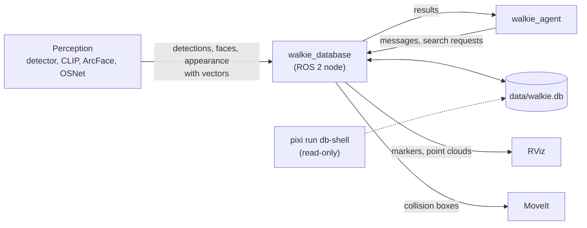
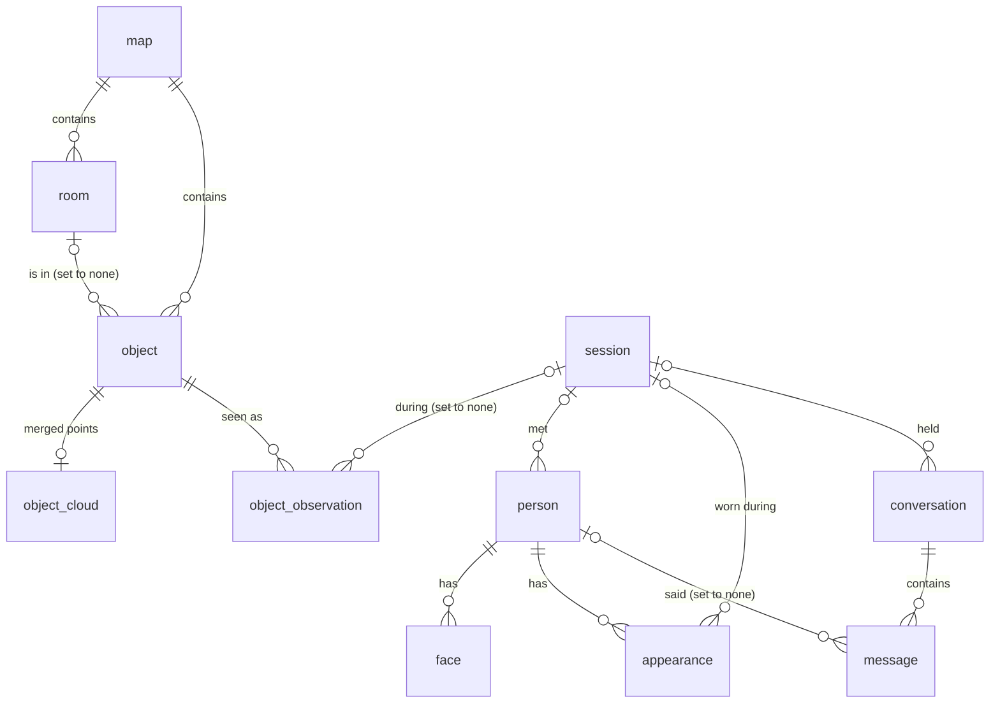

# The Database

Walkie's memory is one SQLite file, `data/walkie.db`, owned by one ROS 2
node, `walkie_database`. Other programs store and search memories through
that node. The tables hold the facts, and SQLite's virtual tables search
them by meaning, by position and by words.

## Summary

- **One file, one writer.** SQLite in WAL mode: one process writes and any
  number read at the same time. The `walkie_database` node is the only
  writer ([ADR-0004](decisions/0004-one-sqlite-file-wal.md),
  [ADR-0005](decisions/0005-one-node-owns-the-database.md)).
- **No models inside.** Perception and the agent compute embeddings and send
  the vectors. The database only stores and searches them
  ([ADR-0006](decisions/0006-callers-send-vectors.md)).
- **One vector table per model.** Vectors from different models cannot be
  compared, so each model gets its own `vec0` table, named after it
  ([ADR-0007](decisions/0007-sqlite-vec-one-table-per-model.md)).
- **Positions belong to a map.** Every coordinate is in metres in the frame
  of one named map. Deleting a map deletes everything measured in it
  ([ADR-0008](decisions/0008-coordinates-in-a-named-map.md)).
- **Plain SQL migrations.** Numbered `.sql` files, tracked by
  `PRAGMA user_version`
  ([ADR-0009](decisions/0009-sql-migrations-user-version.md)).
- **Sessions forget guests.** People met in a session, their appearance and
  their conversations are deleted with the session. Objects and rooms stay
  ([ADR-0010](decisions/0010-session-owns-people-and-conversations.md)).

## The parts

!!! note "Proposed"
    Today the node opens the file and migrates it. The topics and services
    below are the plan, starting with
    [object memory](object-memory.md).



The node is the only program that writes the file. `pixi run db-shell` and
other tools may open it read-only, because WAL mode lets them read while
the node writes.

## The tables

Arrows point from the table that owns a row to the rows it owns. Deleting
the owner deletes them too, except where noted.



| Table                | One row is                                                                | Notes                                                                           |
| -------------------- | ------------------------------------------------------------------------- | ------------------------------------------------------------------------------- |
| `map`                | A map the robot built, for example `arena-2026-10-19`                     | `frame_id` is the TF frame its coordinates are in, usually `map`                 |
| `session`            | One run of a task, for example one Receptionist attempt                   |                                                                                 |
| `room`               | A named room in a map                                                     | `x`, `y`, `yaw`: where the robot stands to be in the room                       |
| `object`             | One real object, merged from all its detections                           | An oriented box: centre, size, and a quaternion. `source` says where it came from: `perception` (merged from detections), `map` (drawn on the map, such as furniture) or `manual` (added by hand) |
| `object_cloud`       | The merged point cloud of one object                                      | Its own table, so reading `object` never loads the points                      |
| `object_observation` | One detection of an object                                                | No points ([ADR-0011](decisions/0011-merge-clouds-in-memory.md))                 |
| `person`             | One person. `session_id` is NULL for people kept across sessions          | `attributes` is JSON, for example `{"drink": "coke"}`                           |
| `face`               | One face sample of a person                                               | A person has several, from different angles                                     |
| `appearance`         | Clothing and body, for when the face is not visible                       | Belongs to one session, because clothes change                                  |
| `conversation`       | Everything said between two resets of the agent                           |                                                                                 |
| `message`            | One thing said, by a human, the robot, a tool or the system               | `person_id` says who, when it is known                                          |

### The search indexes

Each index is a virtual table whose rows have the same id as the row they
index: `object_box` row 10 is the box of `object` row 10. Virtual tables
cannot have foreign keys, so triggers delete index rows with their owner.

| Index                 | Kind      | Indexes      | Answers                                         |
| --------------------- | --------- | ------------ | ----------------------------------------------- |
| `room_shape`          | `geopoly` | `room`       | Which room is this point in?                    |
| `room_clip_vit_b16`   | `vec0`    | `room`       | Which room looks most like "a kitchen"?         |
| `object_box`          | `rtree`   | `object`     | What is near this point?                        |
| `object_clip_vit_b16` | `vec0`    | `object`     | What looks most like "a red mug", in this room? |
| `face_arcface`        | `vec0`    | `face`       | Whose face is this?                             |
| `appearance_osnet`    | `vec0`    | `appearance` | Who is wearing these clothes?                   |
| `message_fts`         | `fts5`    | `message`    | Which messages mention a drink?                 |

All vector tables use cosine distance: 0 means the same direction, 1 means
unrelated, 2 means opposite. sqlite-vec compares the query with every
vector, with no approximate index. On a laptop, that takes about 7 ms for
10,000 vectors of 512 numbers, and about 75 ms for 100,000.

A vector table takes no space until its first row. Then it reserves room
for 1,024 vectors at once: about 2 MB for 512 numbers each. A file with a
few rows in each vector table is therefore already about 8 MB.

## Example queries

The `:name` words are parameters. From Python, pass them as a dictionary:
`conn.execute(sql, {"map": "arena", ...})`. A vector is passed as the bytes
of a float32 NumPy array: `vector.astype(np.float32).tobytes()`. In
`pixi run db-shell`, set a parameter first with `.param set :map 'arena'`.
Vector queries are easier from Python.

=== "Objects by meaning"

    The objects in the kitchen that look most like a text or image query.
    `:query` is a CLIP ViT-B/16 vector made by the caller.

    ```sql
    WITH matches AS (
        SELECT object_id, distance
        FROM object_clip_vit_b16
        WHERE embedding MATCH :query AND k = 5
          AND map_id = :map AND room_id = :room
    )
    SELECT o.id, o.label, o.center_x, o.center_y, o.center_z, matches.distance
    FROM matches JOIN object o ON o.id = matches.object_id
    ORDER BY matches.distance;
    ```

    `k = 5` must be on the `vec0` table itself, so the search stays in its
    own `WITH` part and the join comes after. The `map_id` and `room_id`
    filters are applied during the search, so you still get 5 results when
    the kitchen has 5 objects.

=== "Recognize a face"

    The person whose face samples are closest to a new face.

    ```sql
    WITH matches AS (
        SELECT person_id, distance
        FROM face_arcface
        WHERE embedding MATCH :face AND k = 5
    )
    SELECT p.id, p.name, min(matches.distance) AS distance
    FROM matches JOIN person p ON p.id = matches.person_id
    GROUP BY p.id
    ORDER BY distance
    LIMIT 1;
    ```

    A person has several face samples, so this takes the 5 nearest faces and
    keeps each person's best one. The database always returns someone: the
    caller decides above which distance the face is a stranger. That limit
    depends on the model and the cameras, so measure it on real faces.

=== "Messages by words"

    ```sql
    SELECT m.ts, m.role, m.text
    FROM message_fts JOIN message m ON m.id = message_fts.rowid
    WHERE message_fts MATCH :words
    ORDER BY message_fts.rank
    LIMIT 5;
    ```

    `:words` uses the [FTS5 query syntax](https://www.sqlite.org/fts5.html#full_text_query_syntax),
    for example `drink`, `coke OR pepsi`, or `"living room"`. The porter
    tokenizer matches word forms, so `drinks` finds "a drink".

=== "Which room is this point in"

    ```sql
    SELECT r.id, r.name
    FROM room_shape s JOIN room r ON r.id = s.rowid
    WHERE geopoly_contains_point(s._shape, :x, :y)
      AND r.map_id = :map
    ORDER BY geopoly_contains_point(s._shape, :x, :y) DESC
    LIMIT 1;
    ```

    `geopoly_contains_point` returns 2 for a point inside the outline, 1 for
    a point on its edge and 0 outside. A point on a wall between two rooms
    is on both edges. Sorting puts a room the point is truly inside first.

=== "What is near this point"

    The objects whose box comes within `:r` metres of a point, on every
    axis.

    ```sql
    SELECT o.id, o.label
    FROM object_box b JOIN object o ON o.id = b.id
    WHERE b.max_x >= :x - :r AND b.min_x <= :x + :r
      AND b.max_y >= :y - :r AND b.min_y <= :y + :r
      AND b.max_z >= :z - :r AND b.min_z <= :z + :r
      AND o.map_id = :map;
    ```

    The R*Tree finds the boxes without reading every object. `object_box`
    stores the box aligned with the map's axes around the object's oriented
    box, so it is slightly bigger than the object.

=== "Facts about a person"

    ```sql
    SELECT name, json_extract(attributes, '$.drink') AS drink
    FROM person
    WHERE json_extract(attributes, '$.drink') IS NOT NULL;
    ```

    Facts that every person has, such as `name`, are columns. Facts that only
    some tasks need go into `attributes`, so a new kind of fact needs no
    migration.

## What lives where

| What                              | Where                                       | In Git |
| --------------------------------- | ------------------------------------------- | ------ |
| The memory                        | `data/walkie.db`, plus `-wal` and `-shm` files next to it while the node runs | No |
| Sample data, for learning and demos | `data/demo.db`, written by `pixi run db-seed` ([setup step 6](../setup/06-sample-data-and-browser.md)) | No |
| Images of detections and faces    | Files on disk. The database keeps their path in `crop_path` | No |
| Raw detections, for re-tuning     | A `ros2 bag` of the detection topic ([ADR-0011](decisions/0011-merge-clouds-in-memory.md)) | No |
| The schema                        | `src/walkie_database/migrations/`           | Yes    |
| Connection settings               | `src/walkie_database/db.py`                 | Yes    |

!!! tip "Back up with `VACUUM INTO`, not `cp`"
    While the node runs, recent changes may still be in `walkie.db-wal`, so
    copying only `walkie.db` can miss them or catch a half-written page.
    This writes a complete, consistent copy, even while the node runs:

    ```bash
    pixi run sqlite3 -readonly data/walkie.db "VACUUM INTO 'data/backup.db'"
    ```

## Decisions

??? success "ADR-0001: Record architecture decisions · Accepted"

    --8<-- "architecture/decisions/0001-record-architecture-decisions.md:body"

??? success "ADR-0002: Install ROS 2 and Python packages with Pixi and RoboStack · Accepted"

    --8<-- "architecture/decisions/0002-pixi-and-robostack.md:body"

??? success "ADR-0003: Document the project with MkDocs Material · Accepted"

    --8<-- "architecture/decisions/0003-mkdocs-material.md:body"

??? success "ADR-0004: Keep all memory in one SQLite file in WAL mode · Accepted"

    --8<-- "architecture/decisions/0004-one-sqlite-file-wal.md:body"

??? success "ADR-0005: One ROS 2 node owns and writes the database · Accepted"

    --8<-- "architecture/decisions/0005-one-node-owns-the-database.md:body"

??? success "ADR-0006: Callers send vectors, the database runs no models · Accepted"

    --8<-- "architecture/decisions/0006-callers-send-vectors.md:body"

??? note "ADR-0007: Search vectors with sqlite-vec, one table per model · Proposed"

    --8<-- "architecture/decisions/0007-sqlite-vec-one-table-per-model.md:body"

??? note "ADR-0008: Store coordinates in the frame of a named map · Proposed"

    --8<-- "architecture/decisions/0008-coordinates-in-a-named-map.md:body"

??? note "ADR-0009: Migrate the schema with numbered SQL files and user_version · Proposed"

    --8<-- "architecture/decisions/0009-sql-migrations-user-version.md:body"

??? note "ADR-0010: A session owns the people and conversations in it · Proposed"

    --8<-- "architecture/decisions/0010-session-owns-people-and-conversations.md:body"

The object memory decisions, ADR-0011 to ADR-0013, are on the
[Object Memory](object-memory.md#decisions) page.
