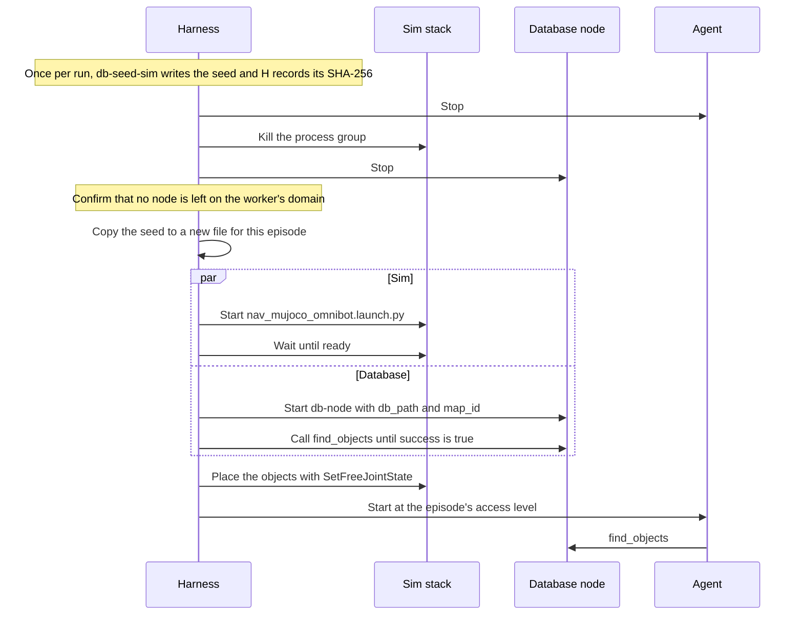

# Sim Harvest Support (Proposed)

!!! note "Status: Proposed"
    Nothing on this page is built or accepted. It records what
    walkie-agent-ros's proposed sim harvest and self-evolving agent need
    from this repository, and the proposed
    [ADR-0016](decisions/0016-sim-snapshot-per-episode.md).

walkie-agent-ros plans to turn its agent into a
[self-evolving agent](https://eic-robocup-2026.github.io/walkie-agent-ros/architecture/self-evolving-agent/).
The agent gets small typed tools, called atomics, which it chains into
bundles. It also writes tools of its own: drafts in simulation, and
session-only tools at Competition when the run profile allows. To learn
which tools are worth keeping, a
[sim harvest](https://eic-robocup-2026.github.io/walkie-agent-ros/architecture/harvest/)
runs the agent through many short episodes in walkie-ros's MuJoCo
simulation, in parallel workers, and checks each result against the
scenario.

When the agent looks for an object, it asks this database first, through
its `find_objects` tool. So every worker needs a database node, and every
episode needs the same memory to start from. The node itself needs no
change for this. What is new is a seed for the sim world and a rule for
restoring it.

walkie-agent-ros calls the harvest's first version v0, and this page plans
for it. Object memory is not built yet, so in v0 nothing writes to the
database during an episode.

## Summary

- **The node does not change.** The harness runs today's node with its
  `db_path` and `map_id` parameters, and `find_objects` works in the sim as
  it does on the robot.
- **New: a sim seed per world.** `pixi run db-seed-sim` builds a database
  with the map `chula_pat14_6` and its two rooms, from walkie-agent-ros's
  planned locations file and the world's own file. It holds no objects and
  no personal data
  ([ADR-0016](decisions/0016-sim-snapshot-per-episode.md)).
- **Restored for every episode, with the node stopped.** Each episode gets
  a new copy of the seed and a newly started node, so no episode or worker
  sees another's memory
  ([ADR-0016](decisions/0016-sim-snapshot-per-episode.md)).
- **Generated tools only read memory.** At every access level, they reach
  memory only through `find_objects`. This holds because the node has no
  service that writes. The first such service must go on walkie-agent-ros's
  never-list in the same change.
- **Later, each with its own decision:** a rooms query, detections from
  oracle perception or walkie-vision, and `classes` read as negative
  evidence.

## What the harvest needs

| Need | Change in this repository | How |
| ---- | ------------------------- | --- |
| Answer `find_objects` in the sim | None | The harness runs `pixi run db-node --ros-args -p db_path:=<file> -p map_id:=chula_pat14_6`. |
| A map that the search can find | New: the sim seed | `FindObjects` fails when its map is not in the `map` table ([The node's interface](database.md#the-nodes-interface)). `db-seed` writes only `data/demo.db`, with the map `demo-house`. |
| Separate memory for each worker | None | The node opens the file it is given. It joins the domain of the shell that starts it: `pixi.toml` here sets `RMW_IMPLEMENTATION` but not `ROS_DOMAIN_ID`. |
| The same start for every episode | None in the node. New: a step in walkie-agent-ros's harness | Copy the seed and restart the node ([Restore it every episode](#restore-it-every-episode)). |
| The service name the agent's policy allows | None | The node serves `/walkie_database/find_objects`, the name on the Standard level's allow-list. The harness must not remap or namespace it. |
| Rooms by name | Later: a new interface and ADR | Until then, the agent answers room questions with its `list_locations` tool ([A rooms query](#a-rooms-query)). |
| Memory filled from what the robot sees | Later: object memory | [Object Memory](object-memory.md), Proposed ([Detections](#detections-from-oracle-perception-or-walkie-vision)). |

## The sim seed

walkie-agent-ros's harvest derives the seed from its planned locations file
for the world, `config/locations.chula_pat14_6.toml`. This page also reads
the world's own file, `30_16102026_ChulaPat14_6_world.toml` (called
`world.toml` below), because only it has the room outlines that
`room_shape` needs. The world file sits in walkie-ros, under
`simulation/gazebo/worlds/chula_pat14_6/source/`, on a branch that is not
merged to main. It moved there from walkie-worlds, which now keeps only
local history and has no remote. The migration is in progress, so the path
may change.

`pixi run db-seed-sim` (new) runs `walkie_database.seed_sim` (new). It
takes the locations file, `world.toml`, the map id and the output path as
arguments, and writes these rows:

| Table | Rows | Source |
| ----- | ---- | ------ |
| `map` | One: `id` `chula_pat14_6`, `frame_id` `map`, a fixed `created_at`, and a `description` that names the source files | The map id argument |
| `room` | One per room in `world.toml`: today `living_room` and `kitchen_room`, each with `name`, `description`, `x`, `y` and `yaw` | Which names are rooms: `world.toml`. Stand pose and description: the location of the same name in the locations file |
| `room_shape` | The outline of each room, written through `geopoly_ccw()` with the first point repeated at the end | The room's `polygon` in `world.toml` |
| Every other table | None | — |

The stand pose comes from the locations file because that is where the
agent's `navigate_to_location` tool sends the robot. So "the kitchen" means
the same spot to the agent and to memory. `world.toml` decides which names
are rooms, because the locations file also lists places that are not rooms.
The `created_at` is fixed so that two builds from the same files hold the
same rows.

Today's values in `world.toml`, from the 16 October 2026 capture:

| Room | Room pose in `world.toml` (x, y, yaw) | Outline |
| ---- | ------------------------------------- | ------- |
| `living_room` | 1.7629, −1.483, 0.0 | Rectangle, x 0.8717 to 3.5722, y −3.3632 to 0.3908 |
| `kitchen_room` | 1.3176, −4.0123, −1.5605 | Rectangle, x −0.3617 to 3.5458, y −7.6095 to −3.3951 |

Both poses lie inside their outlines. The planned locations file is
expected to copy them, because walkie-agent-ros builds it from `world.toml`
([open question 3](#open-questions)). The builder checks the poses it
actually uses, from the locations file. It writes nothing when a room in
`world.toml` has no location of the same name, or when that location's
stand pose is outside the room's outline. A wrong seed then stops the run
before the first episode, instead of failing one episode at a time.

### Coordinates

In this world, the map frame is the MuJoCo world frame. The harvest
starts the robot at the origin, and the sim launch publishes `map` to
`odom` as a fixed identity, with no AMCL. So the coordinates in
`world.toml` are already map coordinates, and the seed copies them
unchanged ([ADR-0008](decisions/0008-coordinates-in-a-named-map.md)). If
the world's map is captured again, the seed gets a new map id.

### Only the map row matters in v0

`find_objects` needs only the `map` row. The rooms are written now
because:

- `RememberedObject.room` names the room of each object, once objects
  arrive.
- A rooms query would answer from these rows.
- Objects seeded from a scenario, if they come, would get their `room` from
  these rows, so `find_objects` can say where they are.

If `world.toml` is not stable when the harvest is built, because its
migration is still under way, the builder can start with the map row
alone. Adding the rooms later changes neither the node nor the harness.

### What stays out

- **Places and the door.** The `world.toml` locations (`shelf`, `tv`,
  `sofa`, `bar` and `table`) and the door `entrance_door` are not rooms.
  Furniture could become `object` rows with `source` `'map'`, but
  `world.toml` gives each place a single point, and an object needs a
  centre and a size.
- **Objects.** Each episode's scenario places the task objects (two each of
  apple, mug, chips_bag, pringles_can, red_plate and water_bottle). If the
  seed held them, `find_objects` would answer from the scenario's truth
  before the robot looked, and "memory first" would look perfect.
- **People, faces and conversations.** `person`, `face`, `appearance`,
  `session`, `conversation` and `message` stay empty. In the sim, people
  come only from oracle perception, because the world has no person
  bodies.
- **Vectors.** Callers send vectors and this repository runs no models
  ([ADR-0006](decisions/0006-callers-send-vectors.md)). With no objects and
  no room embeddings, the vector tables stay empty.

### Why `VACUUM INTO`

The builder fills a database in memory (`:memory:`), migrated to the
newest schema, and then writes it to the output path with `VACUUM INTO`.
This was checked on 2026-10-22 with this repository's environment and
modules:

- The output keeps `user_version`, so the node finds it at the newest
  schema and migrates nothing.
- The node's `connect()` opens it in WAL mode, and `geopoly_contains_point`
  finds the room from its stand pose.
- No `-wal` file is left once the connection closes.
- A second `VACUUM INTO` to the same path fails with `output file already
  exists`. So the builder can never overwrite a file, `data/walkie.db`
  included.
- The file is about 330 KB with the schema, one map and one room.

## Restore it every episode

walkie-agent-ros's harvest page defines the relaunch steps
([Relaunch, per episode](https://eic-robocup-2026.github.io/walkie-agent-ros/architecture/harvest/#relaunch-per-episode)).
This section adds only the database's steps. The harvest relaunches the
sim stack for every episode, on the worker's own domain and router, which
stay up between episodes. The database fits into that relaunch like this:

| Step | What the harness does | Why |
| ---- | --------------------- | --- |
| 1 | Stops the database node together with the agent and the sim. A kill is fine. | The relaunch checks that no node is left on the worker's domain. A node left running would also hold the file open, and, once object memory exists, live objects in its RAM ([ADR-0011](decisions/0011-merge-clouds-in-memory.md)). The episode's file is never reused, so a kill that leaves a `-wal` file next to it does no harm. |
| 2 | Copies the seed to a new file in the episode's folder, under the worker's folder `$WALKIE_TOOLS_HOME/harvest/<run-id>/w<i>/`. The exact layout is walkie-agent-ros's. | A new path means nothing is ever restored into a file a node has open. A `-wal` file left at a reused path by a killed node could be applied to the new copy. |
| 3 | Runs `pixi run db-node --ros-args -p db_path:=<file> -p map_id:=chula_pat14_6`, with an absolute path, the worker's `ROS_DOMAIN_ID` and Zenoh settings, and no remapping. | The agent's tool sends no map id, so the node's `map_id` parameter picks the map ([ADR-0015](decisions/0015-messages-in-this-repository.md)). The node reads parameters only after `--ros-args`. Without it, the node opens its default, `data/walkie.db`. |
| 4 | Calls `/walkie_database/find_objects` with an empty label until it answers with `success` true, with a timeout. In v0 it answers `Found 0 objects.` | See below. |

The probe in step 4 proves three things before the agent starts:

- **The node is up, on the right domain.** The agent's `find_objects` tool
  waits 2 s for the service and 5 s for an answer. A slow node start would
  otherwise show up in the trace as a failed memory lookup, and be blamed on
  the agent.
- **It opened the right file.** `connect()` creates a file that does not
  exist. A wrong `db_path` gives an empty database without the map, and the
  probe fails with `Unknown map 'chula_pat14_6'`.
- **Both sides agree on the message definition.** Under rmw_zenoh_cpp
  0.2.11, a client built from another `FindObjects` definition still finds
  the service, but is never answered
  ([ADR-0015](decisions/0015-messages-in-this-repository.md)). The probe's
  timeout catches that.

The node start runs while the sim starts, so it should add little to an
episode. It is not measured.

A plain copy is safe in step 2. The seed is a closed file that no node has
ever opened, so it has no `-wal` file. The
[backup tip](database.md#what-lives-where) recommends `VACUUM INTO`
because a live database may still have changes in its `-wal` file. That
does not apply here.

## Isolation per worker

walkie-agent-ros's harvest page defines each worker's isolation
([Isolation](https://eic-robocup-2026.github.io/walkie-agent-ros/architecture/harvest/#isolation)).
Each worker runs on its own ROS domain, `77 + i`, with its own Zenoh router
on a localhost-only port. This section adds only the database's pieces:

| Piece | Scope | Set by |
| ----- | ----- | ------ |
| ROS domain | The worker's | The harness's environment. `pixi.toml` here does not set `ROS_DOMAIN_ID`, so the caller's value reaches the node. |
| Zenoh router | The worker's, localhost only | The harness gives the node the same Zenoh session settings as the worker's agent, for example rmw_zenoh's `ZENOH_CONFIG_OVERRIDE` or `ZENOH_SESSION_CONFIG_URI`. `pixi.toml` here sets `RMW_IMPLEMENTATION` to `rmw_zenoh_cpp` ([ADR-0014](decisions/0014-zenoh-default-middleware.md)). |
| Database node | One per worker, started for every episode | The harness |
| Database file | One per episode, in the worker's folder | The harness |
| Seed | One per run, only ever copied | `db-seed-sim`, once per run |

So a worker never opens `data/walkie.db` and never shares a file with
another worker. Its node stays apart from the robot's domain, 23, and from
a sim that someone runs by hand on another domain and router.

## How the self-evolving agent reaches memory

walkie-agent-ros runs generated tools at one of three
[access levels](https://eic-robocup-2026.github.io/walkie-agent-ros/architecture/access-levels/).
Only Competition may run on the real robot. Standard and Unrestricted run
only on a marked sim host.

| Level | How a generated tool reaches memory | Can it write? |
| ----- | ----------------------------------- | ------------- |
| Competition | Only through the `find_objects` atomic (`ctx.tools.find_objects`). It has no direct ROS access. | No |
| Standard | The atomic, or a direct call to `/walkie_database/find_objects`, which is on the read-only call allow-list. It cannot publish. | No |
| Unrestricted | The atomic, or a call to any service that is not on the never-list. It may publish only if harvest evidence calls for it (walkie-agent-ros's phase 4b), and then only base commands (`Twist`, `TwistStamped`). | Not today, because the node has no service that writes |

So "generated tools never write to the database" holds today only because
of what the node offers. The node's parameters are covered already:
`*/set_parameters` and `*/set_parameters_atomically` are on every level's
never-list, so generated code cannot change `map_id`, which the node reads
on every request. The never-list in walkie-agent-ros's planned
`config/access_levels.toml` names nothing else from this node. When the
node gets its first service that writes or deletes, such as a session
service ([ADR-0010](decisions/0010-session-owns-people-and-conversations.md))
or a reset, the same change must add it to that never-list. Otherwise
Unrestricted code could call it. The node subscribes to no topic today.
Topics it may subscribe to later, such as detections, stay covered while
Unrestricted publishing is limited to base commands.

A future read-only service, such as a rooms query, works the other way
round. Standard reaches it only once the allow-list names it, and
Competition only through a new atomic.

## Later

These are not needed for the harvest's first version. Each needs its own
decision when it comes.

### A rooms query

The node serves only `FindObjects`. Until it serves rooms, the agent
answers room questions with its existing `list_locations` tool.
walkie-agent-ros has no separate rooms tool.

A rooms service would add a `.srv` to `walkie_database_msgs`, with its own
ADR ([ADR-0015](decisions/0015-messages-in-this-repository.md)). For
example, it could return a map's rooms with their descriptions and stand
poses, or the room that holds a point. A new type means that walkie-agent-ros
bumps its pin and rebuilds the package. The sim seed already writes the
rows it would answer with, so the sim and the robot would answer the same
way.

### Detections from oracle perception or walkie-vision

[Object Memory](object-memory.md) (Proposed) merges detections into
objects. Each frame's detections arrive together, each with its own points
and embedding ([ADR-0012](decisions/0012-per-detection-clouds-any-frame.md)).
Two producers are planned:

- **On the robot, walkie-vision.** It will publish
  `walkie_vision_msgs/ObjectDetectionArray` on `/walkie_vision/objects`, a
  proposed name. Its nodes are not built yet. Object memory sketches its
  own message on `/walkie_database/detections`.
  [ADR-0015](decisions/0015-messages-in-this-repository.md) keeps a received
  message in its producer's package, which points to walkie-vision's type.
  The topic name is still open, here and in walkie-vision's
  `docs/architecture/vision.md`.
- **In the sim, oracle perception.** walkie-agent-ros plans an
  `oracle_perception` node that publishes detections from the scenario,
  with noise and dropout. It stands in for walkie-vision with the same
  message types. To be merged, its detections need points in a TF frame,
  stamped, and embeddings from the model the node indexes. Label-clustered
  random vectors, as in `seed.py`, would let merging by meaning work, but
  would say nothing about real embedding quality (an idea, not checked).

Three things must be settled before ingestion runs in the sim:

- **The clock.** The node looks up TF at each detection's stamp. In the sim
  those stamps are sim time, so the node must run with `use_sim_time`. The
  schema stores Unix seconds, so `first_seen` and `last_seen` would then
  hold sim seconds, unless the node stores wall time.
- **Drift.** In harvest v0, `map` → `odom` is a static identity with no
  AMCL, and `odom` is open-loop odometry. The robot's pose in `map` drifts
  within an episode, and the drift in this world is unmeasured. Detections
  transformed through TF would be stored at drifted positions, and could
  land in the wrong room, while the seed's outlines stay true.
  walkie-agent-ros plans to ask walkie-ros for ground-truth localization in
  sim if more than about 10% of first-run episodes fail on localization
  ([Localization](https://eic-robocup-2026.github.io/walkie-agent-ros/architecture/harvest/#localization)).
  Sim ingestion should wait for that, or for a measurement that shows the
  drift is small.
- **The restore starts to matter.** Today nothing writes during an episode.
  With ingestion, every episode writes, and only the per-episode copy keeps
  one episode's objects out of the next. ADR-0016 already covers this.

Later still, the agent's planned `localize_object` atomic could ask memory
for an object's position instead of asking walkie-ros perception.

### `classes` as negative evidence

`ObjectDetectionArray` has a `classes` field: the names the detector looked
for in that image. Its message comment says that a class in `classes`
without a detection tells this database that no such object was visible in
that image. Object memory does not use this yet: its cleanup drops objects
by count and age. Negative evidence would let memory forget an object that
was moved, within the camera's view. That is not designed.

It only works if `classes` lists exactly what was looked for in each image.
Re-prompting walkie-vision's streaming detector with an agent's noun would
break that. It would change `classes` on the topic, and the detector's
other names would read as "not seen" when they were only "not looked for".
walkie-vision's proposed ADR-0009 (walkie-vision
`docs/architecture/decisions/0009-on-demand-detect-objects.md`) avoids this
with an on-demand `DetectObjects` service. It runs on a YOLOE instance of
its own, and answers only the caller. Nothing it finds is published on
`/walkie_vision/objects`.

For this repository that means:

- Memory reads the streaming topic only. On-demand results never reach it.
- Feeding on-demand results in later needs its own decision, and a write
  path that does not exist: the caller would have to pass them on to this
  node. Their `classes` are honest for their image. But generated tools may
  call `detect_objects` at every level, Competition included, so they would
  then write to memory indirectly. Today they only read it
  ([How the self-evolving agent reaches memory](#how-the-self-evolving-agent-reaches-memory)).
- In the sim, oracle perception must fill `classes` the same way. Its
  dropout drops a detection while its class stays listed. That reads as
  "not seen", the same false negative that a real detector's miss gives.

## Privacy

walkie-agent-ros's threat model lists this database among its bystander
privacy assets, together with the camera, detections, transcripts and the
robot's location. On the robot it is designed to hold people, faces,
appearances and conversations. Guests belong to a session and are deleted
with it, while permanent people are kept
([ADR-0010](decisions/0010-session-owns-people-and-conversations.md)).
Today the node has no service or topic that writes them. The harvest keeps
all of that out:

- **The seed is synthetic.** It is built only from config and world files,
  and its people, face, conversation and message tables are empty. A test
  checks this.
- **No real memory enters the harvest.** The harness never copies
  `data/walkie.db` or a backup of it, and keeps every `db_path` inside the
  run folder. The builder cannot overwrite an existing file. Harvest v1
  plans to replay real booth and competition requests, reduced to intents
  with personal data stripped. Those are task text for the agent, not
  database contents.
- **Episodes are isolated.** Each episode's memory is its own file, and
  workers share nothing, so no memory crosses episodes or workers.
- **The files share the run's lifetime.** The per-episode copies stay in
  the run folder with the traces, and share its lifetime, which
  walkie-agent-ros sets. In the first version they hold only the seed.
- **What generated tools see is objects only.** `find_objects` returns
  objects, never people. At Competition, a tool that uses the web may
  otherwise only speak, play sounds, tell the time or date and wait, so it
  cannot also read memory. The agent's coder never sees person records.
- **The task agent is the one exception.** It holds memory and may search
  the web in the same turn. Its search query is written by a separate
  model call from the visitor's words only, so memory never reaches a
  query (see walkie-agent-ros's
  [Competition Mode](https://eic-robocup-2026.github.io/walkie-agent-ros/architecture/competition/#web-search)).

## Testing

Proposed tests in this repository:

| Test | What it checks |
| ---- | -------------- |
| `tests/test_seed_sim.py` (new) | The `map` row. One `room` row per room in `world.toml`, with the location's pose and description. Each stand pose inside its outline, with `geopoly_contains_point`. No rows in `object`, `person`, `face`, `appearance`, `session`, `conversation` or `message`. The newest schema version. That an existing output path is refused. That nothing is written when a room has no location of the same name. |
| `tests/test_node.py` (one new test) | A node opened on a sim seed, with `map_id` set, answers `find_objects` with `success` true and no objects. |

The tests write small locations and world files into `tmp_path`, so CI
needs neither walkie-ros nor walkie-agent-ros. walkie-agent-ros's own
harvest checks run the real files, through the probe in step 4.

## What lives where

| Piece | Repository | Location |
| ----- | ---------- | -------- |
| Sim seed builder (new) | walkie-database | `src/walkie_database/seed_sim.py` |
| Its task (new) | walkie-database | `db-seed-sim` in `pixi.toml` |
| Its tests (new) | walkie-database | `tests/test_seed_sim.py`, and one test in `tests/test_node.py` |
| The database node | walkie-database | `src/walkie_database/node.py`, unchanged |
| Locations file for the world (planned) | walkie-agent-ros | `config/locations.chula_pat14_6.toml` |
| Room names and outlines | walkie-ros | `simulation/gazebo/worlds/chula_pat14_6/source/30_16102026_ChulaPat14_6_world.toml`, on a branch not yet merged to main. Moved from walkie-worlds, so the path may change. |
| Sim launch | walkie-ros | `nav_mujoco_omnibot.launch.py`. The world tools are on a branch not yet merged to main. |
| Harness steps: build, copy, start, probe (planned) | walkie-agent-ros | `src/walkie_agent/toolsmith/harvest/` |
| Oracle perception (planned) | walkie-agent-ros | `src/walkie_agent/sim/oracle_perception.py` |
| Access-level policy: allow-list and never-list (planned) | walkie-agent-ros | `config/access_levels.toml` |
| The seed and per-episode files | walkie-agent-ros's run folder | `$WALKIE_TOOLS_HOME/harvest/<run-id>/`, with `w<i>/` per worker. Not in Git. |
| On-demand `DetectObjects` (proposed) | walkie-vision | walkie-vision ADR-0009 (proposed), `docs/architecture/decisions/0009-on-demand-detect-objects.md` |

## Open questions

1. **Remembered objects at the start.** A scenario could seed memory, some
   of it stale on purpose, to test "memory first". The builder would then
   take scenario objects too. Recommended: start empty in v0, and add
   scenario objects only when harvest scenarios test memory. Blocks:
   harvest scenarios that test memory.
2. **Furniture as map objects.** `source` `'map'` exists for furniture
   drawn on the map, but `world.toml` gives each place a single point, and
   an object needs a size. Recommended: leave furniture out until a source
   gives each piece a centre and a size. Blocks: answering "where is the
   shelf" from memory. Nothing in v0.
3. **Room names and poses in the locations file.** The file is planned.
   The builder assumes it names the rooms as `world.toml` does
   (`living_room`, `kitchen_room`). Recommended: build the locations file
   from `world.toml` with the same names and poses, as walkie-agent-ros
   plans. Blocks: the room rows, not the map row.
4. **Which checkout runs the node.** walkie-agent-ros's pinned clone in
   `ros2_ws/src/walkie-database` builds only the message package. Whether
   its own pixi environment can be installed and run in place is not
   checked. Recommended: a separate checkout at the pinned commit, with the
   harness checking that its commit matches the pin, since such a checkout
   can drift from it. Blocks: the harness's start step.
5. **Node start time.** Not measured. Recommended: measure it in the
   harvest's smoke run, next to the sim's readiness wait. Blocks: the
   harness's time budget per episode.
6. **The rooms query.** Its interface and ADR. Recommended: not before the
   harvest needs it; `list_locations` answers room questions meanwhile.
   Blocks: answering room questions from memory.
7. **Ingestion in the sim.** The message type and topic, `use_sim_time` and
   the clock of `last_seen`, oracle embeddings, and drift. Recommended:
   build ingestion on the robot first, and run it in the sim only with
   ground-truth localization or a drift measurement that shows it is small.
   Blocks: object memory in the harvest.

## Decisions

Click a decision to expand it. All of these are proposed. See
[Architecture](index.md) for how decisions work.

??? note "ADR-0016: Restore a seeded sim database for every harvest episode · Proposed"

    --8<-- "architecture/decisions/0016-sim-snapshot-per-episode.md:body"
