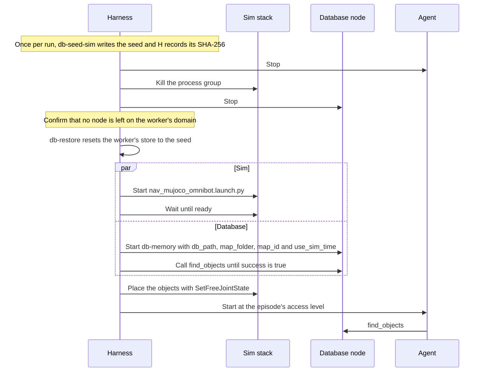

# Sim Harvest Support (Proposed)

!!! note "Status: Proposed"
    This page records what walkie-agent-ros's proposed sim harvest and
    self-evolving agent need from this repository, and the proposed
    [ADR-0016](decisions/0016-sim-snapshot-per-episode.md). This repository's side
    is built: the seed tools, the restore tool and the map gate
    ([Seeds, restore and the map gate](database.md#seeds-restore-and-the-map-gate)).
    The harness that calls them is not, and no real world has been seeded yet.

walkie-agent-ros plans to turn its agent into a
[self-evolving agent](https://eic-robocup-2026.github.io/walkie-agent-ros/architecture/self-evolving-agent/).
The agent gets small typed tools, called atomics, which it chains into
bundles. It also writes tools of its own: drafts in simulation, and
session-only tools at Competition when the run profile allows. To learn
which tools are worth keeping, a
[sim harvest](https://eic-robocup-2026.github.io/walkie-agent-ros/architecture/harvest/)
runs the agent through many short episodes in walkie-ros's MuJoCo
simulation, in parallel workers, and checks each result against the
scenario.

When the agent looks for an object, it asks this database first, through
its `find_objects` tool. So every worker needs a database node, and every
episode needs the same memory to start from. The harness gets that from a seed
for the sim world, the restore tool, and the node's memory mode.

walkie-agent-ros calls the harvest's first version v0, and this page plans
for it. Object memory is not built yet, and in the sim the agent keeps
people in its own in-memory people memory. So in v0 nothing writes to the
database during an episode.

## Summary

- **The node runs in memory mode.** The harness runs `pixi run db-memory` with
  explicit `db_path`, `map_folder` and `map_id` parameters. The node checks the
  store against the map, and refuses to start on the wrong one
  ([ADR-0023](decisions/0023-offline-restore-and-map-gate.md)).
- **A sim seed per world.** `pixi run db-seed-sim` builds a store with one map and
  its two rooms, from the world's authoring file, a locations file and a room-names
  file. The map's ID is computed from its digest. It is not `chula_pat14_6`. The seed
  holds no live objects and no personal data
  ([ADR-0016](decisions/0016-sim-snapshot-per-episode.md)).
- **Restored for every episode, with the node stopped.** `pixi run db-restore` resets
  the worker's one store to the seed, and a newly started node opens it. No episode
  or worker sees another's memory, and no ID repeats within a worker
  ([ADR-0016](decisions/0016-sim-snapshot-per-episode.md)).
- **Generated tools only read memory.** At every access level, they reach
  memory only through `find_objects`. This holds while `start_session`,
  `end_session`, `remember_person`, `match_faces` and `match_appearances`
  are on walkie-agent-ros's never-list at every level. Only the agent's
  planned people memory client is to call them. That never-list does not
  exist yet, so
  Unrestricted harvest runs must not start until it names them
  ([How the self-evolving agent reaches memory](#how-the-self-evolving-agent-reaches-memory)).
- **Later:** serving a rooms query, detections from oracle perception or
  walkie-vision, and `classes` read as negative evidence.

## What the harvest needs

| Need | Change in this repository | How |
| ---- | ------------------------- | --- |
| Answer `find_objects` in the sim | Built: memory mode | The harness runs `pixi run db-memory -p db_path:=<file> -p map_folder:=<folder> -p map_id:=<id> -p use_sim_time:=true`. |
| A map that the search can find | Built: `db-seed-sim` | `FindObjects` fails when its map is not in the `map` table ([The node's interface](database.md#the-nodes-interface)). `db-seed` is the demo tool: it writes only `data/demo.db`, with the map `demo-house`, and memory mode refuses that file. |
| Separate memory for each worker | Built: the store's lock | The node opens the file it is given, and a second holder is refused. It joins the domain of the shell that starts it: `pixi.toml` here sets `RMW_IMPLEMENTATION` but not `ROS_DOMAIN_ID`. |
| The same start for every episode | Built: `db-restore`. New: a step in walkie-agent-ros's harness | Restore the worker's store and restart the node ([Restore it every episode](#restore-it-every-episode)). |
| The service name the agent's policy allows | None | The node serves `/walkie_database/find_objects`, the name on the Standard level's allow-list. The harness must not remap or namespace it. |
| Rooms by name | Later: the node serves the existing types | Until then, the agent answers room questions with its `list_locations` tool ([A rooms query](#a-rooms-query)). |
| Memory filled from what the robot sees | Later: object memory | [Object Memory](object-memory.md), Proposed ([Detections](#detections-from-oracle-perception-or-walkie-vision)). |

## The sim seed

The seed comes from three files and one map folder:

| Input | Argument | What it supplies |
| ----- | -------- | ---------------- |
| The map | `--map-folder`, with `--arena` and `--date` | The digest, and the map ID `<arena>-<date>-<first 8 of the digest>`, computed with [the helper](database.md#map-identity) |
| The world's authoring file | `--world-source` | The room keys and their outlines |
| The room names | `--room-names` | Each room key's display name: `living_room` to `living room`, and `kitchen_room` to `kitchen room` |
| The locations | `--locations` | Each room's stand pose and description, under exactly its display name, such as `[locations."living room"]` |

The authoring file for this world is
`simulation/mujoco/worlds/chula_pat14_6/authoring/source/30_16102026_ChulaPat14_6_world.toml`
in walkie-ros, on the branch `feat/chula-pat14-6-simulation`, which is not merged to
main. This page calls it `world.toml`. Do not confuse it with
`simulation/mujoco/worlds/chula_pat14_6/world.toml`, which is a launch manifest. It
moved there from walkie-worlds, so the path may change.

walkie-agent-ros's `config/locations.sim.toml` describes a blank-map demo, and its
names are not this world's display names, so the builder refuses it. This world
needs its own locations file, which does not exist yet.

`pixi run db-seed-sim` runs `walkie_database.seed_sim`. It takes all of those, plus
`--clock-kind ros_sim` and `--output`, and optionally `--anchors`, `--catalogue`,
`--previous-seed` and `--replace`. It prints the normalized rooms as JSON, and passes
them to the same code as `db-seed-store`. It writes these rows:

| Table | Rows | Source |
| ----- | ---- | ------ |
| `map` | One: the computed `id`, `frame_id` `map`, `map_hash`, `baseline_rev`, `clock_kind` `ros_sim`, a `created_at` from `--date`, and a `description` | The map folder and the arguments |
| `store_meta` | One, with `refresh_anchors_pending` set | The same |
| `room` | One per room in `world.toml`: today `living_room` and `kitchen_room`, each with `name`, `description`, `x`, `y` and `yaw` | Keys: `world.toml`. Name: the room-names file. Stand pose and description: the locations file |
| `room_shape` | The outline of each room | The room's `polygon` in `world.toml` |
| `object`, `surface` and `object_catalogue` | None, unless a reviewed `--anchors` or `--catalogue` file supplies them | [The input files](database.md#the-input-files) |
| Every other table | None | — |

The stand pose comes from the locations file because that is where the
agent's `navigate_to_location` tool sends the robot. So "the kitchen" means
the same spot to the agent and to memory. `world.toml` decides which names
are rooms, because the locations file also lists places that are not rooms.
The `created_at` comes from `--date` so that two builds from the same files hold
the same rows.

Today's values in `world.toml`, from the 16 October 2026 capture:

| Room | Room pose in `world.toml` (x, y, yaw) | Outline |
| ---- | ------------------------------------- | ------- |
| `living_room` | 1.7629, −1.483, 0.0 | Rectangle, x 0.8717 to 3.5722, y −3.3632 to 0.3908 |
| `kitchen_room` | 1.3176, −4.0123, −1.5605 | Rectangle, x −0.3617 to 3.5458, y −7.6095 to −3.3951 |

The builder does not read those room poses. It reads the outlines, and checks the
poses it actually uses, from the locations file. It writes nothing when a room has
no display name, when a display name has no location, or when that location's stand
pose is outside the room's outline. There is no fallback coordinate. A wrong seed
then stops the run before the first episode, instead of failing one episode at a
time.

### Coordinates

In this world, the map frame is the MuJoCo world frame. The harvest
starts the robot at the origin, and the sim launch publishes `map` to
`odom` as a fixed identity, with no AMCL. So the coordinates in
`world.toml` are already map coordinates, and the seed copies them
unchanged ([ADR-0008](decisions/0008-coordinates-in-a-named-map.md)). If
the world's map is captured again, its digest changes, so the seed gets a new map
ID on its own.

### Only the map row matters in v0

`find_objects` needs only the `map` row. A seed must still hold at least one room,
so a seed from the map row alone is not possible. The rooms matter because:

- `RememberedObject.room` names the room of each object, once objects
  arrive.
- A rooms query would answer from these rows.
- Objects seeded from a scenario, if they come, would get their `room` from
  these rows, so `find_objects` can say where they are.

### What stays out

- **Places and the door.** The `world.toml` locations (`shelf`, `tv`,
  `sofa`, `bar` and `table`) and the door `entrance_door` are not rooms. The tool
  never reads them. Each one's `polygon` is one point repeated, so it is no physical
  box, and a stand pose is no box either. A piece of furniture can enter the seed
  only through a reviewed `--anchors` file, with a measured box, or with
  `geometry_valid` false when nothing has measured it.
- **Objects.** Each episode's scenario places the task objects (two each of
  apple, mug, chips_bag, pringles_can, red_plate and water_bottle). If the
  seed held them, `find_objects` would answer from the scenario's truth
  before the robot looked, and "memory first" would look perfect.
- **People, faces and conversations.** `person`, `face`, `appearance`,
  `session`, `conversation` and `message` stay empty. In the sim, people
  come only from oracle perception, because the world has no person
  bodies.
- **Vectors.** Callers send vectors and this repository runs no models
  ([ADR-0006](decisions/0006-callers-send-vectors.md)). With no objects and
  no room embeddings, the vector tables stay empty. An anchor file may carry a real
  fingerprint with its model and provenance. No tool makes one up.

### Why `VACUUM INTO`

The builder fills a database in memory (`:memory:`), migrated to the
newest schema, and then writes it to a temporary file beside the output with
`VACUUM INTO`, and renames that over the output:

- The output keeps `user_version`, so the node finds it at the newest
  schema and migrates nothing.
- No `-wal` file is left, because the output was never a live database.
- A crash leaves either the old file or the complete new one.
- An existing output is refused without `--replace`. With it, only a seed is
  replaced. A file with no `store_meta` row, or with people or live objects in it, is
  refused, so the builder cannot overwrite a robot's `data/walkie.db`.

## Restore it every episode

walkie-agent-ros's harvest page defines the relaunch steps
([Relaunch, per episode](https://eic-robocup-2026.github.io/walkie-agent-ros/architecture/harvest/#relaunch-per-episode)).
This section adds only the database's steps. The harvest relaunches the
sim stack for every episode, on the worker's own domain and router, which
stay up between episodes. The database fits into that relaunch like this:

| Step | What the harness does | Why |
| ---- | --------------------- | --- |
| 1 | Stops the database node together with the agent and the sim. A kill is fine. | The relaunch checks that no node is left on the worker's domain. A node left running would also hold the store's lock, and, once object memory exists, live objects in its RAM ([ADR-0011](decisions/0011-merge-clouds-in-memory.md)). The kernel releases the lock when the node dies. |
| 2 | Runs `pixi run db-restore --seed <seed> --db <worker's store> --map-folder <folder> --clock-kind ros_sim --replace`. The store is one file under the worker's folder `$WALKIE_TOOLS_HOME/harvest/<run-id>/w<i>/`. The exact layout is walkie-agent-ros's. | The tool recovers a killed node's `-wal` and reads its counters first, and refuses while anything holds the lock. A worker that kept making new paths would start each one's IDs from the seed's counters, so one ID could name two objects across episodes. |
| 3 | Runs `pixi run db-memory -p db_path:=<file> -p map_folder:=<folder> -p map_id:=<id> -p use_sim_time:=true`, with absolute paths, the worker's `ROS_DOMAIN_ID` and Zenoh settings, and no remapping. | The agent's tool sends no map ID, so the node's `map_id` parameter picks the map ([ADR-0015](decisions/0015-messages-in-this-repository.md)). `db-memory` has no default paths. |
| 4 | Calls `/walkie_database/find_objects` with an empty label until it answers with `success` true, with a timeout, and stops waiting if the node exits. In v0 it answers `Found 0 objects.` | See below. |

The node refuses the wrong store before step 4: a missing file, another map, another
digest, another baseline or another clock. It logs `Not starting:` with the reason,
and exits with code 1. It never creates a file in this mode, so a wrong `db_path`
cannot give an empty store.

`find_objects` answers before the first `/clock` sample. `start_session` and
`remember_person` do not, because they would otherwise stamp time zero. They fail
with the retryable `The database could not` prefix until the first sample. On that
sample the node also stamps the seed's anchors, once.

The probe in step 4 proves two things before the agent starts:

- **The node is up, on the right domain.** The agent's `find_objects` tool
  waits 2 s for the service and 5 s for an answer. A slow node start would
  otherwise show up in the trace as a failed memory lookup, and be blamed on
  the agent.
- **Both sides agree on the message definition.** Under rmw_zenoh_cpp
  0.2.11, a client built from another `FindObjects` definition still finds
  the service, but is never answered
  ([ADR-0015](decisions/0015-messages-in-this-repository.md)). The probe's
  timeout catches that.

The node start runs while the sim starts, so it should add little to an
episode. Neither it nor the restore is measured.

Do not replace the restore with a plain copy over the worker's store. A killed node's
`-wal` could be applied to the new file, and the ID counters would go back to the
seed's.

## Isolation per worker

walkie-agent-ros's harvest page defines each worker's isolation
([Isolation](https://eic-robocup-2026.github.io/walkie-agent-ros/architecture/harvest/#isolation)).
Each worker runs on its own ROS domain, `77 + i`, with its own Zenoh router
on a localhost-only port. This section adds only the database's pieces:

| Piece | Scope | Set by |
| ----- | ----- | ------ |
| ROS domain | The worker's | The harness's environment. `pixi.toml` here does not set `ROS_DOMAIN_ID`, so the caller's value reaches the node. |
| Zenoh router | The worker's, localhost only | The harness gives the node the same Zenoh session settings as the worker's agent, for example rmw_zenoh's `ZENOH_CONFIG_OVERRIDE` or `ZENOH_SESSION_CONFIG_URI`. `pixi.toml` here sets `RMW_IMPLEMENTATION` to `rmw_zenoh_cpp` ([ADR-0014](decisions/0014-zenoh-default-middleware.md)). |
| Database node | One per worker, started for every episode | The harness |
| Database file | One per worker, in the worker's folder, restored for every episode | The harness, through `db-restore` |
| Seed | One per run, only ever read | `db-seed-sim`, once per run |

So a worker never opens `data/walkie.db` and never shares a file with
another worker, and the store's lock refuses a second node if the harness makes a
mistake. The node stays apart from the robot's domain, 23, and from
a sim that someone runs by hand on another domain and router.

## How the self-evolving agent reaches memory

walkie-agent-ros runs generated tools at one of three
[access levels](https://eic-robocup-2026.github.io/walkie-agent-ros/architecture/access-levels/).
Only Competition may run on the real robot. Standard and Unrestricted run
only on a marked sim host.

| Level | How a generated tool reaches memory | Can it write? |
| ----- | ----------------------------------- | ------------- |
| Competition | Only through the `find_objects` atomic (`ctx.tools.find_objects`). It has no direct ROS access. | No |
| Standard | The atomic, or a direct call to `/walkie_database/find_objects`, which is on the read-only call allow-list. It cannot publish. | No |
| Unrestricted | The atomic, or a call to any service that is not on the never-list. It may publish only if harvest evidence calls for it (walkie-agent-ros's phase 4b), and then only base commands (`Twist`, `TwistStamped`). | No, while the people and session services are on the never-list |

So "generated tools never write to the database" holds only while the
never-list names every service of the node that writes or returns people.
The node's parameters are covered already: `*/set_parameters` and
`*/set_parameters_atomically` are on every level's never-list, and in memory mode
`map_id` is read-only too.

The node now serves five people and session services
([ADR-0017](decisions/0017-one-open-session.md)): `start_session`,
`end_session`, `remember_person`, `match_faces` and `match_appearances`.
The first three write or delete people. The two match services write
nothing, but they return people, with their names and facts, so they are on
the never-list too. walkie-agent-ros's planned `config/access_levels.toml`
does not exist yet. The walkie-agent-ros change that adds the people memory
client must create it with these five services at every level, and a test
there must check that. Until then, Unrestricted harvest runs must not
start, because Unrestricted code could call any of them. The node
subscribes to no topic today.
Topics it may subscribe to later, such as detections, stay covered while
Unrestricted publishing is limited to base commands.

A future read-only service, such as a rooms query, works the other way
round. Standard reaches it only once the allow-list names it, and
Competition only through a new atomic.

## Later

These are not needed for the harvest's first version. Each needs its own
decision when it comes.

### A rooms query

The node serves `FindObjects` and the people and session services, but
nothing about rooms. Until it serves rooms, the agent
answers room questions with its existing `list_locations` tool.
walkie-agent-ros has no separate rooms tool.

`ListRooms` and `GetRoomContents` are already defined in `walkie_database_msgs`
([ADR-0019](decisions/0019-object-service-contracts.md)), and
[ADR-0021](decisions/0021-rooms-and-object-queries.md) stores their rows. The node
does not serve them yet. walkie-agent-ros bumps its pin and rebuilds the package to
use them. The sim seed already writes the rows they would answer with, so the sim
and the robot would answer the same way.

### Detections from oracle perception or walkie-vision

[Object Memory](object-memory.md) (Proposed) merges detections into
objects. Each frame's detections arrive together, each with its own points
and embedding ([ADR-0012](decisions/0012-per-detection-clouds-any-frame.md)).
Two producers are planned:

- **On the robot, walkie-vision.** It publishes
  `walkie_vision_msgs/ObjectDetectionArray` on `/walkie_vision/objects`.
  [ADR-0015](decisions/0015-messages-in-this-repository.md) keeps a received
  message in its producer's package, and this repository builds that type from
  a pinned commit
  ([ADR-0019](decisions/0019-object-service-contracts.md)).
- **In the sim, oracle perception.** walkie-agent-ros plans an
  `oracle_perception` node that publishes detections from the scenario,
  with noise and dropout. It stands in for walkie-vision with the same
  message types. To be merged, its detections need points in a TF frame,
  stamped, and embeddings from the model the node indexes. Label-clustered
  random vectors, as in `seed.py`, would let merging by meaning work, but
  would say nothing about real embedding quality (an idea, not checked).

The clock is settled. The node runs with `use_sim_time`, the store's `clock_kind` is
`ros_sim`, and `first_seen` and `last_seen` hold sim seconds
([ADR-0023](decisions/0023-offline-restore-and-map-gate.md)). Two things must be
settled before ingestion runs in the sim:

- **Drift.** In harvest v0, `map` → `odom` is a static identity with no
  AMCL, and `odom` is open-loop odometry. The robot's pose in `map` drifts
  within an episode, and the drift in this world is unmeasured. Detections
  transformed through TF would be stored at drifted positions, and could
  land in the wrong room, while the seed's outlines stay true.
  walkie-agent-ros plans to ask walkie-ros for ground-truth localization in
  sim if more than about 10% of first-run episodes fail on localization
  ([Localization](https://eic-robocup-2026.github.io/walkie-agent-ros/architecture/harvest/#localization)).
  Sim ingestion should wait for that, or for a measurement that shows the
  drift is small.
- **The restore starts to matter.** Today nothing writes during an episode.
  With ingestion, every episode writes, and only the restore keeps one episode's
  objects out of the next. ADR-0016 already covers this.

Later still, the agent's planned `localize_object` atomic could ask memory
for an object's position instead of asking walkie-ros perception.

### `classes` as negative evidence

`ObjectDetectionArray` has a `classes` field: the names the detector looked
for in that image. Its message comment says that a class in `classes`
without a detection tells this database that no such object was visible in
that image. Object memory does not use this yet: its cleanup drops objects
by count and age. Negative evidence would let memory forget an object that
was moved, within the camera's view. That is not designed.

It only works if `classes` lists exactly what was looked for in each image.
Re-prompting walkie-vision's streaming detector with an agent's noun would
break that. It would change `classes` on the topic, and the detector's
other names would read as "not seen" when they were only "not looked for".
walkie-vision's proposed ADR-0009 (walkie-vision
`docs/architecture/decisions/0009-on-demand-detect-objects.md`) avoids this
with an on-demand `DetectObjects` service. It runs on a YOLOE instance of
its own, and answers only the caller. Nothing it finds is published on
`/walkie_vision/objects`.

For this repository that means:

- Memory reads the streaming topic only. On-demand results never reach it.
- Feeding on-demand results in later needs its own decision, and a write
  path that does not exist: the caller would have to pass them on to this
  node. Their `classes` are honest for their image. But generated tools may
  call `detect_objects` at every level, Competition included, so they would
  then write to memory indirectly. Today they only read it
  ([How the self-evolving agent reaches memory](#how-the-self-evolving-agent-reaches-memory)).
- In the sim, oracle perception must fill `classes` the same way. Its
  dropout drops a detection while its class stays listed. That reads as
  "not seen", the same false negative that a real detector's miss gives.

## Privacy

walkie-agent-ros's threat model lists this database among its bystander
privacy assets, together with the camera, detections, transcripts and the
robot's location. On the robot it is designed to hold people, faces,
appearances and conversations. Guests belong to a session and are deleted
with it, while permanent people are kept
([ADR-0010](decisions/0010-session-owns-people-and-conversations.md)).
The node's session and people services write them. Only the agent's
planned people memory client is to call them, and they must be on the
never-list
([How the self-evolving agent reaches memory](#how-the-self-evolving-agent-reaches-memory)).
In the sim the agent uses its in-memory people memory, so worker stores
keep no people.
The harvest keeps all of that out:

- **The seed is synthetic.** It is built only from config and world files,
  and its people, face, conversation and message tables are empty. A test
  checks this, and the builder and the restore tool both refuse a seed that holds
  any.
- **No real memory enters the harvest.** The harness never copies
  `data/walkie.db` or a backup of it, and keeps every `db_path` inside the
  run folder. The builder replaces only a seed, and the restore tool replaces only a
  store of the same map. Harvest v1
  plans to replay real booth and competition requests, reduced to intents
  with personal data stripped. Those are task text for the agent, not
  database contents.
- **Episodes are isolated.** A restore swaps in a new file and removes the old
  `-wal`, so an episode finds only the seed's rows. Workers share nothing, so no
  memory crosses episodes or workers.
- **The files share the run's lifetime.** The worker stores stay in
  the run folder with the traces, and share its lifetime, which
  walkie-agent-ros sets. In the first version they hold only the seed. Each holds its
  last episode's writes until the run folder goes, so a trace of an earlier episode
  has no copy of its memory.
- **What generated tools see is objects only.** `find_objects` returns
  objects, never people. `match_faces` and `match_appearances` return
  people, so they go on the never-list with the services that write
  people. At Competition, a tool that uses the web may
  otherwise only speak, play sounds, tell the time or date and wait, so it
  cannot also read memory. The agent's coder never sees person records.
- **The task agent is the one exception.** It holds memory and may search
  the web in the same turn. Its search query is written by a separate
  model call from the visitor's words only, so memory never reaches a
  query (see walkie-agent-ros's
  [Competition Mode](https://eic-robocup-2026.github.io/walkie-agent-ros/architecture/competition/#web-search)).

## Testing

Tests in this repository:

| Test | What it checks |
| ---- | -------------- |
| `tests/test_seed_sim.py` | One `room` row per room in the world file, with the display name, and the location's pose and description. No coordinate from the world's room pose, and no anchor from its furniture. That the printed rooms build the same seed through `seed_store`. That every bad input writes nothing, the blank-map locations included. |
| `tests/test_seed_store.py` | That the same inputs give the same rows, that a reseed keeps anchor IDs and tombstones removed ones, that no L3 row or fake vector enters, and that an existing output is refused without `--replace`. |
| `tests/test_restore.py` | A fresh `store_id`, the larger counters, the WAL of a killed node recovered first, a held lock refused, and a crash before the replacement leaving the old store usable. |
| `tests/test_map_gate.py` | A node started on a seed answers `find_objects`, with no objects. A wrong map, digest, baseline or clock stops the start. People times follow a fake `/clock`. |
| `tests/test_store_lock.py` | That a second holder is refused, and that the kernel drops the lock of a killed holder. |

The tests write small locations and world files into `tmp_path`, so CI
needs neither walkie-ros nor walkie-agent-ros. walkie-agent-ros's own
harvest checks run the real files, through the probe in step 4. No test has run a
real world's map yet.

## What lives where

| Piece | Repository | Location |
| ----- | ---------- | -------- |
| Sim seed builder | walkie-database | `src/walkie_database/seed_sim.py`, on `seed_store.py` |
| Restore tool and store lock | walkie-database | `src/walkie_database/restore.py`, `store_lock.py` |
| Their tasks | walkie-database | `db-seed-sim`, `db-seed-store`, `db-restore` and `db-memory` in `pixi.toml` |
| Their tests | walkie-database | See [Testing](#testing) |
| The database node | walkie-database | `src/walkie_database/node.py` |
| Locations file for the world (planned) | walkie-agent-ros | Not chosen. It needs entries named `living room` and `kitchen room`. `config/locations.sim.toml` is a blank-map demo, and is refused. |
| Room names file for the world (planned) | walkie-agent-ros | Not chosen. Its form is in [The input files](database.md#the-input-files). |
| Room keys and outlines | walkie-ros | `simulation/mujoco/worlds/chula_pat14_6/authoring/source/30_16102026_ChulaPat14_6_world.toml`, on the branch `feat/chula-pat14-6-simulation`, not yet merged to main. Moved from walkie-worlds, so the path may change. |
| Sim launch | walkie-ros | `nav_mujoco_omnibot.launch.py`. The world tools are on a branch not yet merged to main. |
| Harness steps: build, restore, start, probe (planned) | walkie-agent-ros | `src/walkie_agent/toolsmith/harvest/` |
| Oracle perception (planned) | walkie-agent-ros | `src/walkie_agent/sim/oracle_perception.py` |
| Access-level policy: allow-list and never-list (planned) | walkie-agent-ros | `config/access_levels.toml` |
| The seed and each worker's store | walkie-agent-ros's run folder | `$WALKIE_TOOLS_HOME/harvest/<run-id>/`, with `w<i>/` per worker. Not in Git. |
| On-demand `DetectObjects` (proposed) | walkie-vision | walkie-vision ADR-0009 (proposed), `docs/architecture/decisions/0009-on-demand-detect-objects.md` |

## Open questions

1. **Remembered objects at the start.** A scenario could seed memory, some
   of it stale on purpose, to test "memory first". The builder would then
   take scenario objects too. Recommended: start empty in v0, and add
   scenario objects only when harvest scenarios test memory. Blocks:
   harvest scenarios that test memory.
2. **Furniture as map objects.** `world.toml` gives each place a single point, and
   the tool never reads it. A reviewed anchors file can add a piece, with a measured
   box or `geometry_valid` false. An anchor with no measured box is left out of
   `find_objects`. Recommended: leave furniture out until a source measures each
   piece. Blocks: answering "where is the shelf" from memory. Nothing in v0.
3. **Room names and poses in the locations file.** The file is planned. It must use
   the display names (`living room`, `kitchen room`), with a pose inside each
   outline. The agent's own location names today use underscores, so either the agent
   gains these names or the file lists both. Blocks: building the seed at all.
4. **Which checkout runs the node.** walkie-agent-ros's pinned clone in
   `ros2_ws/src/walkie-database` builds only the message package. Whether
   its own pixi environment can be installed and run in place is not
   checked. Recommended: a separate checkout at the pinned commit, with the
   harness checking that its commit matches the pin, since such a checkout
   can drift from it. Blocks: the harness's start step.
5. **Node start and restore time.** Not measured. Recommended: measure them in the
   harvest's smoke run, next to the sim's readiness wait. Blocks: the
   harness's time budget per episode.
6. **The rooms query.** Its types exist, and the node does not serve them yet.
   Recommended: not before the harvest needs it; `list_locations` answers room
   questions meanwhile. Blocks: answering room questions from memory.
7. **Ingestion in the sim.** The message type and topic, oracle embeddings, and
   drift. The clock is settled
   ([ADR-0023](decisions/0023-offline-restore-and-map-gate.md)). Recommended:
   build ingestion on the robot first, and run it in the sim only with
   ground-truth localization or a drift measurement that shows it is small.
   Blocks: object memory in the harvest.

## Decisions

Click a decision to expand it. All of these are proposed. See
[Architecture](index.md) for how decisions work. The tools this page uses are decided
in [ADR-0023](decisions/0023-offline-restore-and-map-gate.md), on the database page.

??? note "ADR-0016: Restore a seeded sim database for every harvest episode · Proposed"

    --8<-- "architecture/decisions/0016-sim-snapshot-per-episode.md:body"
