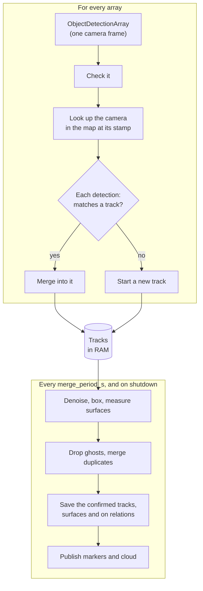

# Object Memory

Perception sees the same cup many times, from different angles, each time as a
partial point cloud. Object memory merges those detections into one object with one
point cloud, one upright box, its labels and, when vision sent any, one embedding.
It finds the furniture's top surfaces, stores which objects rest on them, and shows
it all in RViz or Foxglove.

The method follows [ConceptGraphs](https://concept-graphs.github.io/) (Gu et al.,
2024): match each detection to an existing object by shape and by meaning, merge it
in, and clean the objects up from time to time.

!!! warning "Not built: MoveIt"
    The node publishes markers and a cloud, but no collision boxes for MoveIt
    ([MoveIt](#moveit)). Confirmed objects never expire: an object that is taken
    away stays `present` ([Known limits](#known-limits)).

To run it on the simulation, follow
[15. Run the Object Memory on the Simulation](../setup/15-scene-graph-demo.md).

## Summary

- **Perception sends one cloud per detection**, in the camera's optical frame, with
  the detection's label and score, and sometimes a CLIP vector
  ([ADR-0012](decisions/0012-per-detection-clouds-any-frame.md)).
- **The node merges in memory.** It keeps the live objects in RAM, saves the changed
  ones every `merge_period_s` (2 s) and on shutdown, and stores no raw detection
  ([ADR-0011](decisions/0011-merge-clouds-in-memory.md)).
- **Overlap and label decide a match** when there are no vectors, which is most of
  the time. A movable object may change its name, and furniture may not
  ([ADR-0025](decisions/0025-merge-by-overlap-and-label.md)).
- **Furniture gets a top surface**, measured from its points, and an object resting
  on it gets an `on` relation
  ([ADR-0026](decisions/0026-anchor-surfaces-and-on-relations.md)).
- **Confirmed objects go out as markers and a cloud**, transient local, in the map
  frame ([ADR-0013](decisions/0013-publish-boxes-to-rviz-and-moveit.md)).
- **A recording replays offline** through the same code, to tune and score it
  ([ADR-0027](decisions/0027-replay-a-recording-offline.md)).

## The pipeline



The code is in four modules, all under `src/walkie_database/`:

| Module | What it does |
| ------ | ------------ |
| `object_intake.py` | Turns a checked array into map-frame detections. The node and the replay tool both call it |
| `object_memory.py` | Matching, merging and upkeep, with no ROS and no SQL |
| `object_memory_store.py` | Saves tracks, surfaces and relations, and loads them at start |
| `object_markers.py` | The `MarkerArray` and the `PointCloud2` |

### 1. Receive detections

walkie-vision publishes all detections from one camera frame together, as one
`walkie_vision_msgs/ObjectDetectionArray`. The node subscribes to the topic named by
its `objects_topic` parameter (default `/walkie_vision/objects`; the simulation uses
`/walkie_vision/sim/objects`), best effort, volatile, depth 1. The array has the
`header` (the camera's optical frame and the capture time), the `camera_info`, the
`classes` it searched for, the `detections`, and a `stream_id`, a UUID made once per
publisher run. The fields of one detection:

| Field             | Type                          | What it is                                                         |
| ----------------- | ----------------------------- | ------------------------------------------------------------------ |
| `label`           | `string`                      | What the detector called it, for example `cup`                     |
| `score`           | `float32`                     | The detector's confidence, in [0, 1]                               |
| `track_id`        | `uint32`                      | A hint within `stream_id`. 0 means untracked. Never a memory id    |
| `bbox`            | `vision_msgs/BoundingBox2D`   | The box in full-image pixels                                       |
| `embedding_model` | `string`                      | Which model made `embedding`, for example `clip_vit_b16`. Empty when not sampled |
| `embedding`       | `float32[]`                   | The CLIP vector of the detection's image crop. Empty when not sampled |
| `points`          | `sensor_msgs/PointCloud2`     | The detection's points from the depth image, with the array's header. Empty with under 30 valid points |
| `crop`            | `sensor_msgs/CompressedImage` | The padded JPEG crop, with the array's header. Empty when not sampled |
| `view_quality`    | `float32`                     | How good this view is for choosing a best view, in [0, 1]          |
| `color_shares`    | `float32[]`                   | Twelve mask-only colour shares, or empty                           |

!!! info "The message lives in walkie-vision"
    The node receives this type and does not own it, so it stays in its
    producer's package. This repository builds `walkie_vision_msgs` from the
    commit that `ros2_ws.repos` pins
    ([ADR-0019](decisions/0019-object-service-contracts.md)). Both sides must
    build the same definition, or they cannot read each other's messages.

#### The checks

For each array, the node adds one to `arrays_received`, then runs the checks below.
An array that fails adds one to `arrays_rejected`, the log says why (at most once
every 5 seconds), and nothing of it is merged. A valid array is kept in one slot,
replacing the one before, and goes on to [the map frame](#2-into-the-map-frame).
With `memory_enabled` false, the node has no subscription and no TF listener.

The same checks guard `LocalizeObjects`, which fails as a whole when any part is
malformed. The topic and the service never disagree about what a valid array is.

??? info "What each check refuses"

    | Part | An array is refused unless |
    | ---- | -------------------------- |
    | `stream_id` | It is a UUID in canonical form |
    | `header` | `frame_id` is not empty, has no leading slash and is not the map frame. The stamp is valid and not zero, because TF reads a zero time as "the latest" |
    | `camera_info` | Its header equals the array's, with a non-zero image size and a finite non-zero focal length |
    | `classes` | At least one, all non-empty and unique |
    | `label`, `score`, `view_quality` | The label is in `classes`. The other two are finite and in [0, 1] |
    | `bbox` | Finite, sizes not negative, `theta` 0 |
    | `embedding` | Empty with an empty model, or a model the store has a vector table for, with the right length, finite and unit length. So a fake model's vector is refused |
    | `points` | Its header equals the array's. `x`, `y`, `z` float32 at offsets 0, 4, 8, little-endian, dense, height 1, `point_step` 12. Empty or 30 to 2000 points, all finite with `z` above 0 |
    | `crop` | Empty, or a JPEG with the array's header, at most 512 KiB, whose frame header says that each side is 1 to 512 pixels. The node reads that header and decodes no pixels |
    | `color_shares` | Empty, or 12 finite shares that are not negative and sum to 1 |
    | The stamp's age | At most 1 s old and at most 5 ms ahead of the node's clock. Otherwise it is `STALE`, not `INVALID`. An array that arrives before the first clock sample counts as rejected |

#### LocalizeObjects

`LocalizeObjects` uses the same rules to give one result per detection, in order. It
stores nothing.

| Case | Status |
| ---- | ------ |
| Any check fails | `INVALID` or `STALE` for the whole request, with no results |
| The request names another map | `WRONG_MAP`, with no results |
| No detections | `OK`, with no results and no lookup |
| No transform from the frame to the map at the exact stamp, within 50 ms | Each entry is `TF_UNAVAILABLE`, even one with no points, and the request is `OK` |
| An entry with no points | That entry is `NOT_FOUND` |
| Otherwise | That entry is `OK`, with the average of its points in the map frame, stamped with the array's stamp |

A failed entry leaves `centroid` at its default and `points_used` at 0, so check its
status first.

### 2. Into the map frame

The node looks up the transform from the array's `header.frame_id` to the map frame
at exactly `header.stamp`, waiting at most 50 ms, so perception does not need to know
about maps ([ADR-0012](decisions/0012-per-detection-clouds-any-frame.md)). Between
two transforms, TF interpolates. A stamp before the oldest or after the newest gets
no answer, and never the nearest or the latest transform. An array with no transform
is dropped, counted as a TF miss, and logged at most once every 5 seconds.

Each detection with points becomes a map-frame detection, with the camera's pose for
its sighting row. A detection with no points is skipped.

Under `use_sim_time`, any `/clock` sample earlier than the node's time, even by a
nanosecond, clears the buffer's dynamic transforms. So a restarted simulation cannot
read poses from its previous run, also when it restarts within its first second. The
same sample again, or a later one, keeps them. Static transforms stay, because they do
not depend on time. On the wall clock, rcl reports no jump, so nothing is cleared.

### 3. Match a detection to a track

A track is one object being merged. Before matching, a detection whose label is in
`ignore_labels` is dropped, and its points are downsampled to one point per 2.5 cm
voxel. Then it is scored against every track of its layer whose box is within
`match_distance` of its points
([ADR-0025](decisions/0025-merge-by-overlap-and-label.md)):

- **Spatial**, from 0 to 1: the share of the detection's points that have a track
  point within `match_distance` (0.10 m). When the track answers to the detection's
  label, it is at least the share of the smaller box that the two boxes have in
  common, so a partial view of a large table still matches.
- **Visual**, from 0 to 1: the cosine of the two vectors, when both have one from
  the same model. Otherwise 1 when the track answers to the label, else
  `other_label_similarity` (0.5) for a movable track and 0 for an anchor.

The detection joins the track with the highest total, if that total is at least 1.1
and the spatial part at least 0.1. Otherwise it starts a new track.

**Layers.** A label in `anchor_labels` (chair, table, shelf, cabinet, sofa) makes an
anchor, and any other label a movable object. A detection never joins a track of the
other layer.

**Names.** A movable track answers to every label it was ever given, because the
detector calls a small object `cup` from one view and `bowl` from another. An anchor
answers only to its main label, the one given most often, so a sofa once called
`table` does not pull in the coffee table next to it.

??? info "Why these rules: what the Chula drive showed"
    Vision sends a vector with about 5% of detections, so most matches run on
    labels. With the proposed rule, where another label never matched, each object
    that was found split into 2.1 tracks on average, and 5 tracks stood for nothing.
    Localization drifted by up to 0.3 m during the drive, so views of one object
    landed 0.10 to 0.20 m apart, which set `match_distance`. Letting furniture join
    under another name made a table swallow a stool, so anchors keep strict names.
    The numbers after the change are in
    [ADR-0025](decisions/0025-merge-by-overlap-and-label.md).

### 4. Merge

- **Points:** the detection's points are added to the track's and downsampled again,
  so the cloud stops growing once the object is fully seen. A track keeps at most
  20 000 points, chosen evenly.
- **Labels:** the label's count goes up by one. The track's label is the one with the
  highest count.
- **Embedding:** a sum of the vectors, weighted by the detector's score, scaled to
  length 1 when read. One model per track: a vector of another model starts the sum
  again.
- **Counts:** `n_detections` goes up by one. `n_views` goes up once per array, so
  two detections in one camera frame are one view. Each track keeps the stamps of
  its arrays, so two tracks that merge count an array they both saw once.
- **Sighting:** the label, score, number of points, centre, view quality, camera pose
  and colour shares, kept until the next save writes them to `object_observation`.

A seeded anchor is a fixed track: it has a box and no points. A detection with its
label inside its box joins it and changes only its counts and times.

### 5. Upkeep

Every `merge_period_s` (2 s), the node runs one round:

1. **Denoise.** Each track that changed keeps its largest DBSCAN cluster (8 cm, at
   least 8 points). Depth images smear points along object edges, and these fall
   off as small clusters.
2. **Box.** The track gets an upright box: PCA on `x` and `y` only, so it turns
   about the vertical axis but always stands upright, and does not jitter. The
   extent leaves out 2% of the points on each side, so stray points do not stretch
   it.
3. **Surface.** An anchor gets the height of its highest dense layer of points
   ([ADR-0026](decisions/0026-anchor-surfaces-and-on-relations.md)). The box top is
   the top of the tallest thing on the table, and this is the table.
4. **Ghosts.** A track that is not confirmed and has not been seen for 15 s is
   dropped. It never had an id or a row.
5. **Duplicates.** Two tracks of one layer that overlap by at least half are one
   object when their vectors are alike (cosine 0.8 or more). Without vectors, they
   must share a label (for anchors, the same main label), or be movable objects
   that overlap by at least 60%. The track that keeps its id is a seeded anchor,
   then a stored track, then the one seen most. Two seeded anchors never merge.
   The merged track is denoised, boxed and measured again at once, so the save
   that follows writes geometry that matches its cloud.

A track is **confirmed** once it has been seen in `confirm_views` arrays (3). Only a
confirmed track gets an object id and a row, so a one-off false detection never
reaches the store.

### 6. Save

After each round, the confirmed tracks that changed are written in one transaction
(`object_memory_store.save`):

| What | Where |
| ---- | ----- |
| A merged object becomes a tombstone, `state` `merged`, pointing to the winner | `object.merged_into` |
| A new object gets an id from a reserved block, `state` `present`, `p_exist` 0.9, `source` `perception` | `object` |
| The box, room, label, counts, times and best view | `object`, `object_box` |
| The cloud, as float32 `x`, `y`, `z` | `object_cloud` |
| The embedding, one row per model, and the length of its weighted sum | `object_<model>`, `object.fingerprint_weight` |
| The label counts | `object_label` |
| The sightings since the last save | `object_observation` |
| An anchor's top surface, key `object-<id>-top` | `surface` |
| Each movable object's `on` relation, or its removal | `object_relation` |

A seeded anchor that was seen again changes only its counts, times and sightings,
never its geometry. A failed save rolls back, is logged, and is tried again next
round, with the tracks unchanged.

The ids are reserved before the transaction, in their own committed one, so a crash
can leave gaps but never gives an id twice
([Object ids and tombstones](database.md#object-ids-and-tombstones)). A crash loses
the merging since the last save, at most `merge_period_s`. On Ctrl-C, the node runs a
last round without publishing, and ignores a second SIGINT while it does, because
`pixi run` forwards a terminal's Ctrl-C to a child that already got it.

### 7. Restart

At start, the node loads the map's live objects that have a measured box and came
from perception or are anchors, with their clouds, label counts, vectors and `on`
relations. A seeded anchor, which has no cloud, loads as a fixed track. So a
restarted node goes on merging into the same objects and ids.

Two values make a restart merge as an uninterrupted run would:

- **The embedding's weight.** The stored vector is the direction of the weighted
  sum, and `object.fingerprint_weight` its length. The node rebuilds the same sum,
  so later vectors move it as much as before. A row saved without the weight
  counts as one detection.
- **The top surface.** An anchor the memory made gets back the height of its
  surface `object-<id>-top`, not its box top, which the things on it push up.

## Parameters

All are read-only, and read once at start in memory mode.

| Parameter | Default | What it does |
| --------- | ------- | ------------ |
| `objects_topic` | `/walkie_vision/objects` | The `ObjectDetectionArray` topic |
| `merge_period_s` | 2.0 | Seconds between rounds of upkeep and saves. Above 0 |
| `confirm_views` | 3 | Arrays that must show a track before it is stored. At least 1 |
| `anchor_labels` | `[chair, table, shelf, cabinet, sofa]` | Labels that make anchors |
| `ignore_labels` | `[wall, floor, ceiling, door, window]` | Labels dropped before matching |
| `match_distance` | 0.10 | Metres within which a point overlaps a track. Above 0 |
| `other_label_similarity` | 0.5 | The visual value of another label for a movable track, in [0, 1]. 0 means only the same label joins without vectors |

A value out of range stops the start. The other constants, such as the voxel size,
the thresholds and the DBSCAN settings, are fields of `MergeConfig` in
`object_memory.py`. The replay tool can override every field.

## What other programs see

### The services and the snapshot

The object reads (`search_objects`, `get_object`, `find_near`, `get_room_contents`,
`find_objects`) read the stored rows, so they return the memory's objects as soon as
they are saved, with their layer, labels, room, box and `on` relations
([The object contract](database.md#the-object-contract)). An agent's tool for a
language model strips the poses, and reports sizes only for a measured box
([For agent clients](database.md#for-agent-clients)).

`/walkie_database/objects/snapshot` is still the store as it was at start, with
`sequence` 0. The memory's changes reach viewers through the markers, and clients
through the services.

### RViz and Foxglove

| Topic                                 | Type                               | What it shows                                          |
| ------------------------------------- | ---------------------------------- | ------------------------------------------------------ |
| `/walkie_database/objects/markers`    | `visualization_msgs/MarkerArray`   | The whole memory, starting with a `DELETEALL`          |
| `/walkie_database/objects/cloud`      | `sensor_msgs/PointCloud2`          | Every object's merged points: `x`, `y`, `z`, `rgb` by label, and `object_id` |

The marker namespaces:

| Namespace | One marker per | What it is |
| --------- | -------------- | ---------- |
| `objects` | Object | A translucent box, coloured by label. Anchors are fainter than movable objects |
| `labels` | Object | `#<id> <label> (<detections>)` above the box |
| `relations` | `on` relation | A line from the object's bottom down to the anchor's surface, and the word `on` |

Both are in the map frame, published after each round that changed something, and
once at start: on the wall clock at once, in a simulation after the first `/clock`
sample. They are transient local, like `/robot_description`, so a viewer opened later
still receives the latest message. In RViz, set **Durability Policy** to
**Transient Local** on the display, or it waits for the next change. Foxglove
subscribes with the publisher's durability through the Foxglove bridge.

### MoveIt

Not built. The plan: send confirmed objects to MoveIt as
`moveit_msgs/CollisionObject` boxes, inside `moveit_msgs/PlanningScene` messages with
`is_diff` set, so the node adds and removes only its own objects, with ids like
`walkie_database/42`.

!!! warning "Open questions"
    - **Grasping.** MoveIt refuses to plan the gripper into a collision box.
      Before a grasp, the target must be attached to the gripper or removed
      from the scene, and the node must stop sending it back until it is
      released. Who asks, and how, belongs with walkie-agent-ros's arm
      manipulation design. The
      [page at commit `91ffe25`](https://github.com/EIC-Robocup-2026/walkie-agent-ros/blob/91ffe25cc411700e2fac33adbbd815998a3296c9/docs/architecture/manipulation.md)
      is the last one published. The agent plans to replace it, and the replacement
      is not published yet.
    - **Planning frame.** MoveIt keeps world objects fixed in its planning
      frame. If walkie-ros plans in a frame attached to the robot, such as
      `base_link`, the objects would drive along with it. Check the virtual
      joint in walkie-ros's SRDF before building this.

## Re-tune with a recording

Record the detection topic with TF and the clock, then replay it offline as often as
needed. The replay runs the node's own code and needs no ROS graph
([ADR-0027](decisions/0027-replay-a-recording-offline.md)):

```bash
pixi run ros2 bag record -s mcap /walkie_vision/sim/objects /tf /tf_static /clock
pixi run memory-replay <bag folder> --truth tools/truth/chula_pat14_6.json --set match_distance=0.15
```

[Step 4 of the setup page](../setup/15-scene-graph-demo.md#step-4-replay-the-recording-offline)
explains the output.

## Known limits

- **Objects never expire.** An object that is taken away stays `present` at its last
  place. Nothing sets `missing`, and the writes that would (`set_object_state`,
  `report_sighting`) still answer `NOT_READY`.
- **Top surfaces only.** A shelf's inner levels are not found, so an object inside a
  shelf gets no relation, and the memory never stores `inside`.
- **The detector's labels set the layers.** A partition wall called a chair becomes
  an anchor, and a sofa called a table merges with the coffee table next to it.
  Asking vision for `wall`, `partition` and `door`, which the memory drops, avoids
  the first.
- **Localization error becomes merging error.** Two objects closer than
  `match_distance` with a shared label can merge, and an object seen from two poses
  that disagree by more than it can split.
- **Seeded anchors keep their seeded geometry**, even when the camera sees them
  elsewhere.
- **The values are tuned on one simulated drive.** Real camera data needs its own
  recording.

## Decisions

??? note "ADR-0011: Merge clouds in memory, store only the merged result · Proposed"

    --8<-- "architecture/decisions/0011-merge-clouds-in-memory.md:body"

??? note "ADR-0012: Perception sends one cloud per detection, in the camera frame · Proposed"

    --8<-- "architecture/decisions/0012-per-detection-clouds-any-frame.md:body"

??? note "ADR-0013: Publish confirmed objects to RViz and MoveIt as boxes · Proposed"

    --8<-- "architecture/decisions/0013-publish-boxes-to-rviz-and-moveit.md:body"

??? note "ADR-0025: Merge detections by overlap and label when they have no embedding · Proposed"

    --8<-- "architecture/decisions/0025-merge-by-overlap-and-label.md:body"

??? note "ADR-0026: Measure an anchor's top surface from its points, and derive `on` from geometry · Proposed"

    --8<-- "architecture/decisions/0026-anchor-surfaces-and-on-relations.md:body"

??? note "ADR-0027: Tune the object memory by replaying a recording offline, through the node's own code · Proposed"

    --8<-- "architecture/decisions/0027-replay-a-recording-offline.md:body"
