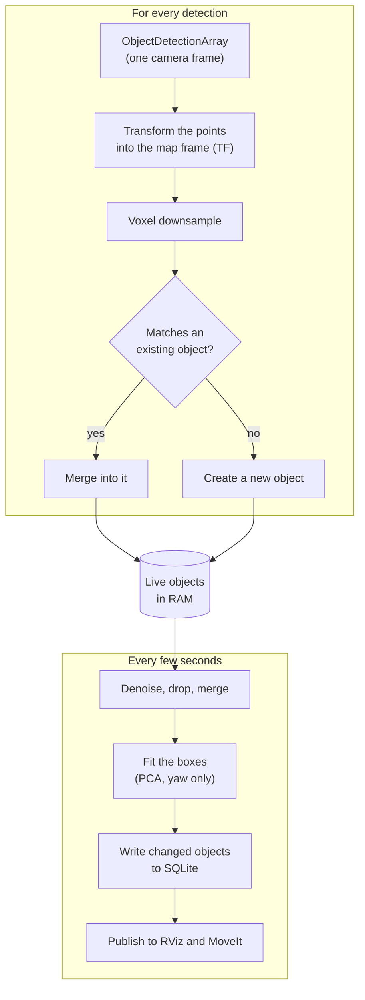

# Object Memory (Proposed)

!!! note "Proposed"
    Nothing on this page is built yet. The tables it writes to are: `object`,
    `object_cloud`, `object_box`, `object_clip_vit_b16` and
    `object_observation` ([The Database](database.md)).

Perception sees the same cup many times, from different angles, each time
as a partial point cloud. Object memory merges those detections into one
object with one point cloud, one bounding box and one embedding. It then
shows the objects in RViz and gives them to MoveIt as obstacles.

The method follows [ConceptGraphs](https://concept-graphs.github.io/)
(Gu et al., 2024): match each detection to an existing object by shape and
by meaning, merge it in, and clean the objects up from time to time.

## Summary

- **Perception sends one cloud per detection**, in whatever TF frame it
  has, with the detection's label, score and CLIP vector
  ([ADR-0012](decisions/0012-per-detection-clouds-any-frame.md)).
- **The node merges in memory.** It keeps the live objects in RAM and writes
  the changed ones to SQLite every few seconds. Raw detections are not
  stored. Record them with `ros2 bag` to re-tune the merging
  ([ADR-0011](decisions/0011-merge-clouds-in-memory.md)).
- **Confirmed objects go out as boxes**: markers and clouds for RViz, and
  collision boxes for MoveIt
  ([ADR-0013](decisions/0013-publish-boxes-to-rviz-and-moveit.md)).

## The pipeline



### 1. Receive detections

Perception publishes all detections from one camera frame together, as one
message. The fields of one detection:

| Field             | Type                         | What it is                                                         |
| ----------------- | ---------------------------- | ------------------------------------------------------------------ |
| `header`          | `std_msgs/Header`            | The camera frame and the time of the image                         |
| `label`           | `string`                     | What the detector called it, for example `cup`                     |
| `score`           | `float32`                    | The detector's confidence                                          |
| `embedding_model` | `string`                     | Which model made `embedding`, for example `clip_vit_b16`           |
| `embedding`       | `float32[]`                  | The CLIP vector of the detection's image crop                      |
| `points`          | `sensor_msgs/PointCloud2`    | The detection's points from the depth image, in `header.frame_id`  |
| `crop`            | `sensor_msgs/CompressedImage` | The image crop, optional. Saved to disk if present                 |

The node looks up the transform from `header.frame_id` to the map frame at
`header.stamp`, so perception does not need to know about maps
([ADR-0012](decisions/0012-per-detection-clouds-any-frame.md)). A detection
whose transform is not available is dropped and counted in the log.

!!! info "A custom message needs an interface package"
    `ObjectDetection` is not a standard ROS message. It needs its own
    interface package, built with colcon, the way walkie-agent-ros builds
    `rai_interfaces`. Perception must build the same package, or the two
    sides cannot read each other's messages.

### 2. Match a detection to an object

For each detection, the node scores every existing object whose box is near
the detection's points:

- **Shape:** the share of the detection's points that have an object point
  within one voxel. 1 means the detection lies entirely on the object.
- **Meaning:** the cosine similarity of the two CLIP vectors, scaled from
  0 to 1.

The detection joins the object with the highest total, if that total is
above a threshold. Otherwise it becomes a new object. Using both scores
keeps a cup and the saucer under it apart (they overlap, but look
different) and two identical cups on opposite tables apart (they look the
same, but do not overlap).

### 3. Merge

- **Points:** add the detection's points to the object's, then downsample to
  one point per voxel, so the cloud stops growing once the object is fully
  seen.
- **Embedding:** the mean of every detection's vector, weighted by the
  number of detections, then scaled back to length 1.
- **Count:** `n_detections` goes up by one, and `last_seen` moves.

### 4. Clean up

Every few seconds, the node:

1. **Denoises** each changed object with DBSCAN and keeps its largest
   cluster. Depth images smear points along object edges, and these fall
   off as small clusters.
2. **Drops** objects seen fewer than a few times that have not been seen for
   a while. A single false detection never becomes a memory.
3. **Merges** pairs of objects that overlap a lot and look similar. Two
   halves of one table, seen from different sides, become one table.

### 5. Fit the box

The box is fitted with PCA on the `x` and `y` of the points only: the box
can turn around the vertical axis, but it always stands upright. Its height
runs from the lowest to the highest point.

A full 3D PCA box tilts and swaps its axes as new points arrive, so it
jitters in RViz and MoveIt. Objects on tables and floors stand upright, so
an upright box fits them almost as well and stays still.

`object_box`, the R*Tree index, stores the box aligned with the map's axes
around this box.

### 6. Write to SQLite

The node keeps the live objects in memory, as NumPy arrays, and loads them
from SQLite when it starts. Every few seconds, and on shutdown, it writes
the objects that changed in one transaction: the `object` row, the cloud,
the R*Tree box, the vector and the new `object_observation` rows.

Writing on every detection would rewrite each object's whole cloud many
times a second, for no benefit
([ADR-0011](decisions/0011-merge-clouds-in-memory.md)). The cost is that a
crash loses the last few seconds of merging.

### Re-tune with a recording

The voxel size, the match threshold and the cleanup limits all need tuning
on real data. Record the detection topic once, then replay it as often as
needed:

```bash
pixi run ros2 bag record /walkie_database/detections
```

```bash
pixi run ros2 bag play <bag folder>
```

## What other programs see

### RViz

| Topic                                 | Type                               | What it shows                                          |
| ------------------------------------- | ---------------------------------- | ------------------------------------------------------ |
| `/walkie_database/objects/markers`    | `visualization_msgs/MarkerArray`   | A box and a text label for each object                 |
| `/walkie_database/objects/cloud`      | `sensor_msgs/PointCloud2`          | Every object's merged points, in color                 |

Both are published with transient local durability, like
`/robot_description`, so an RViz opened later still receives the latest
message. Set **Durability Policy** to **Transient Local** in the RViz
display, or it waits for the next update.

### MoveIt

The node sends confirmed objects to MoveIt as `moveit_msgs/CollisionObject`
boxes, inside `moveit_msgs/PlanningScene` messages with `is_diff` set, so
it adds and removes only its own objects. Each id starts with
`walkie_database/`, for example `walkie_database/42`, so they never clash
with objects from other programs.

!!! warning "Open questions"
    - **Grasping.** MoveIt refuses to plan the gripper into a collision box.
      Before a grasp, the target must be attached to the gripper or removed
      from the scene, and the node must stop sending it back until it is
      released. Who asks, and how, belongs with the
      [arm manipulation design](https://eic-robocup-2026.github.io/walkie-agent-ros/architecture/manipulation/).
    - **Planning frame.** MoveIt keeps world objects fixed in its planning
      frame. If walkie-ros plans in a frame attached to the robot, such as
      `base_link`, the objects would drive along with it. Check the virtual
      joint in walkie-ros's SRDF before building this.

## Decisions

??? note "ADR-0011: Merge clouds in memory, store only the merged result · Proposed"

    --8<-- "architecture/decisions/0011-merge-clouds-in-memory.md:body"

??? note "ADR-0012: Perception sends one cloud per detection, in any TF frame · Proposed"

    --8<-- "architecture/decisions/0012-per-detection-clouds-any-frame.md:body"

??? note "ADR-0013: Publish confirmed objects to RViz and MoveIt as boxes · Proposed"

    --8<-- "architecture/decisions/0013-publish-boxes-to-rviz-and-moveit.md:body"
