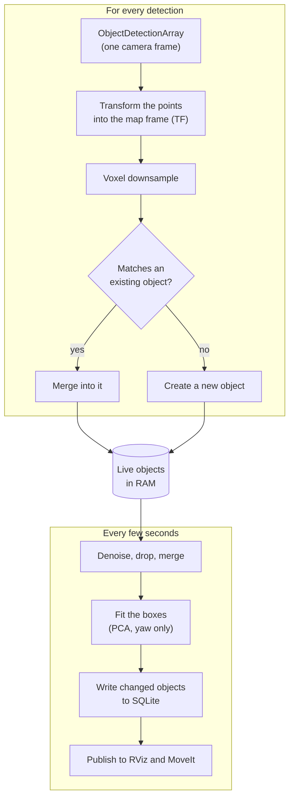

# Object Memory (Proposed)

!!! note "Proposed"
    The merging on this page is not built yet. The tables it writes to are:
    `object`, `object_cloud`, `object_box`, `object_clip_vit_b16` and
    `object_observation` ([The Database](database.md)). Their lifecycle fields,
    the object id allocator and tombstones are built
    ([Object fields](database.md#object-fields)), and nothing writes them yet.
    The node does receive and check observations, and it can localize them, but
    receiving one [creates no row](#what-is-built-the-checks-not-the-merging). The
    object reads and the seeded snapshot serve the stored rows as they are
    ([Object queries](database.md#object-queries)), with no merging behind them.

Perception sees the same cup many times, from different angles, each time
as a partial point cloud. Object memory merges those detections into one
object with one point cloud, one bounding box and one embedding. It then
shows the objects in RViz and gives them to MoveIt as obstacles.

The method follows [ConceptGraphs](https://concept-graphs.github.io/)
(Gu et al., 2024): match each detection to an existing object by shape and
by meaning, merge it in, and clean the objects up from time to time.

## Summary

- **Perception sends one cloud per detection**, in the camera's optical
  frame, with the detection's label, score and CLIP vector
  ([ADR-0012](decisions/0012-per-detection-clouds-any-frame.md)).
- **The node merges in memory.** It keeps the live objects in RAM and writes
  the changed ones to SQLite every few seconds. Raw detections are not
  stored. Record them with `ros2 bag` to re-tune the merging
  ([ADR-0011](decisions/0011-merge-clouds-in-memory.md)).
- **Confirmed objects go out as boxes**: markers and clouds for RViz, and
  collision boxes for MoveIt
  ([ADR-0013](decisions/0013-publish-boxes-to-rviz-and-moveit.md)).

## The pipeline



### 1. Receive detections

walkie-vision publishes all detections from one camera frame together, as one
`walkie_vision_msgs/ObjectDetectionArray` on `/walkie_vision/objects`. The array
has the `header` (the camera's optical frame and the capture time), the
`camera_info`, the `classes` it searched for, the `detections`, and a
`stream_id`, a UUID made once per publisher run. The fields of one detection:

| Field             | Type                          | What it is                                                         |
| ----------------- | ----------------------------- | ------------------------------------------------------------------ |
| `label`           | `string`                      | What the detector called it, for example `cup`                     |
| `score`           | `float32`                     | The detector's confidence, in [0, 1]                               |
| `track_id`        | `uint32`                      | A hint within `stream_id`. 0 means untracked. Never a memory id    |
| `bbox`            | `vision_msgs/BoundingBox2D`   | The box in full-image pixels                                       |
| `embedding_model` | `string`                      | Which model made `embedding`, for example `clip_vit_b16`. Empty when not sampled |
| `embedding`       | `float32[]`                   | The CLIP vector of the detection's image crop. Empty when not sampled |
| `points`          | `sensor_msgs/PointCloud2`     | The detection's points from the depth image, with the array's header. Empty with under 30 valid points |
| `crop`            | `sensor_msgs/CompressedImage` | The padded JPEG crop, with the array's header. Empty when not sampled |
| `view_quality`    | `float32`                     | How good this view is for choosing a best view, in [0, 1]          |
| `color_shares`    | `float32[]`                   | Twelve mask-only colour shares, or empty                           |

The node looks up the transform from the array's `header.frame_id` to the map
frame at `header.stamp`, so perception does not need to know about maps
([ADR-0012](decisions/0012-per-detection-clouds-any-frame.md)). Once merging is
built, a detection whose transform is not available is dropped and counted in the
log.

#### What is built: the checks, not the merging

In memory mode, the node subscribes to the topic named by its `objects_topic`
parameter, best effort, volatile, depth 1. For each array it does three things:

1. It adds one to `arrays_received`.
2. It runs the checks below. An array that fails adds one to `arrays_rejected`, and
   the log says why, at most once every 5 seconds.
3. It keeps a valid array in one slot in memory, replacing the one before.

That is all. It writes no row, allocates no id, stores no vector and writes no file.
The slot exists so that the object memory has something to start from. No request
reads it yet, besides the counters in `get_store_status`, and `SubmitDetections`
and the other writes answer `NOT_READY`
([The object contract](database.md#the-object-contract)). With `memory_enabled`
false, the node has no subscription and no TF listener.

The same checks guard `LocalizeObjects`, which fails as a whole when any part is
malformed. The topic and the service never disagree about what a valid array is.

| Part | An array is refused unless |
| ---- | -------------------------- |
| `stream_id` | It is a UUID in canonical form |
| `header` | `frame_id` is not empty, has no leading slash and is not the map frame. The stamp is valid and not zero, because TF reads a zero time as "the latest" |
| `camera_info` | Its header equals the array's, with a non-zero image size and a finite non-zero focal length |
| `classes` | At least one, all non-empty and unique |
| `label`, `score`, `view_quality` | The label is in `classes`. The other two are finite and in [0, 1] |
| `bbox` | Finite, sizes not negative, `theta` 0 |
| `embedding` | Empty with an empty model, or a model the store has a vector table for, with the right length, finite and unit length. So a fake model's vector is refused |
| `points` | Its header equals the array's. `x`, `y`, `z` float32 at offsets 0, 4, 8, little-endian, dense, height 1, `point_step` 12. Empty or 30 to 2000 points, all finite with `z` above 0 |
| `crop` | Empty, or a JPEG with the array's header, at most 512 KiB, whose frame header says that each side is 1 to 512 pixels. The node reads that header and decodes no pixels |
| `color_shares` | Empty, or 12 finite shares that are not negative and sum to 1 |
| The stamp's age | At most 1 s old and at most 5 ms ahead of the node's clock. Otherwise it is `STALE`, not `INVALID`. An array that arrives before the first clock sample counts as rejected |

`LocalizeObjects` uses these rules to give one result per detection, in order:

| Case | Status |
| ---- | ------ |
| Any check fails | `INVALID` or `STALE` for the whole request, with no results |
| The request names another map | `WRONG_MAP`, with no results |
| No detections | `OK`, with no results and no lookup |
| No transform from the frame to the map at the exact stamp, within 50 ms | Each entry is `TF_UNAVAILABLE`, even one with no points, and the request is `OK` |
| An entry with no points | That entry is `NOT_FOUND` |
| Otherwise | That entry is `OK`, with the average of its points in the map frame, stamped with the array's stamp |

Between two transforms, TF interpolates. A stamp before the oldest or after the
newest gets no answer, and never the nearest or the latest transform. A failed entry
leaves `centroid` at its default and `points_used` at 0, so check its status first.

A clock that jumps back a second or more clears the buffer's dynamic transforms, so a
restarted simulation cannot read poses from its previous run. Static transforms stay,
because they do not depend on time.

!!! info "The message lives in walkie-vision"
    The node receives this type and does not own it, so it stays in its
    producer's package. This repository builds `walkie_vision_msgs` from the
    commit that `ros2_ws.repos` pins
    ([ADR-0019](decisions/0019-object-service-contracts.md)). Both sides must
    build the same definition, or they cannot read each other's messages.

### 2. Match a detection to an object

For each detection, the node scores every existing object whose box is near
the detection's points:

- **Shape:** the share of the detection's points that have an object point
  within one voxel. 1 means the detection lies entirely on the object.
- **Meaning:** the cosine similarity of the two CLIP vectors, scaled from
  0 to 1.

The detection joins the object with the highest total, if that total is
above a threshold. Otherwise it becomes a new object. Using both scores
keeps a cup and the saucer under it apart (they overlap, but look
different) and two identical cups on opposite tables apart (they look the
same, but do not overlap).

### 3. Merge

- **Points:** add the detection's points to the object's, then downsample to
  one point per voxel, so the cloud stops growing once the object is fully
  seen.
- **Embedding:** the mean of every detection's vector, weighted by the
  number of detections, then scaled back to length 1.
- **Count:** `n_detections` goes up by one, and `last_seen` moves.

### 4. Clean up

Every few seconds, the node:

1. **Denoises** each changed object with DBSCAN and keeps its largest
   cluster. Depth images smear points along object edges, and these fall
   off as small clusters.
2. **Drops** objects seen fewer than a few times that have not been seen for
   a while. A single false detection never becomes a memory.
3. **Merges** pairs of objects that overlap a lot and look similar. Two
   halves of one table, seen from different sides, become one table.

A dropped or merged object keeps its row, as a tombstone with the state
`discarded` or `merged`, and a merged one points to the winner through
`merged_into`. Its id is never given again, so a client holding that id still
gets an answer.

### 5. Fit the box

The box is fitted with PCA on the `x` and `y` of the points only: the box
can turn around the vertical axis, but it always stands upright. Its height
runs from the lowest to the highest point.

A full 3D PCA box tilts and swaps its axes as new points arrive, so it
jitters in RViz and MoveIt. Objects on tables and floors stand upright, so
an upright box fits them almost as well and stays still.

`object_box`, the R*Tree index, stores the box aligned with the map's axes
around this box.

### 6. Write to SQLite

The node keeps the live objects in memory, as NumPy arrays, and loads them
from SQLite when it starts. Every few seconds, and on shutdown, it writes
the objects that changed in one transaction: the `object` row, the cloud,
the R*Tree box, the vector and the new `object_observation` rows.

Writing on every detection would rewrite each object's whole cloud many
times a second, for no benefit
([ADR-0011](decisions/0011-merge-clouds-in-memory.md)). The cost is that a
crash loses the last few seconds of merging.

A new object's id cannot wait for that write, because the node can publish the
id first. So the node reserves ids in blocks, in their own committed transaction,
and a crash can leave gaps but never gives an id twice
([Object ids and tombstones](database.md#object-ids-and-tombstones)). A new
candidate with no depth has `geometry_valid` 0 and no row in `object_box`, so a
search by position does not find it at a made-up place.

### Re-tune with a recording

The voxel size, the match threshold and the cleanup limits all need tuning
on real data. Record the detection topic once, then replay it as often as
needed:

```bash
pixi run ros2 bag record /walkie_vision/objects
```

```bash
pixi run ros2 bag play <bag folder>
```

## What other programs see

### The services and the snapshot

The object reads and `/walkie_database/objects/snapshot` are built over the stored
rows ([The object contract](database.md#the-object-contract)). ROS clients that
navigate or grasp read `pose`, `size` and, from `get_object`, the cloud. An agent's
tool for a language model strips them, and reports sizes only for a measured box
([For agent clients](database.md#for-agent-clients)). Once merging is built, the
same services return its objects, with no change to the types.

### RViz

| Topic                                 | Type                               | What it shows                                          |
| ------------------------------------- | ---------------------------------- | ------------------------------------------------------ |
| `/walkie_database/objects/markers`    | `visualization_msgs/MarkerArray`   | A box and a text label for each object                 |
| `/walkie_database/objects/cloud`      | `sensor_msgs/PointCloud2`          | Every object's merged points, in color                 |

Both are published with transient local durability, like
`/robot_description`, so an RViz opened later still receives the latest
message. Set **Durability Policy** to **Transient Local** in the RViz
display, or it waits for the next update.

### MoveIt

The node sends confirmed objects to MoveIt as `moveit_msgs/CollisionObject`
boxes, inside `moveit_msgs/PlanningScene` messages with `is_diff` set, so
it adds and removes only its own objects. Each id starts with
`walkie_database/`, for example `walkie_database/42`, so they never clash
with objects from other programs.

!!! warning "Open questions"
    - **Grasping.** MoveIt refuses to plan the gripper into a collision box.
      Before a grasp, the target must be attached to the gripper or removed
      from the scene, and the node must stop sending it back until it is
      released. Who asks, and how, belongs with walkie-agent-ros's arm
      manipulation design. The
      [page at commit `91ffe25`](https://github.com/EIC-Robocup-2026/walkie-agent-ros/blob/91ffe25cc411700e2fac33adbbd815998a3296c9/docs/architecture/manipulation.md)
      is the last one published. The agent plans to replace it, and the replacement
      is not published yet.
    - **Planning frame.** MoveIt keeps world objects fixed in its planning
      frame. If walkie-ros plans in a frame attached to the robot, such as
      `base_link`, the objects would drive along with it. Check the virtual
      joint in walkie-ros's SRDF before building this.

## Decisions

??? note "ADR-0011: Merge clouds in memory, store only the merged result · Proposed"

    --8<-- "architecture/decisions/0011-merge-clouds-in-memory.md:body"

??? note "ADR-0012: Perception sends one cloud per detection, in the camera frame · Proposed"

    --8<-- "architecture/decisions/0012-per-detection-clouds-any-frame.md:body"

??? note "ADR-0013: Publish confirmed objects to RViz and MoveIt as boxes · Proposed"

    --8<-- "architecture/decisions/0013-publish-boxes-to-rviz-and-moveit.md:body"
